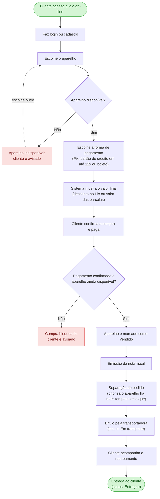
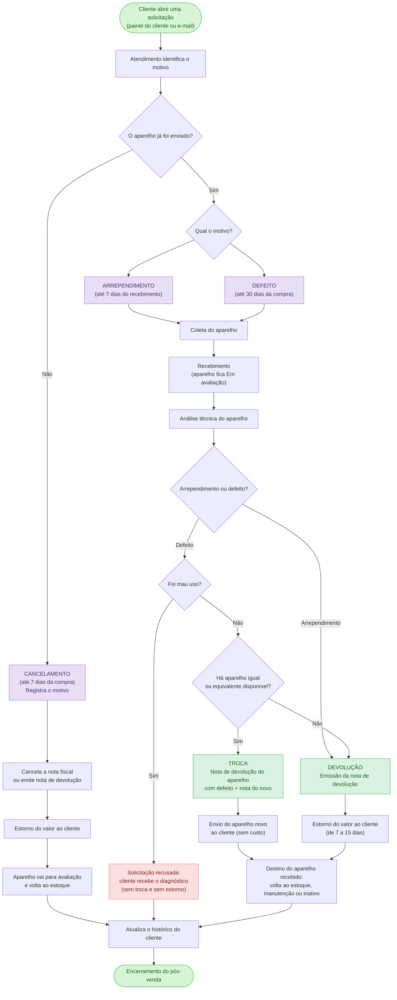
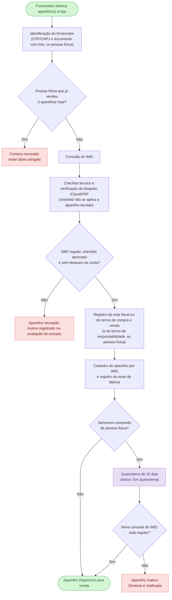
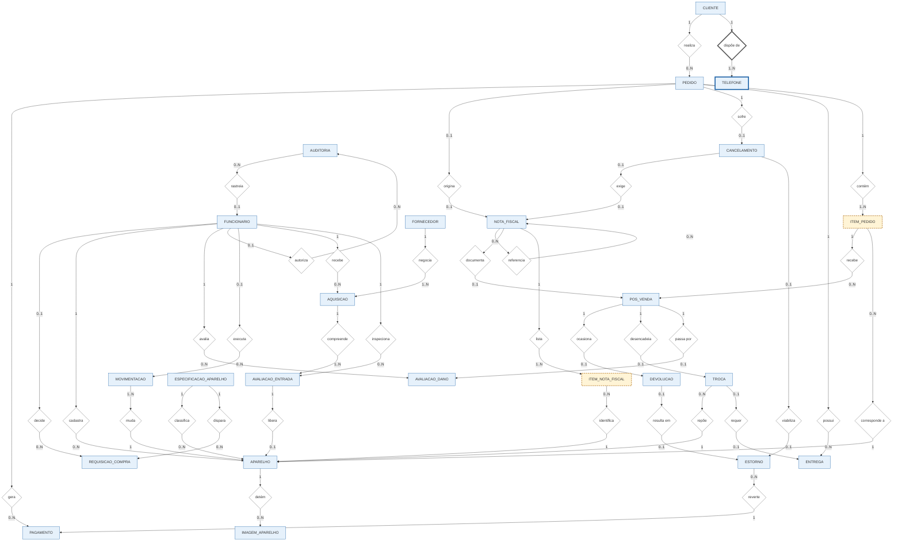

# Projeto ERP - CellGO

## 1. Identificação da Equipe

| Nº | Integrante |
|---:|---|
| 01 | Bernardo Farias de Jesus |
| 02 | Bruno Ferreira Gonçalves |
| 03 | Gabriely Moreira Manna |
| 04 | Henry Gonçalves dos Santos |
| 05 | João Wyctor França dos Santos |
| 06 | Murilo Alves de Sousa |
| 07 | Rafaela Teresa de Oliveira Corrente |
| 08 | Ryan Henrique de Aguiar dos Santos |
| 09 | Sarah Casas Nicolielo Ponti |
| 10 | Victor Rodrigues da Costa |

## 2. Caracterização da Empresa

**Qual é o nome da empresa?**  
CellGo Comércio de Celulares Ltda.

**Qual é o segmento?**  
E-commerce atuando com aparelhos novos e seminovos.

**O que ela vende ou oferece?**  
Smartphones novos, lacrados e com garantia de fábrica; smartphones seminovos, revisados e certificados, com garantia própria da loja; pagamento por Pix, boleto ou cartão de crédito em até 12 parcelas; e vendas somente pelo canal online.

**Quem são seus principais clientes?**  
Consumidores finais (pessoa física) que buscam smartphones com procedência garantida e preço mais acessível do que o de aparelhos novos - tanto quem quer um aparelho novo quanto quem prefere um seminovo confiável em vez de comprar no mercado informal. A empresa também atende pessoa jurídica, já que o cadastro de clientes contempla CNPJ além de CPF.

**Quais são seus principais setores?**  
A empresa é organizada em cinco áreas: Diretoria (2 sócios, decisão estratégica e autorização de exceções); Vendas e Atendimento (registro de vendas e contato com o cliente); Estoque e Logística (cadastro de aparelhos, controle de disponibilidade e envio); Assistência Técnica (avaliação de aparelhos, diagnóstico de defeitos e garantia); e Financeiro/Administrativo (estornos, nota fiscal e controle de pagamentos).

**Como funciona atualmente?**  
Hoje a operação depende de controles manuais e dispersos: o cadastro de clientes e aparelhos, o controle de estoque e o acompanhamento financeiro não estão centralizados em um único sistema. Isso significa que informações como status do aparelho (disponível, vendido, em avaliação), histórico de vendas de cada cliente, prazos de garantia e pedidos de estorno acabam sendo controlados separadamente - dificultando saber rapidamente se um aparelho já foi vendido, se uma garantia ainda está no prazo, ou se um estorno está atrasado. É justamente essa falta de integração entre vendas, estoque, pós-venda e financeiro que motiva o desenvolvimento do ERP.

**Quais informações são importantes para o negócio?**  
Dados completos do cliente (CPF/CNPJ, contato, histórico de compras); identificação única de cada aparelho por IMEI/número de série, com sua condição (novo/seminovo) e status atual; dados de cada venda (valor, forma de pagamento, parcelas, status); prazos e cobertura de garantia por aparelho; registros de trocas, devoluções e estornos com seus prazos; e trilha de auditoria de quem realizou cada operação sensível no sistema.

## 3. Justificativa da Escolha

Escolhemos a CellGO porque alguns processos da empresa estão manuais , desunificados e não estão sendo guardados em um único sistema, isso está impactando a atualização de algumas informações que precisam ser dinâmicas assim que um evento acontece, como por exemplo: venda de aparelho e status do estoque, acompanhamento financeiro, prazos de garantia, pedidos de estorno e o histórico de compras de cada cliente.

Está faltando a integração entre vendas, estoque, assistência técnica/pós-venda e financeiro, isso motiva a criação de um ERP para essa empresa, além de unificar tudo em um só sistema, atualizando os dados de forma dinâmica após a venda do aparelho - evitando que aconteça de um cliente comprar um aparelho que não há mais em estoque, que uma garantia vencida seja aceita por engano, ou que um pedido de estorno fique parado sem controle.

Esse projeto é adequado para um projeto de modelagem de dados, pois além de estarmos pegando um problema real e tentando propor uma solução, estamos reforçando cada vez mais os conceitos que a modelagem de dados possui, como entidades, atributos, relacionamentos, entre outros conceitos.

## 4. Problemas Identificados

### 1. Ausência de sistema único e integrado

**Situação atual:** Os cadastros de clientes, aparelhos, estoque e financeiro são feitos em várias planilhas separadas, sem uma base de dados centralizada. As vendas também não são integradas a um sistema único.

**Causa:** Cada setor (vendas, estoque, assistência técnica/pós-venda e financeiro) mantém seus próprios registros manuais, sem nenhuma conexão automática entre eles.

**Impacto no negócio:** Isso gera duplicidade de informações, obriga os funcionários a digitar os mesmos dados várias vezes (retrabalho) e deixa vendas, estoque e financeiro com informações desatualizadas, comprometendo a confiabilidade dos dados em toda a empresa.

### 2. Falta de atualização em tempo real do estoque

**Situação atual:** O estoque é controlado em planilhas, e o status do aparelho (Disponível, Vendido, Em avaliação, Em manutenção, Inativo) não é atualizado automaticamente após uma venda.

**Causa:** A ausência de integração entre o setor de vendas e o controle de estoque faz com que a atualização dependa de uma ação manual em vez de ocorrer automaticamente.

**Impacto no negócio:** Isso provoca erros na quantidade disponível e problemas de logística, além do risco real de um cliente comprar um aparelho que já foi vendido para outra pessoa.

### 3. Falta de histórico e controle de garantia dos aparelhos

**Situação atual:** Não existe um histórico centralizado por aparelho, nem acompanhamento dos prazos de garantia (30 dias loja para seminovos; 30 dias loja + 1 ano fabricante para novos).

**Causa:** Os dados de cada aparelho (data da venda, manutenções, trocas, devoluções) não são registrados de forma estruturada e centralizada.

**Impacto no negócio:** Fica difícil acompanhar manutenção, trocas e devoluções, saber se uma solicitação ainda está dentro do prazo de garantia, ou até aceitar por engano uma garantia já vencida — gerando prejuízo financeiro.

### 4. Falta de controle sobre estornos

**Situação atual:** Os pedidos de estorno não possuem acompanhamento de prazo.

**Causa:** Não existe um fluxo estruturado que registre a data de abertura do estorno e monitore automaticamente seu andamento.

**Impacto no negócio:** Fica difícil identificar quais estornos estão pendentes, em andamento ou atrasados, o que pode prejudicar o relacionamento com o cliente e atrasar o fechamento financeiro do período.

### 5. Financeiro desatualizado e desconectado das vendas

**Situação atual:** Os dados financeiros são mantidos separadamente dos demais setores, e o financeiro não recebe automaticamente as informações de vendas, cancelamentos, trocas e devoluções.

**Causa:** A comunicação entre o setor comercial e o financeiro depende de repasses manuais (planilhas, mensagens, anotações), em vez de uma integração direta entre os dados.

**Impacto no negócio:** Isso compromete a precisão dos dados financeiros e dificulta o acompanhamento dos resultados, o fechamento de caixa e a tomada de decisões estratégicas com base em números confiáveis.

### 6. Processos manuais

**Situação atual:** Grande parte das tarefas operacionais do dia a dia é realizada manualmente, sem apoio de automação.

**Causa:** A falta de um sistema integrado obriga os funcionários a repetir manualmente tarefas que poderiam ser automatizadas.

**Impacto no negócio:** Isso gera maior gasto de tempo dos funcionários com tarefas operacionais, reduzindo a produtividade e o tempo disponível para atividades estratégicas ou de atendimento ao cliente.

### 7. Ausência de backup

**Situação atual:** Não existe uma rotina estruturada de backup dos dados da empresa.

**Causa:** As informações ficam armazenadas em planilhas e arquivos locais, sem um processo automático de cópia de segurança.

**Impacto no negócio:** Isso gera o risco de dados importantes serem perdidos, duplicados ou ficarem desatualizados, comprometendo a continuidade das operações em caso de falha, exclusão acidental ou perda de um arquivo.

### 8. Ausência de relatórios

**Situação atual:** Não existem relatórios automáticos consolidados sobre vendas, estoque e resultados.

**Causa:** Como os dados estão espalhados em planilhas separadas e não integradas, não é possível gerar relatórios de forma automática e confiável.

**Impacto no negócio:** Isso faz com que os gestores tenham dificuldade para analisar vendas, estoque e resultados, prejudicando a visão estratégica do negócio e a tomada de decisões baseada em dados.

### 9. Histórico do cliente fragmentado

**Situação atual:** As informações de cada cliente estão espalhadas entre os diferentes setores da empresa.

**Causa:** Não existe uma base de dados única que reúna compras, trocas, devoluções e acionamentos de garantia de um mesmo cliente em um só lugar.

**Impacto no negócio:** Isso dificulta o atendimento no pós-venda e na assistência técnica, pois o funcionário precisa consultar vários lugares diferentes para entender o histórico completo do cliente, tornando o atendimento mais lento e sujeito a falhas.

### 10. Histórico de funcionários fragmentado

**Situação atual:** As informações de cada funcionário (cargo, área de atuação, permissões e operações que realizou ou autorizou) estão espalhadas entre os setores.

**Causa:** Assim como ocorre com os clientes, não há uma base de dados centralizada que reúna essas informações em um único cadastro por funcionário.

**Impacto no negócio:** Isso dificulta saber quem pode executar cada operação, quem realizou ou autorizou uma alteração sensível (preço, estorno, troca, mudança de estoque) e controlar o acesso de cada colaborador às informações da empresa.

### 11. Falta de controle sobre a procedência dos aparelhos adquiridos

**Situação atual:** Os aparelhos seminovos comprados de pessoas físicas e os aparelhos comprados de distribuidores entram no estoque sem um registro estruturado de quem os vendeu, da consulta do IMEI, da avaliação técnica de entrada e do prazo de quarentena.

**Causa:** As políticas de aquisição (Seção 9) existem apenas como orientação, sem um registro no sistema que comprove que cada etapa foi cumprida.

**Impacto no negócio:** A empresa corre o risco de revender um aparelho roubado, bloqueado ou com peças adulteradas, sem conseguir provar a origem lícita do aparelho nem identificar quem o vendeu à loja.

## 5. Processos de Negócios

**Processos de Venda em sequência**

Cliente → Login/Cadastro → Escolha do aparelho → Verificação de disponibilidade → Escolha da forma de pagamento (Pix, cartão de crédito em até 12x ou boleto) → Apresentação do valor final (desconto no Pix ou valor das parcelas) → Confirmação da compra e pagamento → Confirmação do pagamento e nova verificação de disponibilidade → Aparelho marcado como Vendido → Emissão da nota fiscal → Separação do pedido → Envio pela transportadora (Em transporte) → Rastreamento → Entrega ao cliente (Entregue)

**Se o aparelho estiver indisponível na escolha:**

Verificação de disponibilidade → Aparelho indisponível → Cliente é avisado → Escolha de outro aparelho

**Se o pagamento não for confirmado ou o aparelho já tiver sido vendido:**

Confirmação do pagamento e nova verificação de disponibilidade → Compra bloqueada → Cliente é avisado

**Processo de Pós-venda em sequência**

**Processo 1 — Cancelamento** (aparelho ainda não enviado, até 7 dias da compra):

Cliente → Solicitação (painel do cliente ou e-mail) → Identificação do motivo → Verificação de envio do aparelho → Aparelho não enviado → Registro do motivo → Cancelamento da nota fiscal ou emissão da nota de devolução → Estorno do valor → Avaliação do aparelho → Retorno ao estoque → Atualização do histórico do cliente → Encerramento do pós-venda

**Processo 2 — Arrependimento** (até 7 dias do recebimento):

Cliente → Solicitação (painel do cliente ou e-mail) → Identificação do motivo → Verificação de envio do aparelho → Aparelho enviado → Arrependimento → Coleta do aparelho → Recebimento (aparelho Em avaliação) → Análise técnica → Emissão da nota de devolução → Estorno do valor (7 a 15 dias) → Destino do aparelho (estoque, manutenção ou inativo) → Atualização do histórico do cliente → Encerramento do pós-venda

**Processo 3 — Troca por defeito** (até 30 dias da compra, com aparelho equivalente disponível):

Cliente → Solicitação (painel do cliente ou e-mail) → Identificação do motivo → Verificação de envio do aparelho → Aparelho enviado → Defeito → Coleta do aparelho → Recebimento (aparelho Em avaliação) → Análise técnica → Defeito confirmado, sem mau uso → Aparelho igual ou equivalente disponível → Nota de devolução do aparelho com defeito + nota do aparelho novo → Envio do aparelho novo sem custo → Destino do aparelho recebido (estoque, manutenção ou inativo) → Atualização do histórico do cliente → Encerramento do pós-venda

**Processo 4 — Devolução por defeito** (sem aparelho equivalente disponível):

Cliente → Solicitação (painel do cliente ou e-mail) → Identificação do motivo → Verificação de envio do aparelho → Aparelho enviado → Defeito → Coleta do aparelho → Recebimento (aparelho Em avaliação) → Análise técnica → Defeito confirmado, sem mau uso → Nenhum aparelho equivalente disponível → Emissão da nota de devolução → Estorno do valor (7 a 15 dias) → Destino do aparelho recebido (estoque, manutenção ou inativo) → Atualização do histórico do cliente → Encerramento do pós-venda

**Processo 5 — Recusa por mau uso:**

Cliente → Solicitação (painel do cliente ou e-mail) → Identificação do motivo → Verificação de envio do aparelho → Aparelho enviado → Defeito → Coleta do aparelho → Recebimento (aparelho Em avaliação) → Análise técnica → Mau uso identificado → Solicitação recusada → Cliente recebe o diagnóstico (sem troca e sem estorno) → Atualização do histórico do cliente → Encerramento do pós-venda

**Processo de Aquisição de Aparelhos em sequência**

Fornecedor (pessoa física ou distribuidor) oferece aparelho(s) → Identificação do fornecedor (CPF/CNPJ e documento com foto, quando pessoa física) → Verificação do limite diário por CPF (pessoa física) → Consulta do IMEI de cada aparelho → Checklist técnico de entrada e verificação de bloqueio de conta (iCloud/FRP) → Aparelho aprovado → Registro da nota fiscal ou do termo de compra e venda (e do termo de responsabilidade, quando pessoa física) → Cadastro do aparelho por IMEI → Reset de fábrica → Quarentena (somente seminovos de pessoa física) → Nova consulta do IMEI ao fim da quarentena → Aparelho Disponível

**Se o IMEI estiver irregular, o checklist reprovar ou o bloqueio de conta não puder ser removido:**

Avaliação de entrada → Aparelho recusado → Motivo da recusa registrado → Aparelho não é comprado nem cadastrado no estoque

**Se a nova consulta ao fim da quarentena apontar restrição:**

Fim da quarentena → IMEI com restrição → Aparelho Inativo → Diretoria é notificada

## 6. Requisitos Funcionais

**RF-01 – Cadastrar clientes** 

O sistema deve permitir o cadastro de clientes pessoa física ou pessoa jurídica.

- Pessoa física: nome completo, CPF, data de nascimento, e-mail, telefone e endereço.
- Pessoa jurídica: nome ou razão social, CNPJ, e-mail, telefone e endereço.
- O cliente pode ter mais de um telefone, e pelo menos um é obrigatório.
- Somente pessoas físicas maiores de 18 anos podem comprar (Seção 9).
- O CPF ou o CNPJ deve ser único para cada cliente.
- Deve ser possível localizar o cliente e suas vendas pelo CPF/CNPJ, pelo e-mail ou pelo número da venda.
- Os dados cadastrais podem ser atualizados pelo próprio cliente ou por um usuário autorizado.

**RF-02 – Cadastrar aparelhos** 

O sistema deve permitir o cadastro de cada aparelho, identificado individualmente pelo IMEI.

- Dados obrigatórios: modelo, marca, cor, capacidade de armazenamento, IMEI/número de série, condição (Novo ou Seminovo), preço de venda, custo de aquisição, data de entrada no estoque e status inicial.
- O IMEI/número de série deve ser único no sistema.
- A condição (Novo ou Seminovo) é obrigatória, pois define o prazo de garantia do aparelho.
- O cadastro deve indicar se o aparelho é elegível ao desconto por Pix; essa definição cabe à Diretoria.
- Para cada especificação (combinação de modelo, cor e capacidade), o sistema deve permitir configurar o Estoque Mínimo e os Limites de Dias de Giro (Atenção e Crítico). Esses parâmetros já vêm com valores padrão e só podem ser alterados pela Diretoria.
- O cadastro só pode ser feito por usuários autorizados, conforme o perfil de acesso.
- Todo aparelho deve estar ligado à aquisição de origem e à avaliação de entrada aprovada (RF-25). Não é possível cadastrar um aparelho sem procedência registrada.

**RF-03 - Controlar status do aparelho**  

O sistema deve controlar o estoque unidade por unidade, pelo IMEI, e nunca por quantidade total de um modelo.

- Cada aparelho tem seu próprio status: Em quarentena, Disponível, Vendido, Em avaliação, Em manutenção ou Inativo.
- Somente aparelhos com status Disponível podem ser vendidos. O sistema deve impedir a venda de aparelhos inexistentes, já vendidos ou indisponíveis.
- Não há reserva de aparelhos antes da confirmação do pagamento.
- Um aparelho Vendido não volta automaticamente ao estoque.
- Toda mudança de status deve ser registrada no histórico do aparelho, com data, hora e usuário responsável.
- Contagens por modelo podem ser exibidas apenas para fins gerenciais, sem substituir o controle por IMEI.

**RF-04 - Validar disponibilidade no fechamento da venda**  

No momento da confirmação do pagamento, o sistema deve verificar novamente se o aparelho continua disponível.

- A verificação e a confirmação do pagamento devem acontecer em uma única operação, para que duas vendas nunca sejam concluídas para o mesmo aparelho.
- Se o aparelho já tiver sido vendido em outra compra, o sistema deve bloquear a nova compra e avisar o cliente.

**RF-05 - Registrar venda**  

O sistema deve registrar cada venda, ligando o cliente, o aparelho e o pagamento.

- Dados obrigatórios: cliente, aparelho(s) com IMEI/número de série, data da venda, valor do produto, desconto (quando houver), valor final, forma de pagamento escolhida, número de parcelas e status da venda.
- O pedido guarda as condições comerciais da venda (o que foi vendido, por qual valor e em qual forma de pagamento). As cobranças efetivamente realizadas ficam registradas no pagamento (RF-09).
- Status da venda: Aberto, Aguardando pagamento, Pago, Finalizado ou Cancelado. "Pago" indica que o pagamento foi aprovado; "Finalizado" indica que o pedido foi entregue ao cliente.
- Após a confirmação do pagamento, o status do aparelho muda para Vendido.
- O sistema deve gerar um comprovante de venda.
- A venda deve ser registrada no histórico do cliente.

**RF-06 - Processar venda à vista ou parcelada** 

O sistema deve permitir que o cliente pague à vista ou parcelado.

- O parcelamento só é permitido no cartão de crédito, de 1 a 12 parcelas.
- O número de parcelas deve ser escolhido antes da confirmação da compra.
- O sistema deve calcular automaticamente o valor de cada parcela.
- Se houver juros ou taxas, eles devem ser mostrados ao cliente antes da confirmação.
- O valor total da venda deve ficar registrado, independentemente do número de parcelas.

**RF-07 - Calcular valor final da venda**  
O sistema deve calcular automaticamente o valor final da venda pela fórmula: Valor Final = Valor do Produto − Desconto + Taxas (quando houver).

- Não é permitido desconto manual. O único desconto existente é o desconto automático por Pix.
- O valor final deve ser mostrado ao cliente antes da confirmação da compra.
- Após a confirmação, o valor da venda deve ser lançado automaticamente no módulo financeiro.

**RF-08 - Aplicar desconto por Pix**  

O sistema deve aplicar o desconto automaticamente quando o pagamento for via Pix e o produto for elegível.

- Faixas de desconto: produto de até R$ 1.000,00 = 5%; de R$ 1.001,00 a R$ 2.500,00 = 7%; acima de R$ 2.500,00 = 10%.
- Não há desconto para pagamento com cartão de crédito ou boleto.
- O desconto deve ser mostrado antes da confirmação da compra. Se o produto não for elegível, o cliente também deve ser informado.
- O percentual e o valor do desconto devem ficar registrados na venda.

**RF-09 - Processar formas de pagamento** 

O sistema deve aceitar apenas Pix, cartão de crédito e boleto bancário. Cartão de débito e dinheiro não são aceitos.

- A forma de pagamento é obrigatória em toda venda e é escolhida no pedido, junto com o número de parcelas (no máximo 12, apenas no cartão de crédito).
- Cada pedido é pago com uma única forma de pagamento. Não é permitido dividir o valor entre formas diferentes.
- Cada cobrança enviada à instituição de pagamento é registrada como um pagamento (uma tentativa), com data, valor, código da transação e status: Pendente, Aprovado, Recusado, Expirado ou Estornado.
- Um pedido pode ter várias tentativas (por exemplo, um Pix expirado seguido de um novo Pix), mas no máximo um pagamento Aprovado.
- Se o cliente quiser trocar a forma de pagamento depois de uma tentativa recusada ou expirada, o pedido é recalculado (desconto Pix e taxas) antes da nova tentativa, enquanto estiver Aguardando pagamento.
- A venda só passa para o status Pago após a aprovação do pagamento.

**RF-10 - Processar cancelamento de venda**  

O sistema deve permitir o cancelamento da venda em até 7 dias corridos a partir da data da compra, desde que o aparelho ainda não tenha sido enviado.

- O sistema deve verificar a data da venda antes de permitir o cancelamento.
- O cancelamento só é permitido enquanto o status de entrega for Aguardando envio.
- Se o status de entrega já for Em transporte ou Entregue, a solicitação passa a ser tratada como devolução (RF-12 ou RF-13).
- O motivo do cancelamento deve ser registrado.
- Se o pagamento já tiver sido feito, o sistema deve abrir o estorno (RF-16).
- O aparelho vai para o status Em avaliação antes de voltar a ficar Disponível.
- A venda cancelada não pode ser excluída: ela permanece registrada no histórico do cliente e da venda.

**RF-11 - Processar troca por defeito coberto pela garantia**  

O sistema deve permitir a troca do aparelho por outro equivalente, em até 30 dias da compra, quando houver defeito coberto pela garantia da loja.

- A solicitação deve estar ligada à venda original e ao IMEI do aparelho.
- O aparelho deve passar por avaliação técnica (status Em avaliação) antes da decisão.
- A troca só é autorizada quando o defeito é coberto pela garantia. Danos por mau uso não dão direito à troca.
- Aparelho equivalente: (a) um aparelho do mesmo modelo, cor e capacidade; ou, se não houver, (b) o aparelho disponível mais próximo do original, com especificação e valor iguais ou superiores.
- O aparelho novo precisa estar com status Disponível no momento da troca. Não é permitido reservar aparelho nem esperar reposição de estoque.
- A troca é feita sem custo para o cliente e sem cobrança de diferença de valor.
- Se não houver aparelho equivalente disponível, o sistema deve seguir imediatamente para a devolução com restituição integral (RF-13).
- O aparelho com defeito vai para o status Em manutenção ou Inativo, conforme a avaliação.
- A troca deve ser registrada no histórico do cliente e da venda.

**RF-12 - Processar devolução por arrependimento**  

O sistema deve permitir a devolução do aparelho em até 7 dias corridos a partir do recebimento, sem necessidade de defeito, conforme o direito de arrependimento do Código de Defesa do Consumidor (art. 49).

- A devolução deve estar ligada à venda original.
- O sistema deve registrar a data e o motivo da devolução, quando o cliente informar.
- O cliente recebe a restituição integral do valor pago (RF-16), sem precisar comprovar defeito.
- O aparelho passa por avaliação (status Em avaliação), que define apenas o seu destino: volta a Disponível se estiver em boas condições, ou vai para Em manutenção ou Inativo se tiver algum dano.

**RF-13 - Processar devolução por defeito**  

O sistema deve permitir a devolução com reembolso quando houver defeito coberto pela garantia e a troca não for possível, ou quando o aparelho já tiver sido entregue no momento em que o cliente relata o problema.

- A venda pode ser localizada pelo CPF/CNPJ, pelo número da venda ou pelo IMEI.
- O aparelho deve passar por avaliação técnica (status Em avaliação).
- Se o dano for causado por mau uso, a devolução não é autorizada.
- O sistema deve registrar o diagnóstico e a decisão tomada.
- Quando aprovada, a devolução gera a restituição integral do valor pago (RF-16).
- O processo deve ficar registrado no histórico do cliente e do aparelho.

**RF-14 - Controlar garantia do aparelho**  

O sistema deve controlar a garantia de cada aparelho vendido, conforme sua condição.

- Aparelho Novo: 30 dias de garantia da loja + 1 ano de garantia do fabricante.
- Aparelho Seminovo: 30 dias de garantia da loja, sem garantia do fabricante (salvo quando o fabricante informar o contrário).
- A garantia da loja começa na data da venda.
- O sistema deve registrar as datas de início e de término da garantia e permitir consultar se ela está vigente ou encerrada.
- O aparelho deve ser identificado pelo IMEI/número de série.
- Danos por mau uso não são cobertos pela garantia da loja.
- Todas as solicitações de garantia devem ser registradas.

**RF-15 - Classificar avaliação de dano**  

O sistema deve registrar a avaliação técnica de todo aparelho com dano e definir se o caso é coberto pela garantia.

- Durante a avaliação, o aparelho fica com status Em avaliação.
- O dano deve ser classificado como: defeito de fabricação, mau uso, dano acidental ou outros.
- São exemplos de mau uso: tela quebrada por impacto, aparelho amassado, danos por líquido, alterações não autorizadas e outros danos por uso inadequado.
- Se o defeito for coberto e estiver dentro da garantia, o atendimento segue para troca (RF-11) ou devolução (RF-13).
- Se for mau uso, o sistema deve bloquear a troca e a devolução. A empresa não faz o reparo: o cliente é informado do diagnóstico e o atendimento é encerrado.

**RF-16 - Processar estorno e restituição**  

O sistema deve processar a devolução de valores ao cliente em casos de cancelamento ou devolução. A troca não gera estorno, pois o aparelho de reposição tem valor igual ou superior e não há cobrança nem devolução de diferença (RF-11).

- Todo estorno é ligado ao pagamento Aprovado que está sendo revertido.
- O estorno segue a forma de pagamento original: Pix, para a chave ou conta de origem; cartão de crédito, junto à operadora do cartão; boleto, por transferência bancária para a conta informada pelo cliente.
- O processo completo deve ser concluído em 7 a 15 dias corridos.
- O sistema deve registrar o valor, a data de abertura, o prazo-limite (data de abertura + 15 dias) e o status do estorno: Pendente, Processado ou Recusado.
- Se o prazo-limite for ultrapassado com o estorno ainda Pendente, o sistema deve sinalizá-lo como Atrasado (situação calculada, não um status gravado) e notificar o setor Financeiro/Administrativo.
- No cartão de crédito, mesmo em compras parceladas, o estorno é solicitado à operadora pelo valor a restituir; a operadora ajusta as parcelas na fatura do cliente.
- Em devoluções, o estorno só é liberado depois que a nota fiscal de devolução estiver com status Emitida.

**RF-17 - Emitir nota fiscal**  

O sistema deve emitir a nota fiscal eletrônica (NF-e) das vendas e das operações de pós-venda.

- A nota documenta a operação com a mercadoria (venda, devolução ou reposição), e não o pagamento. A nota de venda fica ligada ao pedido e lista cada aparelho (IMEI) que ela documenta, usando os dados do cliente e do aparelho.
- Status da nota: Aguardando emissão, Emitida, Pendente ou Cancelada.
- O sistema deve registrar o número e a chave de acesso de cada nota. Esses dados só existem depois que a SEFAZ autoriza a nota; enquanto ela estiver Aguardando emissão ou Pendente, ficam vazios.
- Venda: a aprovação do pagamento é o gatilho para a emissão da nota de venda do pedido.
- Cancelamento: em até 24 horas da emissão, a nota de venda é cancelada. Depois desse prazo, ela continua Emitida e o sistema emite uma nota de entrada (devolução).
- Devolução: o sistema emite uma nota de entrada que faz referência à nota de venda original.
- Troca: o sistema emite duas notas: uma de entrada, para o aparelho com defeito, e uma de saída, para o aparelho novo, sem cobrança adicional.
- As notas de entrada e de saída de reposição não podem ser canceladas depois de emitidas.
- Erro na emissão: a nota fica Pendente, o usuário é avisado e a venda é marcada como "nota fiscal pendente". O estorno ou o envio do aparelho de reposição ficam retidos até a nota ser emitida.

**RF-18 - Manter histórico do cliente**  

O sistema deve manter o histórico completo de cada cliente, reunindo em um só lugar:

- compras realizadas e aparelhos adquiridos, com IMEI e valores;
- pagamentos, cancelamentos, trocas e devoluções;
- solicitações de garantia e seus diagnósticos;
- estornos e créditos concedidos.

**RF-19 - Registrar auditoria das operações**  

O sistema deve registrar, em toda operação importante, o usuário responsável, a data e a hora, a operação realizada, a venda e o aparelho afetados e os valores anteriores e novos, quando houver.

- Operações auditadas: alterações de preço e de desconto, cancelamentos, trocas, devoluções, estornos, alterações de pagamento e alterações de estoque.
- Também devem ser auditados os alertas de aparelhos encalhados (RF-21), todas as etapas das requisições de compra (RF-22) e as aquisições, avaliações de entrada e fins de quarentena (RF-25).
- Toda atualização do status de entrega deve registrar sua origem: integração com a transportadora ou usuário responsável (RF-23).

**RF-20 - Controlar perfis de acesso**  

O sistema deve limitar as operações de cada usuário de acordo com o seu perfil.

- Nível 1 – Operacional: um perfil para cada área (Vendas e Atendimento, Estoque e Logística, Assistência Técnica e Financeiro/Administrativo), usado pelos 8 colaboradores.
- Nível 2 – Estratégico: perfil da Diretoria, usado pelos 2 sócios, com acesso a todas as áreas.
- Somente a Diretoria pode criar, editar ou remover perfis e autorizar exceções fora do fluxo automático.
- Também são exclusivos da Diretoria: aprovar requisições de compra, ajustar os parâmetros de estoque, definir a elegibilidade ao desconto Pix e autorizar a mudança de preço de aparelhos encalhados.
- Toda ação que exige autorização deve registrar o usuário que autorizou, o seu perfil e a área.
- O sistema deve impedir que um usuário execute operações fora da sua área ou do seu nível de autorização.

**RF-21 – Controlar o tempo de estoque de cada aparelho**

O sistema deve calcular, todos os dias, há quantos dias cada aparelho Disponível está parado no estoque.

- A contagem começa na data em que o aparelho passou a ficar Disponível. Se ele voltar ao estoque depois de uma troca ou devolução, a contagem recomeça do zero.
- Classificação: Giro Normal (0 a 30 dias), Atenção/Giro Lento (31 a 60 dias) e Crítico/Encalhado (acima de 60 dias). Esses limites podem ser ajustados pela Diretoria.
- O painel de estoque deve mostrar, para cada unidade: IMEI, modelo, condição e dias parados.
- A classificação deixa de ser exibida quando o aparelho sai do status Disponível.
- Quando houver mais de uma unidade do mesmo modelo, o sistema deve sugerir a saída da mais antiga primeiro (FIFO). Essa sugestão não cria reserva.
- Quando um aparelho chegar a Crítico, o sistema deve alertar a Diretoria e o setor de Estoque e Logística, recomendando incluir o aparelho em promoção ou no desconto Pix, ou rever o seu preço (mudança autorizada somente pela Diretoria).

**RF-22 – Gerar requisição de compra pelo ponto de pedido**

O sistema deve evitar que o estoque de um modelo acabe, gerando requisições de compra automaticamente.

- O sistema deve contar os aparelhos Disponíveis de cada especificação (modelo, cor e capacidade).
- Quando essa quantidade for igual ou menor que o Estoque Mínimo, o sistema gera uma Requisição de Compra com status Aguardando Análise Financeira.
- Enquanto houver uma requisição em aberto para a mesma especificação, nenhuma nova requisição é criada.
- O Financeiro/Administrativo anexa a previsão de fluxo de caixa ou o orçamento disponível, e a requisição passa para Aguardando Aprovação da Diretoria.
- Somente a Diretoria pode aprovar ou recusar a requisição. A recusa exige o registro do motivo e não impede a abertura de uma nova requisição em uma verificação posterior.
- Dados mínimos da requisição: especificação do aparelho, quantidade atual em estoque, Estoque Mínimo, quantidade sugerida para compra, data de abertura e status.
- A requisição não reserva aparelhos e não altera o status do estoque.
- Os aparelhos comprados entram no estoque pelo cadastro individual por IMEI (RF-02).

**RF-23 – Atualizar o status de entrega pela transportadora**

O sistema deve se integrar à transportadora para atualizar automaticamente o status de entrega da venda.

- Sequência de status: Aguardando envio → Em transporte → Entregue.
- Quando a transportadora confirmar a coleta, o status muda para Em transporte; quando confirmar a entrega, muda para Entregue.
- Se a transportadora não enviar a informação em até 48 horas após o prazo previsto de despacho, o setor de Estoque e Logística pode atualizar o status manualmente, depois de confirmar o código de rastreamento.
- Toda atualização deve registrar a data, a hora e a origem (automática ou manual, com o usuário responsável).

**RF-24 – Notificar o cliente**

O sistema deve avisar o cliente, por e-mail e pelo painel do cliente, sobre os principais acontecimentos:

- compra bloqueada por falta de disponibilidade do aparelho;
- confirmação do pagamento;
- mudanças no status de entrega;
- resultado da avaliação técnica (diagnóstico);
- andamento do estorno.

**RF-25 – Registrar aquisição e avaliação de entrada dos aparelhos**

O sistema deve registrar a origem de todo aparelho que entra no estoque, cumprindo a Política de Aquisição (Seção 9).

- Cada aquisição registra o fornecedor (pessoa física ou jurídica), a data, o funcionário que a recebeu e o documento da compra: nota fiscal do fornecedor ou termo de compra e venda.
- Fornecedor pessoa física: CPF, nome, tipo e número do documento oficial com foto, e aceite do termo de responsabilidade (remoção de contas e dados pessoais).
- O sistema deve impedir que um mesmo CPF venda mais de 3 aparelhos por dia à loja.
- Cada aparelho oferecido passa por uma avaliação de entrada, registrada mesmo quando o aparelho é recusado: IMEI consultado, base consultada, resultado da consulta (Regular, Roubado/Furtado, Bloqueado ou Adulterado), checklist técnico (bateria, tela, câmeras, botões, som, conectividade e originalidade das peças), resultado da verificação de bloqueio iCloud/FRP, resultado (Aprovado ou Recusado) e motivo da recusa.
- Somente aparelhos com avaliação de entrada Aprovada podem ser cadastrados no estoque (RF-02).
- Seminovos comprados de pessoa física entram com status Em quarentena por 15 dias. Ao fim do prazo, o IMEI é consultado novamente: se estiver regular, o aparelho passa a Disponível; se houver restrição, passa a Inativo e a Diretoria é notificada.
- O reset de fábrica deve ser registrado antes de o aparelho ficar Disponível.

**RF-26 – Gerar relatórios gerenciais**

O sistema deve gerar relatórios consolidados a partir dos dados registrados, sem depender de planilhas paralelas.

- Vendas por período, por forma de pagamento e por especificação de aparelho.
- Estoque atual por especificação e por classificação de giro (RF-21).
- Cancelamentos, trocas, devoluções e estornos por período, incluindo estornos atrasados.
- Aquisições por período e por fornecedor, com o total de aparelhos aprovados e recusados.

## 7. Requisitos Não Funcionais

**RNF-01 - Disponibilidade**  

O sistema deve ficar disponível pelo menos 99% do tempo a cada mês.

- Manutenções programadas devem ser avisadas com antecedência e feitas, de preferência, fora do horário de maior movimento.

**RNF-02 - Segurança**  

O sistema deve proteger os dados contra vazamento e acesso indevido, cumprindo a Lei Geral de Proteção de Dados (LGPD).

- As senhas devem ser armazenadas de forma criptografada.
- A comunicação entre o usuário e o sistema deve ser protegida (HTTPS).
- Os dados pessoais dos clientes, como CPF e CNPJ, só podem ser acessados pelos perfis autorizados.
- O sistema deve coletar apenas os dados pessoais estritamente necessários.

**RNF-03 - Usabilidade (intuitivo)** 

O sistema deve ser simples e intuitivo para usuários de todos os setores.

- Um usuário novo deve conseguir realizar as operações do seu setor após um treinamento de até 1 hora.
- As telas devem seguir um padrão visual único, em português.
- As mensagens de erro devem explicar o problema e indicar como resolvê-lo.

**RNF-04 - Desempenho**  

O sistema deve responder em até 3 segundos em pelo menos 95% das operações de consulta e de fechamento da compra, incluindo a validação de disponibilidade do aparelho.

**RNF-05 - Escalabilidade (flexível)** 

O sistema deve suportar o aumento do número de clientes, aparelhos, vendas e usuários sem ultrapassar os tempos de resposta definidos no RNF-04.

- A estrutura do sistema deve permitir ampliar a capacidade sem precisar reescrevê-lo.

**RNF-06 - Confiabilidade** 

As operações críticas (fechamento da venda, estorno e troca) devem ser feitas de forma completa ou não ser feitas: se ocorrer uma falha no meio, nada é gravado pela metade.

- O sistema deve impedir que o mesmo aparelho seja vendido para dois clientes ao mesmo tempo.

**RNF-07 - Auditabilidade**  

Os registros de auditoria não podem ser alterados nem excluídos depois de gravados, por nenhum perfil, nem mesmo pela Diretoria.

**RNF-08 – Integração com sistemas externos**

O sistema deve se comunicar com os seguintes serviços externos:

- SEFAZ, para emissão e cancelamento de notas fiscais eletrônicas;
- instituições de pagamento e operadoras de cartão, para Pix, cartão de crédito, boleto e estornos;
- transportadora, para o rastreamento das entregas.

**RNF-09 – Backup**

O sistema deve fazer cópias de segurança automáticas do banco de dados todos os dias.

- As cópias devem ser guardadas em local separado do servidor principal.
- A restauração dos dados deve ser testada periodicamente.

**RNF-10 – Precisão de cálculos e prazos**

O sistema deve garantir que valores e prazos sejam calculados corretamente.

- Os valores em dinheiro devem ter 2 casas decimais e seguir uma regra única de arredondamento.
- Os prazos (24 horas e 7, 15 e 30 dias) devem ser calculados pelo horário oficial de Brasília.

## 8. Regras de Negócio

### Módulo 1 — Cadastro

#### RN-01 — Cadastro de Cliente

**Descrição:** O sistema deverá permitir o cadastro dos clientes que realizam compras, mantendo os dados necessários para localizar vendas, emitir nota fiscal e processar solicitações de pós-venda. O cadastro poderá ser de pessoa física ou pessoa jurídica.

**Regras:**
- Pessoa física: o cadastro deverá conter, no mínimo, nome completo, CPF, data de nascimento, e-mail, telefone e endereço.
- Pessoa jurídica: o cadastro deverá conter, no mínimo, nome ou razão social, CNPJ, e-mail, telefone e endereço.
- O cliente poderá informar mais de um telefone, sendo obrigatório pelo menos um.
- O sistema deverá impedir a compra por pessoa física menor de 18 anos (ver Seção 9 — Política de Revenda).
- O CPF ou CNPJ deverá ser único por cliente.
- O sistema deverá permitir localizar um cliente e suas vendas por CPF/CNPJ, e-mail ou número da venda.
- Os dados cadastrais deverão poder ser atualizados pelo próprio cliente ou por usuário autorizado.

**Resultado esperado:** Garantir que todo cliente, pessoa física ou jurídica, tenha um cadastro completo o suficiente para viabilizar venda, nota fiscal, garantia e pós-venda.

#### RN-02 — Cadastro de Aparelho/Produto

**Descrição:** O sistema deverá permitir o cadastro dos aparelhos disponíveis para venda, com as informações necessárias para estoque, garantia, giro/reposição e nota fiscal.

**Regras:**
- O cadastro deverá conter, no mínimo: modelo, marca, IMEI/número de série, condição (Novo ou Seminovo), preço de venda, custo de aquisição e status inicial.
- O IMEI/número de série deverá ser único no sistema.
- A condição (Novo/Seminovo) é obrigatória e determina o período de garantia aplicável (ver RN-17).
- A entrada do aparelho no estoque deverá registrar data de entrada, custo e identificador, conforme já previsto no controle de estoque (RN-03); essa data de entrada é a base do cálculo de aging individual por IMEI (RN-05), ressalvado o caso de retorno ao estoque previsto na própria RN-05.
- O cadastro de aparelhos deverá ser realizado apenas por funcionários autorizados, de acordo com seu nível de acesso (permissão) no sistema (ver RN-24).
- Todo aparelho cadastrado deverá estar vinculado à aquisição de origem e a uma avaliação de entrada com resultado Aprovado (ver RN-25).
- O sistema deverá permitir configurar, por combinação de modelo, cor e capacidade de armazenamento (a mesma combinação de especificação utilizada para identificar "aparelho equivalente" na RN-14), dois parâmetros: Estoque Mínimo (quantidade), utilizado pela RN-06 (Ponto de Pedido), e dois Limites de Dias de Giro — um para Atenção/Giro Lento e outro para Crítico/Encalhado —, utilizados pela RN-05 (Aging por IMEI). Todos os parâmetros deverão ter valores padrão pré-configurados e poderão ser ajustados pelo perfil Diretoria (RN-24).

**Resultado esperado:** Garantir que todo aparelho tenha um cadastro completo, permitindo o correto funcionamento das regras de estoque, giro, reposição, venda, garantia e nota fiscal que dependem desses dados, restrito a usuários autorizados.

### Módulo 2 — Estoque

#### RN-03 — Controle de Estoque

**Descrição:** O sistema deverá controlar a disponibilidade individual de cada aparelho comercializado pela empresa, unidade a unidade, identificada univocamente pelo IMEI/número de série (RN-02), sem uso de reserva prévia à confirmação da venda e sem controle por quantidade agregada de modelo.

**Regras:**
- O controle de estoque é feito por unidade física (por IMEI), nunca por saldo agregado de modelo: cada aparelho possui seu próprio status, histórico e tempo de permanência em estoque (ver RN-05), ainda que o sistema também exiba, apenas para fins gerenciais, contagens agregadas por modelo/especificação (ver RN-06).
- Um aparelho com status Disponível poderá ser vendido.
- O sistema não realizará reserva de aparelhos antes da confirmação do pagamento da venda.
- Um aparelho com status Vendido não retorna automaticamente ao estoque.
- Toda alteração de status do aparelho deverá ser registrada no histórico do aparelho, com data, hora e usuário responsável quando aplicável.
- O sistema deverá impedir a venda de um aparelho inexistente, já vendido ou indisponível.
- Status possíveis: Em quarentena, Disponível, Vendido, Em avaliação, Em manutenção, Inativo. O status Em quarentena se aplica aos seminovos comprados de pessoa física (ver RN-25).

**Resultado esperado:** Evitar vendas duplicadas e garantir rastreabilidade individual dos aparelhos comercializados, por IMEI, sem depender de um mecanismo de reserva, e servindo de base para as regras de giro (RN-05) e reposição (RN-06).

#### RN-04 — Validação de Disponibilidade no Fechamento da Venda

**Módulo:** Estoque

**Descrição:**
O sistema deverá validar novamente a disponibilidade do aparelho no exato momento da finalização da venda, para evitar que dois clientes concluam a compra do mesmo aparelho.

**Regras:**
- A validação de disponibilidade deverá ocorrer de forma atômica junto com a confirmação do pagamento, de modo que duas vendas não possam ser concluídas simultaneamente para o mesmo aparelho.
- Caso o aparelho já tenha sido vendido por outra transação, a nova tentativa de compra deverá ser bloqueada e o cliente informado.

**Resultado esperado:**
Evitar conflitos de estoque decorrentes da ausência de reserva prévia.

#### RN-05 — Gestão de Aging por IMEI e Identificação de Encalhe

**Descrição:** O sistema deverá controlar o tempo de permanência de cada aparelho individualmente (via IMEI/número de série) no estoque, identificando unidades específicas paradas e fornecendo dados para estratégias de giro de estoque (ex.: priorização de saída FIFO).

**Regras:**
- Cálculo da idade individual: cada aparelho com status Disponível terá seu tempo de estoque calculado individualmente como a diferença entre a data atual e a data em que aquele IMEI passou a constar como Disponível (RN-02); para aparelhos que retornam ao estoque após devolução ou troca (RN-14/RN-16), a contagem reinicia a partir da data em que o aparelho retorna ao status Disponível, e não da data de entrada original no estoque.
- Classificação por status de permanência: Giro Normal (0 a 30 dias de estoque); Atenção / Giro Lento (31 a 60 dias); Crítico / Encalhado (acima de 60 dias) — faixas parametrizáveis pelos Limites de Dias de Giro configurados na RN-02.
- Visualização por unidade física: o painel de estoque deverá listar explicitamente o IMEI, o modelo, a condição (Novo/Seminovo) e os dias exatos em que aquela unidade específica está parada. A classificação de giro deixa de ser calculada e exibida quando o aparelho sai do status Disponível (venda, avaliação, manutenção ou inativação).
- Priorização na saída (sugestão FIFO): quando houver mais de uma unidade do mesmo modelo Disponível para venda, o sistema indicará/sugerirá a expedição do IMEI com maior tempo de estoque, reduzindo o risco de encalhe crônico. Trata-se apenas de uma sugestão de priorização e não cria reserva de estoque (RN-03/RN-04).
- Ações para IMEIs críticos: ao atingir o status Crítico, o sistema envia alerta para a Diretoria e para o perfil Estoque e Logística (RN-24), recomendando: (a) vinculação daquele IMEI a promoções/Desconto Pix (RN-10); e (b) reavaliação de preço de venda daquele IMEI (RN-02/RN-09), sujeita a autorização da Diretoria (RN-24).

**Resultado esperado:** Permitir que o setor de Estoque/Logística e a Diretoria identifiquem, por unidade física, quais aparelhos estão parados há mais tempo, viabilizando estratégias de giro (FIFO, promoção ou reprecificação) antes que o encalhe se torne crônico.

#### RN-06 — Ponto de Pedido e Requisição de Compra

**Descrição:** O sistema deverá monitorar a quantidade de aparelhos disponíveis por modelo/especificação e gerar requisições de compra que tramitam pelo setor Financeiro e pela Diretoria ao atingir o limite mínimo de segurança.

**Regras:**
- Disparo do alerta: quando a quantidade de aparelhos com status Disponível de um determinado modelo/especificação for menor ou igual ao Estoque Mínimo configurado no cadastro (RN-02), o sistema gerará automaticamente uma Requisição de Compra com status "Aguardando Análise Financeira". Esse cálculo é uma contagem agregada, feita apenas para fins de alerta, das unidades com status Disponível de um mesmo modelo/especificação; o controle individual de cada unidade por IMEI, conforme RN-03, não é alterado nem substituído por essa contagem.
- Prevenção de duplicidade: enquanto já existir uma Requisição de Compra em aberto (status "Aguardando Análise Financeira" ou "Aguardando Aprovação da Diretoria") para um mesmo modelo/especificação, o sistema não deverá abrir uma nova requisição para esse mesmo modelo/especificação, ainda que o estoque continue igual ou abaixo do mínimo.
- Análise de viabilidade financeira: o perfil Financeiro/Administrativo (RN-24) receberá a notificação para anexar a previsão de fluxo de caixa e/ou orçamento disponível.
- Aprovação da Diretoria: após a validação financeira, a requisição passa para o status "Aguardando Aprovação da Diretoria". Somente o perfil Diretoria (RN-24) poderá aprovar ou recusar a emissão do Pedido de Compra definitivo, resultando em status "Aprovada" ou "Recusada". Uma requisição Recusada deverá registrar o motivo da recusa e não impede que uma nova requisição seja aberta automaticamente caso o estoque daquele modelo/especificação continue igual ou abaixo do Estoque Mínimo em uma verificação posterior.
- Independência do estoque: a tramitação da Requisição de Compra não realiza reserva de estoque nem altera o status dos aparelhos restantes, preservando integralmente as regras RN-03 e RN-04.
- Dados mínimos da requisição: toda Requisição de Compra deverá conter, no mínimo: modelo/especificação, quantidade atual em estoque, Estoque Mínimo configurado, quantidade sugerida para compra, data de abertura e status.
- Encerramento do ciclo: uma Requisição de Compra Aprovada dá origem a um Pedido de Compra junto ao fornecedor, fora do escopo desta regra; a chegada dos aparelhos adquiridos segue o cadastro individual por IMEI já previsto na RN-02, sem necessidade de regra adicional.
- Toda abertura, análise e decisão sobre uma Requisição de Compra deverá ser registrada para fins de auditoria (RN-23).

**Resultado esperado:** Evitar ruptura de estoque (estoque zerado) por modelo, antecipando a necessidade de reposição por meio de um fluxo formal de análise financeira e aprovação da Diretoria, sem interferir no controle individual de estoque por IMEI e sem gerar requisições duplicadas para o mesmo modelo.

### Módulo 3 — Venda

#### RN-07 — Venda de Aparelho

**Descrição:** O sistema deverá permitir a realização da venda de aparelhos cadastrados no estoque, vinculando o(s) produto(s) a um cliente e registrando todas as informações financeiras da operação.

**Regras:**
- Só poderá ser realizada uma venda para um aparelho com status Disponível.
- A venda deverá possuir obrigatoriamente: cliente, aparelho(s), data da venda, valor do produto, desconto quando aplicável, valor final, forma de pagamento escolhida, número de parcelas e status da venda.
- O pedido registra as condições comerciais da venda; cada cobrança efetivamente enviada à instituição de pagamento é registrada separadamente como pagamento (ver RN-11).
- Após a aprovação do pagamento, o aparelho deverá ter seu status alterado para Vendido.
- O IMEI/número de série deverá ficar vinculado ao registro da venda.
- A venda deverá ser registrada no histórico do cliente (ver RN-22).
- O sistema deverá gerar um comprovante de venda.
- Status da venda: Aberto, Aguardando pagamento, Pago (pagamento aprovado), Finalizado (pedido entregue ao cliente) ou Cancelado.

**Resultado esperado:** Garantir que toda venda seja registrada corretamente, vinculando cliente, aparelho, estoque e financeiro.

#### RN-08 — Forma de Venda — À Vista ou Parcelada

**Regras:**
- O cliente poderá optar por compra à vista ou parcelada.
- O parcelamento é permitido apenas para pagamento via cartão de crédito, em até 12 vezes.
- O número de parcelas deverá ser informado antes da confirmação da venda.
- O sistema deverá calcular automaticamente o valor de cada parcela.

**Resultado esperado:** Permitir vendas à vista e parceladas, mantendo o controle correto dos valores e parcelas.

#### RN-09 — Cálculo do Valor da Venda

**Regras:**
- Valor Final = Valor do Produto − Desconto + Taxas (quando houver).
- No modelo de e-commerce, não há desconto discricionário aplicado manualmente por um vendedor: o único desconto previsto é o desconto automático por pagamento via Pix, aplicável apenas aos produtos elegíveis (ver RN-10).
- O valor final deverá ser apresentado ao cliente antes da confirmação da venda.
- Após a confirmação, o valor da venda deverá ser registrado no módulo financeiro.

**Resultado esperado:** Garantir que o valor cobrado seja calculado corretamente e de forma consistente com o modelo de e-commerce.

#### RN-10 — Desconto para Pagamento via Pix

**Regras:**
- O desconto é aplicado somente quando a forma de pagamento é Pix.
- Faixas confirmadas: produto até R$ 1.000,00 = 5%; de R$ 1.001,00 a R$ 2.500,00 = 7%; acima de R$ 2.500,00 = 10%.
- Nem todos os produtos participarão do desconto Pix: a elegibilidade de cada produto ao desconto deverá ser configurável no cadastro do aparelho (RN-02).
- Não será aplicado desconto para pagamentos via cartão de crédito ou boleto.
- O desconto deverá ser apresentado ao cliente antes da confirmação da compra, incluindo os casos em que o produto não é elegível ao desconto.
- O sistema deverá registrar o percentual e o valor do desconto na venda.

**Resultado esperado:** Controlar os descontos concedidos para pagamentos via Pix, evitando descontos indevidos em outras formas de pagamento ou em produtos não elegíveis.

#### RN-11 — Formas de Pagamento

**Regras:**
- A venda deverá informar obrigatoriamente a forma de pagamento, escolhida no pedido.
- Para cartão de crédito, deverá ser informado o número de parcelas (máximo 12).
- Cada pedido é pago com uma única forma de pagamento; não é permitido dividir o valor entre formas diferentes.
- Cada cobrança enviada à instituição de pagamento é registrada como um pagamento (tentativa), com status Pendente, Aprovado, Recusado, Expirado ou Estornado.
- Um pedido pode ter várias tentativas de pagamento, mas no máximo um pagamento Aprovado.
- Se o cliente trocar a forma de pagamento após uma tentativa recusada ou expirada, o pedido deverá ser recalculado (RN-09/RN-10) antes da nova tentativa, enquanto estiver Aguardando pagamento.
- Uma venda somente passa para o status Pago após a aprovação do pagamento.
- Cartão de débito não é uma forma de pagamento aceita nesta consolidação, por decisão do negócio.

**Resultado esperado:** Garantir o controle dos pagamentos e a correta vinculação entre venda e financeiro, com as formas de pagamento efetivamente aceitas pelo e-commerce.

#### RN-12 — Parcelamento

**Regras:**
- Número mínimo de parcelas: 1. Número máximo: 12.
- O sistema deverá calcular automaticamente o valor das parcelas.
- O valor total da venda deverá permanecer registrado independentemente da quantidade de parcelas.
- Caso existam juros ou taxas, estes deverão ser apresentados antes da confirmação da venda.

**Resultado esperado:** Permitir o parcelamento das vendas de forma transparente e controlada.

### Módulo 4 — Pós-venda: Cancelamento

#### RN-13 — Cancelamento da Venda

**Descrição:** O sistema deverá permitir o cancelamento de uma venda no prazo de até 7 dias corridos a partir da data da venda, desde que o aparelho ainda não tenha saído para entrega.

**Regras:**
- O sistema deverá verificar a data da venda antes de permitir o cancelamento.
- O cancelamento por esta regra somente será permitido enquanto o status de entrega da venda for "Aguardando envio". A atualização desse status é feita pela integração com a API da transportadora.
- A partir do momento em que o status de entrega passar para "Em transporte" ou "Entregue", a solicitação do cliente deixa de ser tratada como cancelamento e passa a seguir o fluxo do Módulo 5 — Devolução (RN-15/RN-16), conforme o caso.
- O motivo do cancelamento deverá ser registrado.
- Caso o pagamento já tenha sido realizado, deverá ser aberto o processo de estorno (ver RN-19).
- Como o aparelho ainda não foi enviado, ele deverá ser diretamente direcionado a nova avaliação de estoque (status Em avaliação) antes de retornar como Disponível.
- A venda cancelada não deverá ser excluída do sistema; o cancelamento fica registrado no histórico do cliente e da venda, para fins de auditoria (ver RN-23).

**Resultado esperado:** Permitir o cancelamento dentro do prazo estabelecido e apenas antes da saída do aparelho para entrega, mantendo o histórico financeiro e de estoque e direcionando corretamente os casos pós-envio para o fluxo de devolução.

### Módulo 5 — Pós-venda: Troca e Devolução

#### RN-14 — Troca por Defeito Coberto pela Garantia

**Descrição:** O sistema deverá permitir a troca de um aparelho vendido por outro equivalente, quando for identificado defeito coberto pela garantia da loja, dentro do prazo de 30 dias da compra.

**Regras:**
- A solicitação deverá estar vinculada à venda original e ao IMEI/número de série do aparelho.
- O aparelho deverá passar por avaliação técnica (status Em avaliação) antes da decisão.
- A troca somente será autorizada quando o defeito estiver coberto pela garantia da loja (RN-17).
- Danos causados por mau uso não são elegíveis para esta troca (ver RN-18).
- Considera-se "aparelho equivalente": (a) o aparelho do mesmo modelo, cor e capacidade de armazenamento do aparelho trocado; ou, na ausência deste, (b) o aparelho disponível em estoque, com especificação e valor igual ou superior, mais próximo do aparelho original.
- O novo aparelho deverá estar com status Disponível no estoque no momento da troca — não é permitido reservar ou aguardar reposição futura de estoque, em conformidade com a política de não realizar reserva de aparelhos (RN-03/RN-04).
- Caso não exista aparelho equivalente disponível, aplica-se imediatamente a política de devolução por defeito (RN-16) como alternativa, sem período de espera — ver tabela de política comercial nesta seção.
- O aparelho substituído deverá ser direcionado para Em manutenção ou Inativo, conforme avaliação.
- A troca deverá ser registrada no histórico do cliente e da venda.

**Resultado esperado:** Permitir trocas por defeito dentro do período de garantia da loja, evitando trocas decorrentes de mau uso e definindo com clareza o que fazer quando não há aparelho equivalente em estoque.

**Política comercial de troca por defeito (detalhamento da RN-14)**

| Situação | Equivalente? | Política comercial aplicada | Regras |
|---|---|---|---|
| Existe o mesmo modelo, cor e capacidade do aparelho trocado, com status Disponível. | Sim (idêntico) | Troca direta pelo aparelho idêntico, sem custo adicional ao cliente. | RN-14 |
| Não existe o mesmo modelo/cor/capacidade, mas existe aparelho de especificação e valor igual ou superior, com status Disponível. | Sim (equivalente) | Troca direta pelo aparelho equivalente disponível, sem cobrança de diferença de valor ao cliente. | RN-14 |
| Não existe nenhum aparelho idêntico nem equivalente com status Disponível no momento da solicitação. | Não | Devolução imediata com restituição integral do valor pago. Não é oferecida a opção de aguardar reposição de estoque, pois equivaleria a uma reserva de aparelho, vedada pela política de estoque (RN-03/RN-04). | RN-16 + RN-19 + RN-20 |
| Existe um aparelho equivalente, porém com status Em avaliação, Em manutenção ou Inativo (não Disponível) no momento da solicitação. | Não (indisponível) | Mesmo tratamento da situação anterior: devolução imediata com restituição integral, sem espera pela liberação desse aparelho. | RN-16 + RN-19 + RN-20 |

#### RN-15 — Devolução por Arrependimento

**Descrição:** O sistema deverá permitir a devolução de um aparelho no prazo de até 7 dias corridos a partir do recebimento, independentemente de defeito, em conformidade com o direito de arrependimento previsto no Art. 49 do Código de Defesa do Consumidor para compras realizadas fora do estabelecimento comercial (e-commerce).

**Regras:**
- A devolução deverá estar vinculada à venda original.
- O sistema deverá registrar a data e o motivo da devolução, quando informado pelo cliente.
- O aparelho deverá ser devolvido em condições de revenda e passar por avaliação (status Em avaliação).
- O valor pago deverá ser integralmente restituído ao cliente (ver RN-19), sem necessidade de comprovação de defeito.
- O aparelho somente retorna ao estoque como Disponível após avaliação e aprovação; caso apresente dano, é direcionado para Em manutenção ou Inativo.

**Resultado esperado:** Garantir o cumprimento do direito de arrependimento do consumidor em compras de e-commerce, controlando devoluções sem perder o histórico da venda.

#### RN-16 — Devolução por Defeito

**Descrição:** O sistema deverá permitir a devolução (com reembolso) do aparelho quando for identificado defeito coberto pela garantia, sem solução adequada por troca, ou quando o aparelho já tiver sido entregue no momento em que o cliente reporta o problema (ver RN-13).

**Regras:**
- O cliente deverá apresentar o aparelho para avaliação; a venda pode ser localizada por CPF/CNPJ, número da venda ou IMEI.
- O aparelho deverá ser submetido a avaliação técnica (status Em avaliação).
- Se o defeito for coberto pela garantia e não houver aparelho equivalente para troca (RN-14), a empresa deverá seguir o procedimento de devolução com restituição (RN-19).
- Se o problema for causado por mau uso, a devolução por esta regra não é autorizada (ver RN-18).
- O sistema deverá registrar o diagnóstico e a decisão tomada.
- O processo deverá ficar registrado no histórico do cliente e do aparelho.

**Resultado esperado:** Garantir que devoluções por defeito sejam realizadas somente quando a troca não for uma alternativa viável, mantendo a cobertura de garantia como critério central.

### Módulo 6 — Pós-venda: Garantia e Avaliação de Danos

#### RN-17 — Garantia do Aparelho

**Descrição:** Todo aparelho vendido possui garantia da loja e, quando aplicável, garantia adicional do fabricante, conforme sua condição de cadastro (Novo ou Seminovo).

**Regras:**
- Aparelhos Novos: 30 dias de garantia da loja + 1 ano de garantia do fabricante, conforme condições estabelecidas pelo fabricante.
- Aparelhos Seminovos: 30 dias de garantia da loja; sem garantia adicional do fabricante, salvo quando expressamente informado pelo fabricante.
- A garantia da loja tem início na data da venda.
- O sistema deverá registrar a data de início e término da garantia e permitir consultar se está vigente ou encerrada.
- O IMEI/número de série deverá ser utilizado para identificar o aparelho.
- Danos decorrentes de mau uso não são cobertos pela garantia da loja (ver RN-18).
- O sistema deverá registrar todas as solicitações de garantia.

**Resultado esperado:** Controlar os diferentes períodos de garantia e diferenciar claramente a cobertura da loja da cobertura do fabricante.

#### RN-18 — Avaliação de Dano e Elegibilidade para Cobertura

**Descrição:** Quando o aparelho apresentar dano, o sistema deverá registrar a ocorrência e determinar se o caso é coberto pela garantia ou se é caracterizado como mau uso, sem cobertura da empresa.

**Regras:**
- O aparelho deverá ser avaliado tecnicamente (status Em avaliação).
- O sistema deverá registrar o tipo de dano e classificá-lo como: defeito de fabricação, dano por mau uso, dano acidental ou outros.
- Exemplos de mau uso (não cobertos pela garantia): tela quebrada por impacto, aparelho amassado, danos por líquido não cobertos, alterações não autorizadas, outros danos por uso inadequado.
- Caso esteja dentro da garantia e seja defeito coberto, o atendimento segue as regras de garantia (RN-17) e, conforme o caso, troca (RN-14) ou devolução (RN-16).
- Caso o dano seja caracterizado como mau uso, a solicitação de troca ou devolução não será autorizada e o aparelho não será reparado pela empresa; o cliente deverá ser informado do diagnóstico e o atendimento é encerrado sem custo para a empresa.

**Resultado esperado:** Diferenciar de forma clara problemas cobertos pela garantia de danos causados por mau uso, sem que a empresa assuma qualquer serviço de reparo nesses casos.

### Módulo 7 — Financeiro e Fiscal

#### RN-19 — Estorno e Restituição

**Descrição:** O sistema deverá processar estornos e restituições decorrentes de cancelamento ou devolução. A troca por defeito não gera estorno, pois o aparelho de reposição tem valor igual ou superior e não há diferença a devolver (RN-14).

**Regras:**
- Todo estorno deverá estar vinculado ao pagamento Aprovado que está sendo revertido.
- O estorno deverá seguir a forma de pagamento original utilizada na venda.
- Pagamentos via Pix deverão ser estornados diretamente para a chave/conta de origem.
- Pagamentos via cartão de crédito deverão ser estornados junto à operadora do cartão.
- Pagamentos via boleto deverão gerar restituição por transferência bancária, mediante dados informados pelo cliente.
- O processo completo de estorno, da abertura da solicitação até a efetiva liberação do valor ao cliente, deverá ocorrer dentro do prazo de 7 a 15 dias corridos, podendo variar conforme a forma de pagamento.
- O sistema deverá registrar valor, data de abertura, prazo-limite (data de abertura + 15 dias) e status do estorno (Pendente, Processado, Recusado).
- Caso o prazo-limite seja ultrapassado com o estorno ainda Pendente, o sistema deverá sinalizá-lo como atrasado e notificar o perfil Financeiro/Administrativo (RN-24) para tratamento manual. "Atrasado" é uma situação calculada (prazo-limite vencido e status Pendente), e não um status gravado.
- Em vendas no cartão de crédito, inclusive parceladas, o estorno é solicitado à operadora pelo valor a restituir; a operadora ajusta as parcelas na fatura do cliente.

**Resultado esperado:** Garantir que todo valor devido ao cliente em cancelamentos e devoluções seja restituído de forma rastreável e dentro de um prazo definido.

#### RN-20 — Emissão de Nota Fiscal

**Descrição:** O sistema deverá possuir integração ou funcionalidade para emissão de nota fiscal eletrônica referente às vendas realizadas, incluindo tratamento fiscal específico para cancelamento, troca e devolução.

**Regras:**
- A nota fiscal documenta a operação com a mercadoria, e não o pagamento. A nota de venda deverá estar vinculada ao pedido e listar cada aparelho (IMEI) documentado, utilizando os dados cadastrados do cliente (RN-01) e do aparelho (RN-02).
- A aprovação do pagamento (RN-11) é o gatilho que inicia a emissão da nota de venda; o pagamento não fica vinculado à nota.
- A emissão deverá ocorrer conforme as regras fiscais aplicáveis, iniciando com status Aguardando emissão.
- O sistema deverá registrar o número e a chave de acesso da nota fiscal quando a SEFAZ autorizar a emissão (antes disso esses dados ficam vazios), e permitir consultar seu status (Aguardando emissão, Emitida, Pendente ou Cancelada).
- Em caso de cancelamento (RN-13) dentro do prazo legal da SEFAZ para cancelamento direto (via de regra, até 24 horas da emissão), a nota fiscal de venda deverá passar para o status Cancelada. Fora desse prazo, a nota de venda permanece Emitida e o cancelamento segue o mesmo procedimento fiscal da devolução (nota de entrada).
- Em caso de devolução (RN-15 — arrependimento, ou RN-16 — defeito), o sistema deverá emitir uma Nota Fiscal de Entrada (devolução), referenciando a NF-e de venda original, para desfazer fiscalmente a operação. A liberação do estorno (RN-19) só deverá ocorrer quando essa nota de devolução atingir o status Emitida.
- Em caso de troca por defeito (RN-14), o sistema deverá emitir duas notas: (1) uma Nota Fiscal de Entrada (devolução), referenciando a NF-e original, para o aparelho defeituoso devolvido; e (2) uma nova Nota Fiscal de Saída para o aparelho de reposição. Quando não houver diferença de valor entre os aparelhos, a nova nota é emitida sem cobrança adicional ao cliente.
- Caso ocorra erro na emissão de qualquer nota (venda, devolução ou reposição), ela permanece com status Pendente, o usuário deverá ser informado, e a venda correspondente fica sinalizada como "nota fiscal pendente" até a regularização. Essa sinalização é obtida pela consulta ao status das notas vinculadas, sem atributo próprio no pedido.

**Resultado esperado:** Garantir que todas as vendas e movimentações de pós-venda sejam devidamente documentadas fiscalmente antes da liberação do respectivo estorno ou da saída do aparelho de reposição.

#### RN-21 — Comissão de Vendedores — Não Aplicável

**Descrição:** O sistema não possuirá controle de comissão de vendedores, pois o modelo de negócio é de e-commerce, sem vendedor associado à venda.

**Regras:**
- Não haverá cálculo nem lançamento financeiro de comissão.
- O sistema poderá registrar o usuário responsável por atendimentos de pós-venda apenas para fins de auditoria (ver RN-23), sem gerar comissão.

**Resultado esperado:** Manter o módulo financeiro simplificado, coerente com a ausência de vendedores no modelo de e-commerce.

### Módulo 8 — Histórico, Auditoria e Acesso

#### RN-22 — Histórico do Cliente

**Descrição:** O sistema deverá manter o histórico comercial completo de cada cliente.

**Regras:**
- Compras realizadas e aparelhos adquiridos, com IMEI/número de série e valores.
- Pagamentos, cancelamentos, trocas por defeito e devoluções.
- Solicitações de garantia e respectivos diagnósticos.
- Créditos ou estornos concedidos.

**Resultado esperado:** Permitir que a empresa tenha uma visão completa do relacionamento comercial com o cliente.

#### RN-23 — Auditoria das Operações

**Descrição:** Operações importantes realizadas no sistema deverão possuir registro para auditoria.

**Regras:**
- Registrar usuário responsável, data e hora, operação realizada, venda afetada, aparelho afetado e valores anteriores e novos, quando aplicável.
- Auditar principalmente: alterações de preço/desconto, cancelamentos, trocas, devoluções, estornos, alterações de pagamento e alterações de estoque.
- Auditar também: alertas de encalhe/aging crítico por IMEI (RN-05), o ciclo completo das Requisições de Compra (RN-06), incluindo abertura, análise financeira e decisão da Diretoria, e as aquisições, avaliações de entrada e fins de quarentena (RN-25).

**Resultado esperado:** Garantir rastreabilidade de todas as operações relevantes realizadas no ERP, incluindo as novas rotinas de gestão de estoque desta revisão.

#### RN-24 — Perfis de Acesso e Autorizações

**Descrição:** O sistema deverá definir perfis de acesso que determinam quais usuários podem executar operações sensíveis, como cancelamentos, aprovações de troca/devolução, cadastro de aparelhos, ajustes financeiros, alertas de gestão de estoque (aging e ponto de pedido) e requisições de compra. Os perfis seguem a estrutura organizacional do negócio: Diretoria (2 sócios) e 4 áreas operacionais com 8 colaboradores (Vendas e Atendimento, Estoque e Logística, Assistência Técnica e Financeiro/Administrativo).

**Regras:**
- São definidos 2 níveis hierárquicos de acesso: Nível 1 — Operacional (um perfil por área, para os 8 colaboradores) e Nível 2 — Estratégico (perfil único da Diretoria, para os 2 sócios).
- Cada colaborador recebe o perfil operacional correspondente à sua área; os sócios recebem o perfil de Diretoria, com acesso a todas as áreas.
- O perfil de Diretoria é o único autorizado a criar, editar ou remover perfis de acesso (esta própria regra) e a autorizar exceções fora do fluxo automático em qualquer área.
- Toda ação que exigir autorização deverá registrar o usuário autorizador, seu perfil e a área correspondente (ver RN-23).
- O sistema deverá impedir que usuários sem o perfil adequado executem operações fora de sua área ou nível de autorização.
- Na aquisição de aparelhos (RN-25), o registro da aquisição cabe ao perfil Estoque e Logística, e a avaliação de entrada cabe ao perfil Assistência Técnica.

**Resultado esperado:** Fechar a lacuna de definição de quem é o "usuário autorizado"/"usuário responsável" citado em várias regras do documento, com uma estrutura de perfis compatível com o tamanho da empresa (2 sócios e 8 colaboradores), agora incluindo também as novas rotinas de gestão de estoque (RN-05/RN-06).

### Módulo 9 — Aquisição de Aparelhos

#### RN-25 — Aquisição, Procedência e Avaliação de Entrada

**Descrição:** O sistema deverá registrar a origem de todo aparelho que entra no estoque, comprovando o cumprimento da Política de Aquisição (Seção 9) antes que o aparelho possa ser vendido.

**Regras:**
- Toda entrada de aparelho deverá estar vinculada a uma aquisição, que registra o fornecedor, a data, o funcionário que a recebeu e o documento da compra (nota fiscal do fornecedor ou termo de compra e venda).
- O fornecedor poderá ser pessoa jurídica (distribuidor) ou pessoa física. Para pessoa física, é obrigatório registrar CPF, nome, tipo e número do documento oficial com foto e o aceite do termo de responsabilidade sobre a remoção de contas e dados pessoais.
- Um mesmo CPF poderá vender no máximo 3 aparelhos por dia à loja. O sistema verifica o limite contando as aquisições aprovadas daquele CPF na data.
- Cada aparelho oferecido deverá passar por uma avaliação de entrada, registrada mesmo quando o aparelho for recusado, contendo: IMEI consultado, base consultada, resultado da consulta (Regular, Roubado/Furtado, Bloqueado ou Adulterado), checklist técnico (bateria, tela, câmeras, botões, som, conectividade e originalidade das peças), resultado da verificação de bloqueio iCloud/FRP e resultado final (Aprovado ou Recusado), com motivo em caso de recusa.
- O aparelho deverá ser recusado se o IMEI não estiver Regular, se o checklist reprovar ou se o bloqueio de conta não puder ser removido. Aparelho recusado não é comprado nem cadastrado no estoque.
- Somente um aparelho com avaliação de entrada Aprovada poderá ser cadastrado (RN-02); o cadastro fica vinculado a essa avaliação.
- Para aparelhos lacrados comprados de distribuidor, o checklist técnico não se aplica; a consulta do IMEI continua obrigatória.
- Seminovos comprados de pessoa física entram com status Em quarentena por 15 dias corridos. Ao fim do prazo, o IMEI deverá ser consultado novamente: se estiver Regular, o aparelho passa a Disponível; se houver restrição, passa a Inativo e a Diretoria é notificada.
- O reset de fábrica deverá ser registrado antes de o aparelho passar a Disponível.
- Toda aquisição, avaliação de entrada e fim de quarentena deverá ser registrado para fins de auditoria (RN-23).

**Resultado esperado:** Garantir que a empresa saiba de onde veio cada aparelho, quem o vendeu e quais verificações foram feitas, evitando a revenda de aparelhos roubados, bloqueados ou adulterados e permitindo comprovar a procedência lícita do estoque.

## 9. Restrições e Políticas Organizacionais

### Política de Aquisição de Aparelhos

- **Verificação de procedência:** consultar o IMEI antes da compra, confirmando que o aparelho não consta como roubado, furtado ou com restrição. A consulta fica registrada na avaliação de entrada (RN-25).
- **Recusa de aparelhos irregulares:** não aceitar celulares com IMEI adulterado, bloqueado ou com indícios de clonagem. A recusa e o motivo ficam registrados na avaliação de entrada (RN-25).
- **Identificação do vendedor:** exigir documento oficial com foto e CPF de quem está vendendo o aparelho para a loja. Esses dados ficam registrados no cadastro do fornecedor (RN-25).
- **Limite de compras por CPF/dia:** cada CPF pode vender no máximo 3 aparelhos por dia à loja, verificado pelo sistema (RN-25).
- **Documentação obrigatória:** emissão de nota fiscal ou termo de compra e venda, mesmo em transações entre pessoas físicas, registrada na aquisição (RN-25).

### Política de Avaliação Técnica

- **Checklist técnico:** avaliação obrigatória de bateria, tela, câmeras, botões, autofalante, som, conectividade e autenticidade das peças em todo aparelho seminovo adquirido, registrada na avaliação de entrada (RN-25).
- **Verificação de bloqueios de conta:** checagem de bloqueio iCloud/Google (FRP), com recusa do aparelho caso não seja possível desbloquear, registrada na avaliação de entrada (RN-25).

### Política de Revenda

- **Reset de fábrica:** remoção de contas, dados pessoais e bloqueios (FRP/iCloud) antes de expor o aparelho para venda, registrada na avaliação de entrada (RN-25).
- **Prazo de quarentena:** os seminovos comprados de pessoa física ficam 15 dias corridos com status Em quarentena, para confirmar que não haverá contestação de furto; ao fim do prazo, o IMEI é consultado novamente (RN-25).
- **Restrição etária:** como a venda é exclusivamente on-line, só é permitido o cadastro e a compra por pessoa física maior de 18 anos. A data de nascimento é informada no cadastro do cliente (RN-01) e o sistema bloqueia a compra de menores.

### Política Fiscal e Documental

- **Emissão de nota fiscal:** obrigatória para toda venda realizada.
- **Rastreabilidade por IMEI:** registro de garantia e histórico do aparelho vinculado ao número de IMEI.
- **Retenção de comprovantes:** guarda de comprovantes pelo prazo mínimo exigido pela legislação fiscal.

### Política de Proteção de Dados (LGPD)

- **Termo de responsabilidade do fornecedor:** declaração de que a pessoa física que vende o aparelho à loja removeu contas e dados pessoais antes da entrega, com aceite registrado na aquisição (RN-25).
- **Minimização de dados:** não armazenamento de dados pessoais extraídos além do estritamente necessário. Do fornecedor pessoa física são guardados apenas os dados exigidos para comprovar a procedência (CPF, nome e documento com foto).

### Restrições Operacionais

- **Seguro de estoque:** contratação de seguro patrimonial adequado ao valor e ao perfil do estoque, com cobertura para riscos como roubo, furto qualificado, incêndio e outros eventos previstos na apólice.
- **Controle e segregação de estoque:** os aparelhos deverão permanecer armazenados em local seguro e com acesso restrito. Fisicamente, o estoque será dividido entre aparelhos em quarentena ou avaliação, aparelhos disponíveis para venda e aparelhos já vendidos aguardando expedição. Essa divisão acompanha o status de cada IMEI e não cria reserva de aparelhos antes da confirmação do pagamento (RN-03/RN-04).
- **Limite de exposição do estoque:** devido ao alto valor dos aparelhos, será mantida a quantidade mínima necessária de produtos fora do local de armazenamento seguro. A movimentação dos aparelhos deverá ser registrada no sistema ou controle interno.
- **Controle de acesso:** o acesso ao estoque será restrito a colaboradores previamente autorizados, com registro das movimentações de entrada, saída e transferência dos aparelhos.
- **Conferência na expedição:** todo pedido deverá passar por conferência do modelo, cor, capacidade, número de série/IMEI e integridade do produto antes do envio ao cliente.
- **Rastreabilidade:** cada aparelho deverá ser identificado e vinculado ao respectivo registro de estoque e, quando aplicável, ao pedido realizado pelo cliente, permitindo o acompanhamento desde a entrada do produto até a entrega.

### Quem Pode Aprovar uma Operação

- **Aprovação de exceções:** qualquer operação fora do fluxo automático (cancelamento fora do prazo, troca sem aparelho equivalente, ajuste financeiro extraordinário) só pode ser autorizada pela Diretoria.
- **Aprovação de cancelamento padrão:** Vendas e Atendimento aprova cancelamento apenas dentro da janela de 7 dias corridos.
- **Aprovação de retorno ao estoque:** Estoque e Logística aprova o retorno do aparelho a "Disponível" após avaliação técnica.
- **Aprovação de troca/devolução técnica:** Assistência Técnica aprova troca ou devolução por defeito, dentro dos critérios técnicos definidos.
- **Aprovação financeira:** Financeiro/Administrativo aprova liberação de estornos e emissão de nota fiscal, dentro dos valores e prazos definidos.
- **Aprovação de entrada de aparelho:** Assistência Técnica aprova ou recusa cada aparelho na avaliação de entrada; Estoque e Logística registra a aquisição e libera o aparelho ao fim da quarentena (RN-25).

### Quem Pode Alterar Cadastros

- **Cadastro de aparelho:** alteração restrita a funcionários autorizados.
- **Cadastro de cliente:** alteração permitida ao próprio cliente ou a usuário autorizado.
- **Perfis de acesso:** criação, edição ou remoção exclusiva da Diretoria.
- **Elegibilidade ao desconto Pix:** definição exclusiva da Diretoria.

### Limites de Desconto

- **Desconto manual:** não é permitido desconto discricionário aplicado por vendedor.
- **Desconto automático via Pix:** único desconto existente, calculado por faixa de valor do produto (5%, 7% ou 10%).
- 5% de desconto: produtos até R$ 1.000,00;
- 7% de desconto: produtos de R$ 1.001,00 a R$ 2.500,00;
- 10% de desconto: produtos acima de R$ 2.500,00.

### Condições de Pagamento

- **Formas aceitas:** Pix, cartão de crédito e boleto.
- **Forma não aceita:** cartão de débito.
- **Parcelamento:** permitido somente no cartão de crédito, em até 12 vezes.
- **Taxas do parcelamento:** os juros e encargos cobrados pela operadora da maquininha, quando aplicáveis, são de responsabilidade do cliente.
- **Confirmação:** venda só é finalizada após confirmação do pagamento.

## 10. Fluxogramas

### Fluxo de Venda

### Fluxo de Pós-venda

### Fluxo de Aquisição de Aparelhos

## 11. Entidades

| Nº | Entidade | Tipo | Descrição |
|---:|---|---|---|
| 01 | **CLIENTE** | Forte | Pessoa física ou jurídica que compra aparelhos na loja on-line. |
| 02 | **TELEFONE** | Fraca (depende de CLIENTE) | Cada número de telefone de um cliente. |
| 03 | **PEDIDO** | Forte | A venda e suas condições comerciais: o que foi vendido, por qual valor e em qual forma de pagamento. |
| 04 | **ITEM_PEDIDO** | Associativa (PEDIDO × APARELHO) | Cada aparelho vendido em um pedido, com o preço praticado e as datas de garantia. |
| 05 | **PAGAMENTO** | Forte | Cada tentativa de cobrança do pedido enviada à instituição de pagamento. |
| 06 | **NOTA_FISCAL** | Forte | Documento fiscal de venda, de entrada (devolução) ou de saída (reposição). |
| 07 | **ITEM_NOTA_FISCAL** | Associativa (NOTA_FISCAL × APARELHO) | Cada aparelho (IMEI) documentado em uma nota fiscal. |
| 08 | **CANCELAMENTO** | Forte | Cancelamento de um pedido antes do envio. |
| 09 | **ESTORNO** | Forte | Devolução de valor ao cliente, ligada ao pagamento revertido. |
| 10 | **ENTREGA** | Forte | Envio de um pedido ou de um aparelho de reposição, com rastreamento. |
| 11 | **POS_VENDA** | Forte | Solicitação do cliente sobre um aparelho já vendido (arrependimento, defeito ou garantia). |
| 12 | **DEVOLUCAO** | Forte | Devolução de um aparelho, por arrependimento ou por defeito. |
| 13 | **AVALIACAO_DANO** | Forte | Avaliação técnica do aparelho em uma solicitação de pós-venda. |
| 14 | **TROCA** | Forte | Troca de um aparelho com defeito por um aparelho equivalente. |
| 15 | **APARELHO** | Forte | Unidade física de celular, identificada pelo IMEI. |
| 16 | **IMAGEM_APARELHO** | Forte | Foto de um aparelho exibida na loja on-line. |
| 17 | **ESPECIFICACAO_APARELHO** | Forte | Combinação de modelo, marca, cor e capacidade, com os parâmetros de estoque. |
| 18 | **REQUISICAO_COMPRA** | Forte | Pedido interno de reposição de estoque de uma especificação. |
| 19 | **MOVIMENTACAO** | Forte | Cada mudança de status de um aparelho. |
| 20 | **AUDITORIA** | Forte | Registro de operações sensíveis, com executor e autorizador. |
| 21 | **FUNCIONARIO** | Forte | Colaborador ou sócio que usa o sistema, com perfil e nível de acesso. |
| 22 | **FORNECEDOR** | Forte | Pessoa física ou distribuidor que vende aparelhos para a loja. |
| 23 | **AQUISICAO** | Forte | Compra de um ou mais aparelhos de um fornecedor, com o documento da compra. |
| 24 | **AVALIACAO_ENTRADA** | Forte | Verificação de procedência e checklist técnico de cada aparelho oferecido à loja. |

## 12. Atributos

### CLIENTE
- Cpf_Cnpj (PK)
- Nome
- Email
- Tipo_Pessoa
- Data_Nascimento
- Tipo_Endereco
- Logradouro
- Numero
- Complemento
- Bairro
- Cidade
- CEP

### TELEFONE
- Cpf_Cnpj (PK, FK)
- DDD (PK)
- Numero_Telefone (PK)

### PEDIDO (VENDA)
- Id_Pedido (PK)
- Cpf_Cnpj (FK)
- Data_Pedido
- Status_Pedido
- Forma_Pagamento
- Numero_Parcelas
- Valor_Produtos
- Percentual_Desconto_Pix
- Valor_Desconto
- Valor_Taxas
- Valor_Final

### ITEM_PEDIDO
- Id_Pedido (PK, FK)
- Imei (PK, FK)
- Preco_Unitario
- Data_Inicio_Garantia
- Data_Fim_Garantia_Loja
- Data_Fim_Garantia_Fabricante

### PAGAMENTO
- Id_Pagamento (PK)
- Id_Pedido (FK)
- Codigo_Transacao
- Data_Tentativa
- Data_Confirmacao
- Valor
- Status
- Comprovante

### NOTA_FISCAL
- Id_Nota (PK)
- Id_Pedido (FK)
- Codigo_Cancelamento (FK)
- Id_PosVenda (FK)
- Id_Nota_Referencia (FK)
- Numero_Nota
- Chave_Acesso
- Tipo_Nota
- Natureza
- Status
- Data_Emissao

### ITEM_NOTA_FISCAL
- Id_Nota (PK, FK)
- Imei (PK, FK)
- Valor_Item

### CANCELAMENTO
- Codigo_Cancelamento (PK)
- Id_Pedido (FK)
- Data_Solicitacao
- Motivo
- Status

### ESTORNO
- Id_Estorno (PK)
- Id_Pagamento (FK)
- Codigo_Cancelamento (FK)
- Codigo_Devolucao (FK)
- Valor
- Forma_Restituicao
- Dados_Bancarios
- Data_Abertura
- Prazo_Limite
- Data_Conclusao
- Status

### ENTREGA
- Codigo_Rastreio (PK)
- Id_Pedido (FK)
- Codigo_Troca (FK)
- Transportadora
- Status_Entrega
- Data_Despacho
- Data_Entrega
- Tipo_Envio
- Origem_Atualizacao

### POS_VENDA
- Id_PosVenda (PK)
- Id_Pedido (FK)
- Imei (FK)
- Tipo_Solicitacao
- Data_Abertura
- Descricao
- Status

> Id_Pedido e Imei formam juntos uma única chave estrangeira composta, que aponta para ITEM_PEDIDO.

### DEVOLUCAO
- Codigo_Devolucao (PK)
- Id_PosVenda (FK)
- Tipo_Devolucao
- Data_Devolucao
- Motivo
- Status

### AVALIACAO_DANO
- Codigo_Avaliacao (PK)
- Id_PosVenda (FK)
- Codigo_Funcionario (FK)
- Classificacao_Dano
- Descricao_Dano
- Cobertura_Garantia
- Destino_Aparelho
- Data_Avaliacao

### TROCA
- Codigo_Troca (PK)
- Id_PosVenda (FK)
- Imei_Reposicao (FK)
- Data_Troca
- Status

### APARELHO
- Imei (PK)
- Id_Especificacao (FK)
- Id_Avaliacao_Entrada (FK)
- Codigo_Funcionario (FK)
- Condicao
- Preco_Venda
- Custo_Aquisicao
- Status
- Data_Entrada
- Data_Disponivel
- Data_Fim_Quarentena
- Elegivel_Desconto_Pix

### IMAGEM_APARELHO
- Id_Imagem (PK)
- Imei (FK)
- URL

### ESPECIFICACAO_APARELHO
- Id_Especificacao (PK)
- Modelo
- Marca
- Cor
- Capacidade
- Estoque_Minimo
- Limite_Dias_Atencao
- Limite_Dias_Critico

### REQUISICAO_COMPRA
- Id_Requisicao (PK)
- Id_Especificacao (FK)
- Codigo_Funcionario (FK)
- Qtd_Atual_Estoque
- Estoque_Minimo
- Qtd_Sugerida
- Parecer_Financeiro
- Data_Abertura
- Data_Decisao
- Motivo_Recusa
- Status

### MOVIMENTACAO
- Numero_Movimentacao (PK)
- Imei (FK)
- Codigo_Funcionario (FK)
- Tipo_Movimento
- Status_Anterior
- Status_Novo
- Data_Hora

### AUDITORIA
- Id_Auditoria (PK)
- Codigo_Funcionario (FK)
- Codigo_Autorizador (FK)
- Acao
- Tabela_Afetada
- Registro_Id
- Valor_Anterior
- Valor_Novo
- Data_Hora
- Descricao

### FUNCIONARIO
- Codigo_Funcionario (PK)
- Nome
- Cargo
- Login
- Perfil_Acesso
- Nivel_Acesso
- Ativo

### FORNECEDOR
- Cpf_Cnpj_Fornecedor (PK)
- Tipo_Pessoa
- Nome
- Tipo_Documento
- Numero_Documento
- Telefone_Contato

### AQUISICAO
- Id_Aquisicao (PK)
- Cpf_Cnpj_Fornecedor (FK)
- Codigo_Funcionario (FK)
- Data_Aquisicao
- Tipo_Documento_Compra
- Numero_Documento_Compra
- Termo_Responsabilidade_Aceito
- Valor_Total
- Status

### AVALIACAO_ENTRADA
- Id_Avaliacao_Entrada (PK)
- Id_Aquisicao (FK)
- Codigo_Funcionario (FK)
- Imei_Avaliado
- Base_Consultada
- Resultado_Consulta_Imei
- Data_Consulta
- Checklist_Bateria
- Checklist_Tela
- Checklist_Cameras
- Checklist_Botoes
- Checklist_Som
- Checklist_Conectividade
- Checklist_Pecas_Originais
- Bloqueio_Conta
- Reset_Fabrica_Realizado
- Resultado
- Motivo_Recusa
- Data_Reconsulta_Imei
- Resultado_Reconsulta_Imei

## 13. Relacionamentos

| # | Entidade | Relação | Entidade |
|---|---|---|---|
| 1 | CLIENTE | **REALIZA** | PEDIDO |
| 2 | CLIENTE | **DISPÕE DE** (identificador) | TELEFONE |
| 3 | PEDIDO | **GERA** | PAGAMENTO |
| 4 | PEDIDO | **ORIGINA** | NOTA_FISCAL |
| 5 | PEDIDO | **SOFRE** | CANCELAMENTO |
| 6 | CANCELAMENTO | **EXIGE** | NOTA_FISCAL |
| 7 | CANCELAMENTO | **VIABILIZA** | ESTORNO |
| 8 | NOTA_FISCAL (original) | **REFERENCIA** | NOTA_FISCAL (derivada) |
| 9 | PEDIDO | **POSSUI** | ENTREGA |
| 10 | PEDIDO | **CONTÉM** | ITEM_PEDIDO |
| 11 | ITEM_PEDIDO | **RECEBE** | POS_VENDA |
| 12 | NOTA_FISCAL | **DOCUMENTA** | POS_VENDA |
| 13 | POS_VENDA | **OCASIONA** | DEVOLUCAO |
| 14 | DEVOLUCAO | **RESULTA EM** | ESTORNO |
| 15 | POS_VENDA | **DESENCADEIA** | TROCA |
| 16 | POS_VENDA | **PASSA POR** | AVALIACAO_DANO |
| 17 | ITEM_PEDIDO | **CORRESPONDE A** | APARELHO |
| 18 | TROCA | **REPÕE** | APARELHO |
| 19 | TROCA | **REQUER** | ENTREGA |
| 20 | APARELHO | **DETÉM** | IMAGEM_APARELHO |
| 21 | ESPECIFICACAO_APARELHO | **CLASSIFICA** | APARELHO |
| 22 | MOVIMENTACAO | **MUDA** | APARELHO |
| 23 | ESPECIFICACAO_APARELHO | **DISPARA** | REQUISICAO_COMPRA |
| 24 | FUNCIONARIO | **DECIDE** | REQUISICAO_COMPRA |
| 25 | FUNCIONARIO | **CADASTRA** | APARELHO |
| 26 | FUNCIONARIO | **AVALIA** | AVALIACAO_DANO |
| 27 | AUDITORIA | **RASTREIA** | FUNCIONARIO |
| 28 | FUNCIONARIO | **AUTORIZA** | AUDITORIA |
| 29 | FUNCIONARIO | **EXECUTA** | MOVIMENTACAO |
| 30 | ESTORNO | **REVERTE** | PAGAMENTO |
| 31 | NOTA_FISCAL | **LISTA** | ITEM_NOTA_FISCAL |
| 32 | ITEM_NOTA_FISCAL | **IDENTIFICA** | APARELHO |
| 33 | FORNECEDOR | **NEGOCIA** | AQUISICAO |
| 34 | AQUISICAO | **COMPREENDE** | AVALIACAO_ENTRADA |
| 35 | AVALIACAO_ENTRADA | **LIBERA** | APARELHO |
| 36 | FUNCIONARIO | **RECEBE** | AQUISICAO |
| 37 | FUNCIONARIO | **INSPECIONA** | AVALIACAO_ENTRADA |

> Os relacionamentos 10 e 17 formam juntos a entidade associativa ITEM_PEDIDO, que resolve o relacionamento N:N entre PEDIDO e APARELHO. Da mesma forma, os relacionamentos 31 e 32 formam a entidade associativa ITEM_NOTA_FISCAL, que resolve o relacionamento N:N entre NOTA_FISCAL e APARELHO.

## 14. Cardinalidades

> Leitura da notação: em "A (x,y) — relação — B (z,w)", o par ao lado de cada entidade indica quantas ocorrências dela se ligam a uma ocorrência da outra.

**1. Cliente – Pedido**
 - Descrição: 1 CLIENTE realiza N PEDIDOs (cada pedido pertence a exatamente 1 cliente)
 - Notação: CLIENTE (1,1) — realiza — PEDIDO (0,N)

**2. Cliente – Telefone**
 - Descrição: 1 CLIENTE dispõe de pelo menos 1 TELEFONE (o telefone é obrigatório no cadastro, RN-01); cada telefone pertence a exatamente 1 cliente
 - Notação: CLIENTE (1,1) — dispõe de — TELEFONE (1,N)

**3. Pedido – Pagamento**
 - Descrição: 1 PEDIDO gera N PAGAMENTOs (tentativas de cobrança), dos quais no máximo 1 é Aprovado; cada pagamento pertence a exatamente 1 pedido
 - Notação: PEDIDO (1,1) — gera — PAGAMENTO (0,N)

**4. Pedido – Nota Fiscal**
 - Descrição: 1 PEDIDO origina no máximo 1 NOTA_FISCAL de venda; as notas de entrada e de reposição não têm essa origem
 - Notação: PEDIDO (0,1) — origina — NOTA_FISCAL (0,1)

**5. Pedido – Cancelamento**
 - Descrição: 1 PEDIDO sofre no máximo 1 CANCELAMENTO
 - Notação: PEDIDO (1,1) — sofre — CANCELAMENTO (0,1)

**6. Cancelamento – Nota Fiscal**
 - Descrição: 1 CANCELAMENTO exige no máximo 1 NOTA_FISCAL de entrada (apenas quando o prazo de cancelamento direto da nota de venda já passou)
 - Notação: CANCELAMENTO (0,1) — exige — NOTA_FISCAL (0,1)

**7. Cancelamento – Estorno**
 - Descrição: 1 CANCELAMENTO viabiliza no máximo 1 ESTORNO
 - Notação: CANCELAMENTO (0,1) — viabiliza — ESTORNO (0,1)

**8. Nota Fiscal (original) – Nota Fiscal (derivada)**
 - Descrição: 1 NOTA_FISCAL original é referenciada por N NOTA_FISCAL derivadas (autorrelacionamento); cada nota derivada referencia exatamente 1 nota original
 - Notação: NOTA_FISCAL original (1,1) — referencia — NOTA_FISCAL derivada (0,N)

**9. Pedido – Entrega**
 - Descrição: 1 PEDIDO possui N ENTREGAs (a entrega da venda e, quando houver troca, a entrega do aparelho de reposição)
 - Notação: PEDIDO (1,1) — possui — ENTREGA (0,N)

**10. Pedido – Item do Pedido**
 - Descrição: 1 PEDIDO contém N ITEM_PEDIDO (mínimo 1 item por pedido)
 - Notação: PEDIDO (1,1) — contém — ITEM_PEDIDO (1,N)

**11. Item do Pedido – Pós-Venda**
 - Descrição: 1 ITEM_PEDIDO recebe N solicitações de POS_VENDA
 - Notação: ITEM_PEDIDO (1,1) — recebe — POS_VENDA (0,N)

**12. Nota Fiscal – Pós-Venda**
 - Descrição: 1 POS_VENDA é documentado por N NOTA_FISCAL (na troca, uma de entrada e uma de saída); cada uma dessas notas documenta no máximo 1 POS_VENDA
 - Notação: NOTA_FISCAL (0,N) — documenta — POS_VENDA (0,1)

**13. Pós-Venda – Devolução**
 - Descrição: 1 POS_VENDA ocasiona no máximo 1 DEVOLUCAO
 - Notação: POS_VENDA (1,1) — ocasiona — DEVOLUCAO (0,1)

**14. Devolução – Estorno**
 - Descrição: 1 DEVOLUCAO resulta em no máximo 1 ESTORNO
 - Notação: DEVOLUCAO (0,1) — resulta em — ESTORNO (0,1)

**15. Pós-Venda – Troca**
 - Descrição: 1 POS_VENDA desencadeia no máximo 1 TROCA
 - Notação: POS_VENDA (1,1) — desencadeia — TROCA (0,1)

**16. Pós-Venda – Avaliação de Dano**
 - Descrição: 1 POS_VENDA passa por no máximo 1 AVALIACAO_DANO
 - Notação: POS_VENDA (1,1) — passa por — AVALIACAO_DANO (0,1)

**17. Item do Pedido – Aparelho**
 - Descrição: 1 APARELHO corresponde a N ITEM_PEDIDO ao longo do tempo (pode ser vendido de novo após devolução); cada item corresponde a exatamente 1 aparelho
 - Notação: ITEM_PEDIDO (0,N) — corresponde a — APARELHO (1,1)

**18. Troca – Aparelho**
 - Descrição: N TROCA repõem exatamente 1 APARELHO cada (aparelho de reposição)
 - Notação: TROCA (0,N) — repõe — APARELHO (1,1)

**19. Troca – Entrega**
 - Descrição: 1 TROCA requer no máximo 1 ENTREGA
 - Notação: TROCA (0,1) — requer — ENTREGA (0,1)

**20. Aparelho – Imagem do Aparelho**
 - Descrição: 1 APARELHO detém N IMAGEM_APARELHO
 - Notação: APARELHO (1,1) — detém — IMAGEM_APARELHO (0,N)

**21. Especificação do Aparelho – Aparelho**
 - Descrição: 1 ESPECIFICACAO_APARELHO classifica N APARELHOs
 - Notação: ESPECIFICACAO_APARELHO (1,1) — classifica — APARELHO (0,N)

**22. Movimentação – Aparelho**
 - Descrição: 1 APARELHO tem pelo menos 1 MOVIMENTACAO (a entrada no estoque); cada movimentação muda exatamente 1 aparelho
 - Notação: MOVIMENTACAO (1,N) — muda — APARELHO (1,1)

**23. Especificação do Aparelho – Requisição de Compra**
 - Descrição: 1 ESPECIFICACAO_APARELHO dispara N REQUISICAO_COMPRA
 - Notação: ESPECIFICACAO_APARELHO (1,1) — dispara — REQUISICAO_COMPRA (0,N)

**24. Funcionário – Requisição de Compra**
 - Descrição: 1 FUNCIONARIO (Diretoria) decide N REQUISICAO_COMPRA; a requisição ainda não decidida não tem decisor
 - Notação: FUNCIONARIO (0,1) — decide — REQUISICAO_COMPRA (0,N)

**25. Funcionário – Aparelho**
 - Descrição: 1 FUNCIONARIO cadastra N APARELHOs
 - Notação: FUNCIONARIO (1,1) — cadastra — APARELHO (0,N)

**26. Funcionário – Avaliação de Dano**
 - Descrição: 1 FUNCIONARIO avalia N AVALIACAO_DANO
 - Notação: FUNCIONARIO (1,1) — avalia — AVALIACAO_DANO (0,N)

**27. Auditoria – Funcionário**
 - Descrição: cada AUDITORIA rastreia no máximo 1 FUNCIONARIO executor (vazio quando a ação é automática)
 - Notação: AUDITORIA (0,N) — rastreia — FUNCIONARIO (0,1)

**28. Funcionário – Auditoria**
 - Descrição: 1 FUNCIONARIO (autorizador) autoriza N AUDITORIA (vazio quando a operação não exige autorização)
 - Notação: FUNCIONARIO (0,1) — autoriza — AUDITORIA (0,N)

**29. Funcionário – Movimentação**
 - Descrição: 1 FUNCIONARIO executa N MOVIMENTACAO (vazio quando a mudança é automática, como a baixa na aprovação do pagamento)
 - Notação: FUNCIONARIO (0,1) — executa — MOVIMENTACAO (0,N)

**30. Estorno – Pagamento**
 - Descrição: 1 PAGAMENTO aprovado pode ser revertido por N ESTORNOs (por exemplo, devoluções de aparelhos diferentes do mesmo pedido); cada estorno reverte exatamente 1 pagamento
 - Notação: ESTORNO (0,N) — reverte — PAGAMENTO (1,1)

**31. Nota Fiscal – Item da Nota Fiscal**
 - Descrição: 1 NOTA_FISCAL lista N ITEM_NOTA_FISCAL (mínimo 1 aparelho por nota)
 - Notação: NOTA_FISCAL (1,1) — lista — ITEM_NOTA_FISCAL (1,N)

**32. Item da Nota Fiscal – Aparelho**
 - Descrição: 1 APARELHO aparece em N ITEM_NOTA_FISCAL ao longo do tempo (venda, devolução, reposição); cada item identifica exatamente 1 aparelho
 - Notação: ITEM_NOTA_FISCAL (0,N) — identifica — APARELHO (1,1)

**33. Fornecedor – Aquisição**
 - Descrição: 1 FORNECEDOR negocia N AQUISICOES (o fornecedor só é cadastrado quando vende algo à loja); cada aquisição tem exatamente 1 fornecedor
 - Notação: FORNECEDOR (1,1) — negocia — AQUISICAO (1,N)

**34. Aquisição – Avaliação de Entrada**
 - Descrição: 1 AQUISICAO compreende N AVALIACAO_ENTRADA, uma para cada aparelho oferecido (mínimo 1)
 - Notação: AQUISICAO (1,1) — compreende — AVALIACAO_ENTRADA (1,N)

**35. Avaliação de Entrada – Aparelho**
 - Descrição: 1 AVALIACAO_ENTRADA aprovada libera no máximo 1 APARELHO (a recusada não libera nenhum); cada aparelho está ligado a exatamente 1 avaliação de entrada (a da sua entrada mais recente)
 - Notação: AVALIACAO_ENTRADA (1,1) — libera — APARELHO (0,1)

**36. Funcionário – Aquisição**
 - Descrição: 1 FUNCIONARIO (Estoque e Logística) recebe N AQUISICOES
 - Notação: FUNCIONARIO (1,1) — recebe — AQUISICAO (0,N)

**37. Funcionário – Avaliação de Entrada**
 - Descrição: 1 FUNCIONARIO (Assistência Técnica) inspeciona N AVALIACAO_ENTRADA
 - Notação: FUNCIONARIO (1,1) — inspeciona — AVALIACAO_ENTRADA (0,N)

## 15. Dicionário de Dados Conceitual

### 1. CLIENTE

Pessoa física ou jurídica que adquire aparelhos junto à loja.

| Nome do campo | Chave | Tipo do dado | Descrição/Regra de negócio | Tamanho/precisão | Nulo? |
|---|---|---|---|---|---|
| Cpf_Cnpj | PK | VARCHAR | Identificador único do cliente: CPF para pessoa física ou CNPJ para pessoa jurídica. | 14 | NÃO |
| Nome | — | VARCHAR | Nome completo do cliente ou razão social, quando pessoa jurídica. | 150 | NÃO |
| Email | — | VARCHAR | Endereço de e-mail de contato do cliente. | 254 | NÃO |
| Tipo_Pessoa | — | CHAR | Indica se o cliente é pessoa física (PF) ou pessoa jurídica (PJ). | 2 | NÃO |
| Data_Nascimento | — | DATE | Data de nascimento do cliente pessoa física; usada para impedir compra por menor de 18 anos. Vazia para pessoa jurídica. | — | SIM |
| Tipo_Endereco | — | VARCHAR | Classificação do endereço informado (ex.: residencial, comercial, entrega). | 20 | NÃO |
| Logradouro | — | VARCHAR | Nome da rua ou avenida do endereço do cliente. | 150 | NÃO |
| Numero | — | VARCHAR | Número do imóvel no endereço do cliente. | 10 | NÃO |
| Complemento | — | VARCHAR | Informação complementar do endereço (apartamento, bloco, etc.). | 100 | SIM |
| Bairro | — | VARCHAR | Bairro do endereço do cliente. | 100 | NÃO |
| Cidade | — | VARCHAR | Cidade do endereço do cliente. | 100 | NÃO |
| CEP | — | CHAR | Código de Endereçamento Postal do endereço do cliente. | 8 | NÃO |

### 2. TELEFONE

Entidade fraca: cada número de telefone de um cliente. Só existe ligada ao CLIENTE e é identificada pelo Cpf_Cnpj do cliente junto com DDD e número.

| Nome do campo | Chave | Tipo do dado | Descrição/Regra de negócio | Tamanho/precisão | Nulo? |
|---|---|---|---|---|---|
| Cpf_Cnpj | PK, FK | VARCHAR | Identifica o cliente titular do telefone. | 14 | NÃO |
| DDD | PK | CHAR | Código de área do telefone, com dois dígitos. | 2 | NÃO |
| Numero_Telefone | PK | VARCHAR | Número do telefone, apenas dígitos, sem caracteres especiais (8 dígitos para fixo ou 9 para celular). | 9 | NÃO |

### 3. PEDIDO (VENDA)

Registra a venda feita a um cliente e suas condições comerciais: os aparelhos vendidos (por meio de ITEM_PEDIDO), a forma de pagamento escolhida e os valores calculados. As cobranças efetivamente realizadas ficam em PAGAMENTO.

| Nome do campo | Chave | Tipo do dado | Descrição/Regra de negócio | Tamanho/precisão | Nulo? |
|---|---|---|---|---|---|
| Id_Pedido | PK | Inteiro | Identificador único do pedido. | 10 | NÃO |
| Cpf_Cnpj | FK | VARCHAR | Referencia o cliente que realizou o pedido. | 14 | NÃO |
| Data_Pedido | — | DATETIME | Data e hora em que o pedido foi realizado. | — | NÃO |
| Status_Pedido | — | VARCHAR | Situação do pedido: Aberto, Aguardando pagamento, Pago, Finalizado ou Cancelado. | 25 | NÃO |
| Forma_Pagamento | — | VARCHAR | Forma de pagamento escolhida pelo cliente para o pedido: Pix, Cartão de crédito ou Boleto. Define o desconto e as taxas. | 20 | NÃO |
| Numero_Parcelas | — | Inteiro | Quantidade de parcelas escolhida (1 a 12; maior que 1 apenas no cartão de crédito). | 2 | NÃO |
| Valor_Produtos | Derivado | DECIMAL | Soma dos preços dos aparelhos incluídos no pedido (ITEM_PEDIDO). | (10,2) | NÃO |
| Percentual_Desconto_Pix | — | DECIMAL | Percentual de desconto concedido para pagamento via Pix. | (5,2) | SIM |
| Valor_Desconto | — | DECIMAL | Valor total de desconto aplicado ao pedido. | (10,2) | SIM |
| Valor_Taxas | — | DECIMAL | Valor total de juros ou taxas do parcelamento, quando houver. | (10,2) | SIM |
| Valor_Final | Derivado | DECIMAL | Valor_Produtos − Valor_Desconto + Valor_Taxas. | (10,2) | NÃO |

### 4. ITEM_PEDIDO

Entidade associativa: resolve o relacionamento N:N entre PEDIDO e APARELHO, registrando o preço praticado e a garantia de cada aparelho naquele pedido.

| Nome do campo | Chave | Tipo do dado | Descrição/Regra de negócio | Tamanho/precisão | Nulo? |
|---|---|---|---|---|---|
| Id_Pedido | PK, FK | Inteiro | Referencia o PEDIDO ao qual o item pertence. | 10 | NÃO |
| Imei | PK, FK | CHAR | Referencia o APARELHO vendido nesse item do pedido. | 15 | NÃO |
| Preco_Unitario | — | DECIMAL | Preço de venda do aparelho praticado naquele pedido. | (10,2) | NÃO |
| Data_Inicio_Garantia | — | DATETIME | Data de início da garantia do aparelho vendido (data da venda). | — | NÃO |
| Data_Fim_Garantia_Loja | Derivado | DATETIME | Data de término da garantia da loja (início + 30 dias). | — | NÃO |
| Data_Fim_Garantia_Fabricante | — | DATETIME | Data de término da garantia do fabricante. Vazia para seminovos sem garantia do fabricante. | — | SIM |

### 5. PAGAMENTO

Registra cada tentativa de cobrança do pedido enviada à instituição de pagamento ou à operadora do cartão. A forma de pagamento e as parcelas vêm do PEDIDO e não são repetidas aqui.

| Nome do campo | Chave | Tipo do dado | Descrição/Regra de negócio | Tamanho/precisão | Nulo? |
|---|---|---|---|---|---|
| Id_Pagamento | PK | Inteiro | Identificador único do pagamento. | 10 | NÃO |
| Id_Pedido | FK | Inteiro | Referencia o PEDIDO cobrado. | 10 | NÃO |
| Codigo_Transacao | — | VARCHAR | Identificador da transação devolvido pela instituição de pagamento (txid do Pix, NSU do cartão ou nosso número do boleto). | 100 | SIM |
| Data_Tentativa | — | DATETIME | Data e hora em que a cobrança foi gerada. | — | NÃO |
| Data_Confirmacao | — | DATETIME | Data e hora em que o pagamento foi aprovado. Vazia enquanto não for aprovado. | — | SIM |
| Valor | — | DECIMAL | Valor cobrado nesta tentativa (igual ao Valor_Final do pedido no momento da cobrança). | (10,2) | NÃO |
| Status | — | VARCHAR | Situação da tentativa: Pendente, Aprovado, Recusado, Expirado ou Estornado. No máximo um pagamento Aprovado por pedido. | 20 | NÃO |
| Comprovante | — | VARCHAR | Referência ou identificação do comprovante de pagamento. | 100 | SIM |

### 6. NOTA_FISCAL

Documento fiscal que registra uma operação com a mercadoria: venda, entrada (devolução) ou saída (reposição de troca). Cada nota tem exatamente uma origem: pedido, cancelamento ou pós-venda.

| Nome do campo | Chave | Tipo do dado | Descrição/Regra de negócio | Tamanho/precisão | Nulo? |
|---|---|---|---|---|---|
| Id_Nota | PK | Inteiro | Identificador interno da nota, criado assim que a emissão é iniciada. | 10 | NÃO |
| Id_Pedido | FK | Inteiro | Referencia o PEDIDO, quando a nota é de venda. | 10 | SIM |
| Codigo_Cancelamento | FK | VARCHAR | Referencia o CANCELAMENTO, quando a nota é de entrada por cancelamento fora do prazo de cancelamento direto. | 20 | SIM |
| Id_PosVenda | FK | Inteiro | Referencia o POS_VENDA, quando a nota é de entrada (devolução/troca) ou de saída (reposição). | 10 | SIM |
| Id_Nota_Referencia | FK | Inteiro | Referencia a NOTA_FISCAL original (de venda), quando esta nota é derivada dela. Vazia na nota de venda. | 10 | SIM |
| Numero_Nota | — | Inteiro | Número da NF-e atribuído na autorização. Vazio enquanto a nota estiver Aguardando emissão ou Pendente. | 9 | SIM |
| Chave_Acesso | Único | CHAR | Chave de acesso de 44 dígitos gerada na autorização da SEFAZ. Vazia enquanto a nota não for autorizada. | 44 | SIM |
| Tipo_Nota | — | VARCHAR | Classificação: Venda, Entrada (Devolução) ou Saída (Reposição). | 20 | NÃO |
| Natureza | — | VARCHAR | Natureza da operação fiscal registrada. | 60 | NÃO |
| Status | — | VARCHAR | Aguardando emissão, Emitida, Pendente ou Cancelada. | 20 | NÃO |
| Data_Emissao | — | DATETIME | Data de emissão da nota. Vazia enquanto a nota não for emitida. | — | SIM |

### 7. ITEM_NOTA_FISCAL

Entidade associativa: resolve o relacionamento N:N entre NOTA_FISCAL e APARELHO, registrando cada aparelho (IMEI) documentado em uma nota.

| Nome do campo | Chave | Tipo do dado | Descrição/Regra de negócio | Tamanho/precisão | Nulo? |
|---|---|---|---|---|---|
| Id_Nota | PK, FK | Inteiro | Referencia a NOTA_FISCAL à qual o item pertence. | 10 | NÃO |
| Imei | PK, FK | CHAR | Referencia o APARELHO documentado na nota. | 15 | NÃO |
| Valor_Item | — | DECIMAL | Valor do aparelho na nota (na reposição de troca, o valor fiscal do aparelho, sem cobrança ao cliente). | (10,2) | NÃO |

### 8. CANCELAMENTO

Registra o cancelamento de um pedido antes do envio.

| Nome do campo | Chave | Tipo do dado | Descrição/Regra de negócio | Tamanho/precisão | Nulo? |
|---|---|---|---|---|---|
| Codigo_Cancelamento | PK | VARCHAR | Identificador único do cancelamento. | 20 | NÃO |
| Id_Pedido | FK | Inteiro | Referencia o PEDIDO cancelado. | 10 | NÃO |
| Data_Solicitacao | — | DATETIME | Data em que o cancelamento foi solicitado. | — | NÃO |
| Motivo | — | VARCHAR | Justificativa apresentada para o cancelamento. | 255 | NÃO |
| Status | — | VARCHAR | Situação atual do cancelamento. | 20 | NÃO |

### 9. ESTORNO

Registra a devolução de valores ao cliente, decorrente de um cancelamento ou de uma devolução, sempre ligada ao pagamento que está sendo revertido.

| Nome do campo | Chave | Tipo do dado | Descrição/Regra de negócio | Tamanho/precisão | Nulo? |
|---|---|---|---|---|---|
| Id_Estorno | PK | Inteiro | Identificador único do estorno. | 10 | NÃO |
| Id_Pagamento | FK | Inteiro | Referencia o PAGAMENTO Aprovado que está sendo revertido; define a forma de restituição. | 10 | NÃO |
| Codigo_Cancelamento | FK | VARCHAR | Referencia o CANCELAMENTO que originou o estorno, quando aplicável. | 20 | SIM |
| Codigo_Devolucao | FK | VARCHAR | Referencia a DEVOLUCAO que originou o estorno, quando aplicável. | 20 | SIM |
| Valor | — | DECIMAL | Valor a ser restituído ao cliente. | (10,2) | NÃO |
| Forma_Restituicao | — | VARCHAR | Meio de restituição: Pix, Estorno no cartão ou Transferência bancária (boleto). | 30 | NÃO |
| Dados_Bancarios | — | VARCHAR | Informações bancárias, apenas quando a restituição for por transferência (pagamento original por boleto). | 255 | SIM |
| Data_Abertura | — | DATETIME | Data de abertura do processo de estorno. | — | NÃO |
| Prazo_Limite | Derivado | DATETIME | Data_Abertura + 15 dias. O estorno é considerado atrasado quando esse prazo vence com status Pendente. | — | NÃO |
| Data_Conclusao | — | DATETIME | Data em que o estorno foi efetivamente concluído. | — | SIM |
| Status | — | VARCHAR | Pendente, Processado ou Recusado. | 20 | NÃO |

### 10. ENTREGA

Registra o envio e o rastreamento de um pedido ou de uma reposição decorrente de uma troca.

| Nome do campo | Chave | Tipo do dado | Descrição/Regra de negócio | Tamanho/precisão | Nulo? |
|---|---|---|---|---|---|
| Codigo_Rastreio | PK | VARCHAR | Identificador único de rastreamento da entrega. | 30 | NÃO |
| Id_Pedido | FK | Inteiro | Referencia o PEDIDO ao qual a entrega se refere. | 10 | NÃO |
| Codigo_Troca | FK | VARCHAR | Referencia a TROCA que originou uma entrega de reposição, quando aplicável. | 20 | SIM |
| Transportadora | — | VARCHAR | Empresa responsável pelo transporte da entrega. | 100 | NÃO |
| Status_Entrega | — | VARCHAR | Aguardando envio, Em transporte ou Entregue. | 20 | NÃO |
| Data_Despacho | — | DATETIME | Data em que a entrega foi despachada. | — | SIM |
| Data_Entrega | — | DATETIME | Data em que a entrega foi efetivamente concluída. | — | SIM |
| Tipo_Envio | — | VARCHAR | Indica se a entrega refere-se a uma Venda ou a uma Reposição de troca. | 10 | NÃO |
| Origem_Atualizacao | — | VARCHAR | Indica se a última atualização do status foi Automática (API) ou Manual. | 10 | NÃO |

### 11. POS_VENDA

Registra uma solicitação de atendimento pós-venda relacionada a um item comprado, como garantia ou arrependimento.

| Nome do campo | Chave | Tipo do dado | Descrição/Regra de negócio | Tamanho/precisão | Nulo? |
|---|---|---|---|---|---|
| Id_PosVenda | PK | Inteiro | Identificador único da solicitação de pós-venda. | 10 | NÃO |
| Id_Pedido | FK | Inteiro | Junto com Imei, referencia o ITEM_PEDIDO objeto da solicitação. | 10 | NÃO |
| Imei | FK | CHAR | Junto com Id_Pedido, referencia o ITEM_PEDIDO objeto da solicitação. | 15 | NÃO |
| Tipo_Solicitacao | — | VARCHAR | Natureza da solicitação: Arrependimento, Defeito ou Garantia. | 15 | NÃO |
| Data_Abertura | — | DATETIME | Data de abertura da solicitação. | — | NÃO |
| Descricao | — | VARCHAR | Detalhamento da solicitação registrada pelo cliente. | 500 | NÃO |
| Status | — | VARCHAR | Situação atual da solicitação. | 20 | NÃO |

### 12. DEVOLUCAO

Registra a devolução de um aparelho decorrente de uma solicitação de pós-venda.

| Nome do campo | Chave | Tipo do dado | Descrição/Regra de negócio | Tamanho/precisão | Nulo? |
|---|---|---|---|---|---|
| Codigo_Devolucao | PK | VARCHAR | Identificador único da devolução. | 20 | NÃO |
| Id_PosVenda | FK | Inteiro | Referencia o POS_VENDA que originou a devolução. | 10 | NÃO |
| Tipo_Devolucao | — | VARCHAR | Arrependimento ou Defeito. | 15 | NÃO |
| Data_Devolucao | — | DATETIME | Data em que a devolução foi realizada. | — | NÃO |
| Motivo | — | VARCHAR | Justificativa detalhada da devolução. | 255 | NÃO |
| Status | — | VARCHAR | Situação atual da devolução. | 20 | NÃO |

### 13. AVALIACAO_DANO

Registra a avaliação técnica realizada sobre um aparelho no contexto de uma solicitação de pós-venda.

| Nome do campo | Chave | Tipo do dado | Descrição/Regra de negócio | Tamanho/precisão | Nulo? |
|---|---|---|---|---|---|
| Codigo_Avaliacao | PK | VARCHAR | Identificador único da avaliação de dano. | 20 | NÃO |
| Id_PosVenda | FK | Inteiro | Referencia o POS_VENDA ao qual a avaliação se refere. | 10 | NÃO |
| Codigo_Funcionario | FK | VARCHAR | Referencia o FUNCIONARIO responsável pela avaliação. | 20 | NÃO |
| Classificacao_Dano | — | VARCHAR | Defeito de fabricação, Mau uso, Dano acidental ou Outros. | 50 | NÃO |
| Descricao_Dano | — | VARCHAR | Detalhamento textual do dano constatado. | 500 | NÃO |
| Cobertura_Garantia | — | CHAR | Indica se o dano está coberto pela garantia (SIM/NÃO). | 3 | NÃO |
| Destino_Aparelho | — | VARCHAR | Encaminhamento definido para o aparelho: Disponível, Em manutenção ou Inativo. | 50 | NÃO |
| Data_Avaliacao | — | DATETIME | Data em que a avaliação foi realizada. | — | NÃO |

### 14. TROCA

Registra a troca de um aparelho por outro em decorrência de uma solicitação de pós-venda.

| Nome do campo | Chave | Tipo do dado | Descrição/Regra de negócio | Tamanho/precisão | Nulo? |
|---|---|---|---|---|---|
| Codigo_Troca | PK | VARCHAR | Identificador único da troca. | 20 | NÃO |
| Id_PosVenda | FK | Inteiro | Referencia o POS_VENDA que originou a troca. | 10 | NÃO |
| Imei_Reposicao | FK | CHAR | Referencia o APARELHO utilizado como reposição na troca. | 15 | NÃO |
| Data_Troca | — | DATETIME | Data em que a troca foi realizada. | — | NÃO |
| Status | — | VARCHAR | Situação atual da troca. | 20 | NÃO |

### 15. APARELHO

Representa uma unidade física de celular controlada pela loja, desde a entrada em estoque até a venda.

| Nome do campo | Chave | Tipo do dado | Descrição/Regra de negócio | Tamanho/precisão | Nulo? |
|---|---|---|---|---|---|
| Imei | PK | CHAR | Identificador único internacional do aparelho. | 15 | NÃO |
| Id_Especificacao | FK | Inteiro | Referencia a ESPECIFICACAO_APARELHO correspondente ao modelo do aparelho. | 10 | NÃO |
| Id_Avaliacao_Entrada | FK, Único | Inteiro | Referencia a AVALIACAO_ENTRADA aprovada que liberou a entrada mais recente do aparelho; por meio dela se chega à AQUISICAO e ao FORNECEDOR. | 10 | NÃO |
| Codigo_Funcionario | FK | VARCHAR | Referencia o FUNCIONARIO responsável pelo cadastro do aparelho. | 20 | NÃO |
| Condicao | — | VARCHAR | Novo ou Seminovo; define o prazo de garantia. | 10 | NÃO |
| Preco_Venda | — | DECIMAL | Preço de venda estabelecido para o aparelho. | (10,2) | NÃO |
| Custo_Aquisicao | — | DECIMAL | Valor pago pela loja por este aparelho na aquisição. | (10,2) | NÃO |
| Status | — | VARCHAR | Em quarentena, Disponível, Vendido, Em avaliação, Em manutenção ou Inativo. | 20 | NÃO |
| Data_Entrada | — | DATETIME | Data de entrada do aparelho no estoque. | — | NÃO |
| Data_Disponivel | — | DATETIME | Data em que o aparelho passou a Disponível; base do cálculo de aging (RN-05). | — | SIM |
| Data_Fim_Quarentena | Derivado | DATETIME | Data_Entrada + 15 dias, apenas para seminovos comprados de pessoa física. | — | SIM |
| Elegivel_Desconto_Pix | — | CHAR | Indica se o aparelho é elegível ao desconto por pagamento via Pix (SIM/NÃO). | 3 | NÃO |

### 16. IMAGEM_APARELHO

Armazena as fotografias associadas a um aparelho cadastrado.

| Nome do campo | Chave | Tipo do dado | Descrição/Regra de negócio | Tamanho/precisão | Nulo? |
|---|---|---|---|---|---|
| Id_Imagem | PK | Inteiro | Identificador único da imagem. | 10 | NÃO |
| Imei | FK | CHAR | Referencia o APARELHO fotografado. | 15 | NÃO |
| URL | — | VARCHAR | Endereço eletrônico onde a imagem está armazenada. | 500 | NÃO |

### 17. ESPECIFICACAO_APARELHO

Descreve o modelo de referência dos aparelhos, com suas características técnicas e parâmetros de controle de estoque.

| Nome do campo | Chave | Tipo do dado | Descrição/Regra de negócio | Tamanho/precisão | Nulo? |
|---|---|---|---|---|---|
| Id_Especificacao | PK | Inteiro | Identificador único da especificação de aparelho. | 10 | NÃO |
| Modelo | — | VARCHAR | Nome do modelo do aparelho. | 100 | NÃO |
| Marca | — | VARCHAR | Fabricante do aparelho. | 50 | NÃO |
| Cor | — | VARCHAR | Cor do aparelho. | 30 | NÃO |
| Capacidade | — | VARCHAR | Capacidade de armazenamento do aparelho. | 20 | NÃO |
| Estoque_Minimo | — | Inteiro | Quantidade mínima definida em estoque para essa especificação. | 5 | NÃO |
| Limite_Dias_Atencao | — | Inteiro | Prazo, em dias, a partir do qual o aparelho é classificado como Atenção/Giro Lento. | 5 | NÃO |
| Limite_Dias_Critico | — | Inteiro | Prazo, em dias, a partir do qual o aparelho é classificado como Crítico/Encalhado. | 5 | NÃO |

### 18. REQUISICAO_COMPRA

Registra a solicitação de reposição de estoque para uma especificação de aparelho.

| Nome do campo | Chave | Tipo do dado | Descrição/Regra de negócio | Tamanho/precisão | Nulo? |
|---|---|---|---|---|---|
| Id_Requisicao | PK | Inteiro | Identificador único da requisição de compra. | 10 | NÃO |
| Id_Especificacao | FK | Inteiro | Referencia a ESPECIFICACAO_APARELHO cujo estoque está sendo requisitado. | 10 | NÃO |
| Codigo_Funcionario | FK | VARCHAR | Referencia o FUNCIONARIO da Diretoria que decidiu a requisição. Vazio até a decisão. | 20 | SIM |
| Qtd_Atual_Estoque | — | Inteiro | Quantidade em estoque no momento da abertura da requisição. | 5 | NÃO |
| Estoque_Minimo | — | Inteiro | Estoque mínimo vigente no momento da abertura (registro histórico, pois o parâmetro pode mudar depois). | 5 | NÃO |
| Qtd_Sugerida | — | Inteiro | Quantidade sugerida para reposição de estoque. | 5 | NÃO |
| Parecer_Financeiro | — | VARCHAR | Avaliação do setor financeiro sobre a requisição. | 500 | SIM |
| Data_Abertura | — | DATETIME | Data de abertura da requisição. | — | NÃO |
| Data_Decisao | — | DATETIME | Data em que a requisição foi decidida (aprovada ou recusada). | — | SIM |
| Motivo_Recusa | — | VARCHAR | Justificativa registrada em caso de recusa da requisição. | 255 | SIM |
| Status | — | VARCHAR | Aguardando Análise Financeira, Aguardando Aprovação da Diretoria, Aprovada ou Recusada. | 40 | NÃO |

### 19. MOVIMENTACAO

Registra o histórico de mudanças de status de um aparelho.

| Nome do campo | Chave | Tipo do dado | Descrição/Regra de negócio | Tamanho/precisão | Nulo? |
|---|---|---|---|---|---|
| Numero_Movimentacao | PK | Inteiro | Identificador único da movimentação. | 10 | NÃO |
| Imei | FK | CHAR | Referencia o APARELHO ao qual a movimentação se refere. | 15 | NÃO |
| Codigo_Funcionario | FK | VARCHAR | Referencia o FUNCIONARIO que realizou a movimentação. Vazio quando a mudança é automática. | 20 | SIM |
| Tipo_Movimento | — | VARCHAR | Classificação do tipo de movimentação registrada. | 30 | NÃO |
| Status_Anterior | — | VARCHAR | Status do aparelho antes da movimentação. Vazio na primeira movimentação (entrada no estoque). | 20 | SIM |
| Status_Novo | — | VARCHAR | Status do aparelho após a movimentação. | 20 | NÃO |
| Data_Hora | — | DATETIME | Data e hora em que a movimentação ocorreu. | — | NÃO |

### 20. AUDITORIA

Registra as ações realizadas no sistema para fins de rastreabilidade e controle.

| Nome do campo | Chave | Tipo do dado | Descrição/Regra de negócio | Tamanho/precisão | Nulo? |
|---|---|---|---|---|---|
| Id_Auditoria | PK | Inteiro | Identificador único do registro de auditoria. | 10 | NÃO |
| Codigo_Funcionario | FK | VARCHAR | Referencia o FUNCIONARIO que executou a ação. Vazio quando a ação é automática (ex.: atualização da entrega pela transportadora). | 20 | SIM |
| Codigo_Autorizador | FK | VARCHAR | Referencia o FUNCIONARIO que autorizou a ação. Vazio quando a operação não exige autorização. | 20 | SIM |
| Acao | — | VARCHAR | Tipo de ação realizada no sistema. | 50 | NÃO |
| Tabela_Afetada | — | VARCHAR | Nome da entidade/tabela afetada pela ação. | 50 | NÃO |
| Registro_Id | — | VARCHAR | Identificador do registro afetado pela ação. | 50 | NÃO |
| Valor_Anterior | — | VARCHAR | Valor do dado antes da alteração registrada. | 500 | SIM |
| Valor_Novo | — | VARCHAR | Valor do dado após a alteração registrada. | 500 | SIM |
| Data_Hora | — | DATETIME | Data e hora em que a ação foi registrada. | — | NÃO |
| Descricao | — | VARCHAR | Detalhamento textual da ação registrada. | 500 | SIM |

### 21. FUNCIONARIO

Representa o colaborador ou sócio da empresa que executa operações e atendimentos registrados no sistema.

| Nome do campo | Chave | Tipo do dado | Descrição/Regra de negócio | Tamanho/precisão | Nulo? |
|---|---|---|---|---|---|
| Codigo_Funcionario | PK | VARCHAR | Identificador único do funcionário. | 20 | NÃO |
| Nome | — | VARCHAR | Nome completo do funcionário. | 150 | NÃO |
| Cargo | — | VARCHAR | Cargo ou função ocupada pelo funcionário na empresa. | 50 | NÃO |
| Login | Único | VARCHAR | Identificação de acesso do funcionário ao sistema. | 50 | NÃO |
| Perfil_Acesso | — | VARCHAR | Vendas e Atendimento, Estoque e Logística, Assistência Técnica, Financeiro/Administrativo ou Diretoria. | 30 | NÃO |
| Nivel_Acesso | — | Inteiro | 1 (Operacional) ou 2 (Estratégico). | 1 | NÃO |
| Ativo | — | CHAR | Indica se o funcionário está atualmente ativo na empresa (SIM/NÃO). | 3 | NÃO |

### 22. FORNECEDOR

Pessoa física ou jurídica (distribuidor) que vende aparelhos para a loja.

| Nome do campo | Chave | Tipo do dado | Descrição/Regra de negócio | Tamanho/precisão | Nulo? |
|---|---|---|---|---|---|
| Cpf_Cnpj_Fornecedor | PK | VARCHAR | CPF (pessoa física) ou CNPJ (distribuidor) do fornecedor; base do limite de 3 aparelhos por CPF/dia. | 14 | NÃO |
| Tipo_Pessoa | — | CHAR | PF ou PJ. | 2 | NÃO |
| Nome | — | VARCHAR | Nome completo ou razão social. | 150 | NÃO |
| Tipo_Documento | — | VARCHAR | Tipo do documento oficial com foto apresentado (RG ou CNH). Obrigatório para pessoa física. | 10 | SIM |
| Numero_Documento | — | VARCHAR | Número do documento oficial com foto. Obrigatório para pessoa física. | 20 | SIM |
| Telefone_Contato | — | VARCHAR | Um telefone de contato do fornecedor, com DDD, apenas dígitos. | 11 | NÃO |

### 23. AQUISICAO

Registra cada compra de aparelhos feita pela loja junto a um fornecedor.

| Nome do campo | Chave | Tipo do dado | Descrição/Regra de negócio | Tamanho/precisão | Nulo? |
|---|---|---|---|---|---|
| Id_Aquisicao | PK | Inteiro | Identificador único da aquisição. | 10 | NÃO |
| Cpf_Cnpj_Fornecedor | FK | VARCHAR | Referencia o FORNECEDOR que vendeu os aparelhos. | 14 | NÃO |
| Codigo_Funcionario | FK | VARCHAR | Referencia o FUNCIONARIO de Estoque e Logística que registrou a aquisição. | 20 | NÃO |
| Data_Aquisicao | — | DATETIME | Data e hora da aquisição; usada no limite diário por CPF. | — | NÃO |
| Tipo_Documento_Compra | — | VARCHAR | Nota fiscal do fornecedor ou Termo de compra e venda. | 30 | NÃO |
| Numero_Documento_Compra | — | VARCHAR | Número da nota fiscal do fornecedor ou do termo de compra e venda. | 50 | NÃO |
| Termo_Responsabilidade_Aceito | — | CHAR | Indica se o fornecedor pessoa física aceitou o termo de remoção de contas e dados (SIM/NÃO). Vazio para pessoa jurídica. | 3 | SIM |
| Valor_Total | Derivado | DECIMAL | Soma do Custo_Aquisicao dos aparelhos aprovados nesta aquisição. | (10,2) | NÃO |
| Status | — | VARCHAR | Em avaliação, Concluída ou Recusada (quando nenhum aparelho é aprovado). | 20 | NÃO |

### 24. AVALIACAO_ENTRADA

Registra a verificação de procedência e o checklist técnico de cada aparelho oferecido à loja, inclusive dos aparelhos recusados.

| Nome do campo | Chave | Tipo do dado | Descrição/Regra de negócio | Tamanho/precisão | Nulo? |
|---|---|---|---|---|---|
| Id_Avaliacao_Entrada | PK | Inteiro | Identificador único da avaliação de entrada. | 10 | NÃO |
| Id_Aquisicao | FK | Inteiro | Referencia a AQUISICAO em que o aparelho foi oferecido. | 10 | NÃO |
| Codigo_Funcionario | FK | VARCHAR | Referencia o FUNCIONARIO de Assistência Técnica que fez a avaliação. | 20 | NÃO |
| Imei_Avaliado | — | CHAR | IMEI do aparelho oferecido. Não é chave estrangeira, porque o aparelho recusado nunca chega a ser cadastrado em APARELHO. | 15 | NÃO |
| Base_Consultada | — | VARCHAR | Base em que o IMEI foi consultado (ex.: cadastro de aparelhos impedidos). | 50 | NÃO |
| Resultado_Consulta_Imei | — | VARCHAR | Regular, Roubado/Furtado, Bloqueado ou Adulterado. | 20 | NÃO |
| Data_Consulta | — | DATETIME | Data e hora da consulta do IMEI. | — | NÃO |
| Checklist_Bateria | — | VARCHAR | Aprovado ou Reprovado. Vazio para aparelho lacrado. | 10 | SIM |
| Checklist_Tela | — | VARCHAR | Aprovado ou Reprovado. Vazio para aparelho lacrado. | 10 | SIM |
| Checklist_Cameras | — | VARCHAR | Aprovado ou Reprovado. Vazio para aparelho lacrado. | 10 | SIM |
| Checklist_Botoes | — | VARCHAR | Aprovado ou Reprovado. Vazio para aparelho lacrado. | 10 | SIM |
| Checklist_Som | — | VARCHAR | Aprovado ou Reprovado (autofalante e microfone). Vazio para aparelho lacrado. | 10 | SIM |
| Checklist_Conectividade | — | VARCHAR | Aprovado ou Reprovado (rede, Wi-Fi, Bluetooth). Vazio para aparelho lacrado. | 10 | SIM |
| Checklist_Pecas_Originais | — | VARCHAR | Aprovado ou Reprovado (autenticidade das peças). Vazio para aparelho lacrado. | 10 | SIM |
| Bloqueio_Conta | — | VARCHAR | Sem bloqueio, Removido ou Não removível (iCloud/FRP). Vazio para aparelho lacrado. | 20 | SIM |
| Reset_Fabrica_Realizado | — | CHAR | Indica se o reset de fábrica foi feito (SIM/NÃO). Vazio para aparelho recusado. | 3 | SIM |
| Resultado | — | VARCHAR | Aprovado ou Recusado. | 10 | NÃO |
| Motivo_Recusa | — | VARCHAR | Motivo da recusa. Obrigatório quando Resultado = Recusado. | 255 | SIM |
| Data_Reconsulta_Imei | — | DATETIME | Data da nova consulta do IMEI ao fim da quarentena. Vazia quando não há quarentena. | — | SIM |
| Resultado_Reconsulta_Imei | — | VARCHAR | Resultado da nova consulta: Regular, Roubado/Furtado, Bloqueado ou Adulterado. | 20 | SIM |

## 16. DER

### Legenda

| Forma | Significado |
|---|---|
| Retângulo de borda fina | Entidade forte |
| Retângulo de borda grossa | Entidade fraca (`TELEFONE`) |
| Retângulo amarelo de borda tracejada | Entidade associativa (`ITEM_PEDIDO`, `ITEM_NOTA_FISCAL`): relacionamento N:N transformado em entidade por ter atributos próprios |
| Losango de borda fina | Relacionamento |
| Losango de borda grossa | Relacionamento identificador (`dispõe de`, entre `CLIENTE` e `TELEFONE`) |
| Número na linha | Cardinalidade (`1`, `0..1`, `0..N`, `1..N`) |

## 17. Justificativas Técnicas

### Controle de estoque por unidade (IMEI), e não por quantidade

**Decisão:** A entidade APARELHO é controlada individualmente pelo Imei (PK), e não existe nenhuma entidade de "saldo de estoque" por modelo.

**Justificativa:** A RN-03 e o RF-03 exigem que cada aparelho seja acompanhado individualmente, com seu próprio histórico, status, garantia e tempo em estoque. Isso não é possível quando o estoque é controlado apenas pela quantidade de cada modelo. Com um controle por quantidade, a empresa não saberia, por exemplo, qual unidade está parada há mais de 60 dias (RN-05) nem conseguiria ligar a garantia a um aparelho específico (RN-17). A contagem por modelo, usada no ponto de pedido (RN-06), é apenas uma consulta feita sobre os registros de APARELHO, e não uma tabela própria. Assim, não existem dois números de estoque diferentes que poderiam discordar entre si.

### Separação entre APARELHO e ESPECIFICACAO_APARELHO

**Decisão:** Modelo, Marca, Cor, Capacidade, Estoque_Minimo e os limites de dias de giro ficam em uma entidade própria, ESPECIFICACAO_APARELHO, separada da unidade física (APARELHO).

**Justificativa:** Esses dados valem para todos os aparelhos de uma mesma combinação de modelo, cor e capacidade, e não para cada unidade (RN-02, RN-05 e RN-06). Se ficassem dentro de APARELHO, o mesmo estoque mínimo teria de ser repetido em cada IMEI daquele modelo. Quando a Diretoria alterasse esse valor, seria preciso atualizar vários registros, com risco de algum ficar diferente dos outros. Com a separação, basta alterar um único registro. A separação também permite que a REQUISICAO_COMPRA (RN-06) seja gerada a partir da especificação, e não de um aparelho específico. Essa organização segue as regras de normalização: cada informação fica guardada na entidade da qual ela realmente depende.

### Ausência de reserva de estoque e validação no fechamento da venda

**Decisão:** Não existe o status "Reservado" no ciclo de vida do APARELHO. A disponibilidade é conferida quando o cliente monta o pedido e conferida novamente no momento da aprovação do pagamento (RN-04).

**Justificativa:** A proibição de reserva é uma decisão explícita do negócio (RN-03 e RN-04). Ela simplifica o modelo e evita um problema comum em e-commerce: dois clientes "segurando" o mesmo aparelho ao mesmo tempo. Para impedir que duas compras sejam concluídas para a mesma unidade, a conferência da disponibilidade, a aprovação do pagamento e a mudança do status para "Vendido" acontecem como uma única operação: ou tudo é concluído junto, ou nada é gravado. Se outro cliente já tiver comprado o aparelho, a segunda compra é bloqueada e o cliente é informado. Isso sustenta o RNF-06 (confiabilidade).

### Entidade fraca × entidade associativa

**Decisão:** O modelo usa os dois conceitos, cada um no lugar certo: TELEFONE é uma **entidade fraca**; ITEM_PEDIDO e ITEM_NOTA_FISCAL são **entidades associativas**.

**Justificativa:** Os dois conceitos são diferentes e não devem ser confundidos:

| | Entidade fraca | Entidade associativa |
|---|---|---|
| Origem | Depende de **uma** entidade dona para existir e para ser identificada | Nasce de um relacionamento **N:N** entre **duas** entidades que precisa guardar atributos próprios |
| Chave primária | Chave da entidade dona + um identificador parcial (discriminador) | Chaves das duas entidades que ela liga |
| Relacionamento | Ligada à dona por um relacionamento identificador | Ligada às duas entidades, sem dona única |
| No CellGo | TELEFONE: (Cpf_Cnpj + DDD + Numero_Telefone) | ITEM_PEDIDO: (Id_Pedido + Imei); ITEM_NOTA_FISCAL: (Id_Nota + Imei) |

TELEFONE é fraca porque não tem identidade fora do cliente: DDD e número só identificam o registro quando combinados com o Cpf_Cnpj do titular (identificador parcial), e o telefone deixa de existir se o cliente for removido. Por isso o relacionamento "dispõe de" é identificador.

ITEM_PEDIDO não é fraca: sua chave não é "chave do pedido + discriminador", mas a junção das chaves de duas entidades fortes, PEDIDO e APARELHO. A relação entre elas é N:N, porque um pedido pode ter vários aparelhos e um mesmo aparelho pode aparecer em vários pedidos ao longo do tempo (quando é devolvido e revendido). Esse relacionamento precisa guardar dados que pertencem à combinação dos dois: o preço praticado naquela venda e as datas de garantia daquele aparelho naquele pedido. Se ficassem em APARELHO, seriam substituídos a cada revenda; se ficassem em PEDIDO, não funcionariam para pedidos com mais de um aparelho. Por isso o relacionamento N:N é promovido a entidade associativa. A mesma lógica vale para ITEM_NOTA_FISCAL (uma nota lista vários aparelhos, e um aparelho aparece em várias notas: venda, devolução, reposição).

### Telefone como entidade do cliente

**Decisão:** O telefone não é um campo dentro de CLIENTE: ele é modelado como a entidade fraca TELEFONE, ligada a CLIENTE por um relacionamento identificador, com cardinalidade 1..N.

**Justificativa:** A RN-01 e o RF-01 exigem telefone no cadastro, e um mesmo cliente pode ter mais de um número (celular, fixo ou WhatsApp). Um único atributo não comporta essa variação, e colunas fixas como Telefone1 e Telefone2 violariam a 1ª Forma Normal e limitariam a quantidade de números. Com a entidade TELEFONE, cada número é um registro separado. A cardinalidade mínima 1 no lado do telefone garante que todo cliente tenha pelo menos um contato, como exige a regra. Já no FORNECEDOR a regra pede apenas um contato, por isso lá o telefone é um atributo simples (Telefone_Contato).

### Imagem do aparelho como entidade separada

**Decisão:** As fotos de cada aparelho ficam em uma entidade própria, IMAGEM_APARELHO (Id_Imagem, Imei, URL), e não em um atributo de APARELHO.

**Justificativa:** Como a venda é feita exclusivamente pela internet, cada aparelho pode ter várias fotos (frente, verso ou o detalhe de uma marca de uso em um seminovo, por exemplo), e a quantidade varia de uma unidade para outra. Guardar as fotos em um único campo de APARELHO dificultaria incluir ou remover uma imagem sem alterar o registro inteiro. Com a entidade própria, cada foto é um registro, identificado pelo seu próprio código (Id_Imagem) e ligado ao aparelho pelo Imei. Um aparelho pode não ter nenhuma foto ou ter uma ou várias (cardinalidade 1 : 0..N). Diferente de TELEFONE, IMAGEM_APARELHO tem identificador próprio (Id_Imagem), por isso é uma entidade forte.

### Semântica de PEDIDO × PAGAMENTO

**Decisão:** PEDIDO representa a **venda e suas condições comerciais**: o que foi vendido (ITEM_PEDIDO), a forma de pagamento escolhida, o número de parcelas, o desconto, as taxas e o valor final. PAGAMENTO representa **cada tentativa de cobrança** desse valor enviada à instituição de pagamento, com código da transação, datas, valor e status. Os atributos Forma_Pagamento e Numero_Parcelas ficam apenas em PEDIDO, e os status das duas entidades são separados.

**Justificativa:** Na versão anterior, PEDIDO e PAGAMENTO repetiam a forma de pagamento e o número de parcelas, e o status do pedido misturava a situação da venda com a situação da cobrança ("Parcialmente pago"). Isso não deixava claro o que cada entidade representava, nem o que significava um pedido ter vários pagamentos.

A forma de pagamento pertence ao pedido porque é ela que define o valor da venda: o desconto Pix (RN-10) e as taxas do parcelamento (RN-12) são calculados antes da confirmação, a partir da forma escolhida. O pagamento, por sua vez, registra o que de fato aconteceu com a cobrança. A cardinalidade 1 : 0..N passa a ter um significado concreto: um Pix pode expirar, um cartão pode ser recusado e o cliente pode tentar de novo, e cada tentativa fica registrada com seu próprio status (Pendente, Aprovado, Recusado, Expirado ou Estornado). A regra de que existe no máximo um pagamento Aprovado por pedido garante que a venda não seja cobrada duas vezes. Se o cliente mudar a forma de pagamento entre uma tentativa e outra, o pedido é recalculado antes da nova cobrança (RN-11), e por isso a forma continua sendo um dado do pedido.

Com essa separação, cada status descreve uma única coisa: Status_Pedido diz em que ponto está a venda (Aberto, Aguardando pagamento, Pago, Finalizado, Cancelado), e o Status do pagamento diz o que aconteceu com cada cobrança. O status "Parcialmente pago" foi removido, pois o negócio não aceita dividir o pagamento entre formas diferentes e, no cartão parcelado, quem recebe as parcelas é a operadora, e não a loja.

### NOTA_FISCAL ligada ao PEDIDO, e não ao PAGAMENTO

**Decisão:** A nota fiscal de venda passa a ser originada pelo PEDIDO (Id_Pedido), e não pelo PAGAMENTO. A NOTA_FISCAL continua tendo três origens possíveis e excludentes: Id_Pedido (nota de venda), Codigo_Cancelamento (nota de entrada por cancelamento fora do prazo de cancelamento direto) e Id_PosVenda (nota de entrada por devolução ou troca, e nota de saída do aparelho de reposição). O atributo Tipo_Nota indica qual é o documento.

**Justificativa:** A nota fiscal documenta uma operação com mercadoria: quem comprou, quais aparelhos (IMEI) e por qual valor. Essas informações estão no pedido e em seus itens, e não no pagamento. A aprovação do pagamento é apenas o **gatilho** que inicia a emissão (RN-20), ou seja, uma regra de momento, e não um vínculo entre os dados. Ligar a nota ao pagamento trazia ainda um problema: como um pedido pode ter várias tentativas de pagamento, a nota ficaria presa a uma tentativa específica, e não à venda. Ligada ao pedido, a nota de venda acompanha a venda inteira, independentemente de quantas tentativas de cobrança houve. A regra de que cada nota tem exatamente uma origem é registrada como restrição do modelo e verificada pelo sistema no momento da gravação.

### Identificador próprio da NOTA_FISCAL e chave de acesso opcional

**Decisão:** A chave primária de NOTA_FISCAL passa a ser um identificador interno (Id_Nota). A chave de acesso (Chave_Acesso) e o número da nota (Numero_Nota) passam a ser atributos que podem ficar vazios, com a chave de acesso marcada como única.

**Justificativa:** A chave de acesso de 44 dígitos e o número da NF-e só existem depois que a SEFAZ autoriza a nota. Pela RN-20, a nota nasce com status "Aguardando emissão" e pode ficar "Pendente" em caso de erro, situações em que ainda não há chave nem número. Uma chave primária não pode ser vazia, por isso usar a chave de acesso como PK impediria registrar a nota antes da autorização. Com o Id_Nota, o registro existe desde o início da emissão, e a chave de acesso e o número são preenchidos quando a nota é autorizada. O número da nota também foi incluído porque o RF-17 e a RN-20 exigem registrá-lo.

### ITEM_NOTA_FISCAL: os aparelhos documentados em cada nota

**Decisão:** A entidade associativa ITEM_NOTA_FISCAL (Id_Nota, Imei, Valor_Item) registra quais aparelhos cada nota documenta.

**Justificativa:** Uma nota fiscal lista mercadorias, e no CellGo cada mercadoria é um aparelho identificado pelo IMEI (Política Fiscal e Documental: rastreabilidade por IMEI). Sem essa entidade, a nota de saída da troca não teria como indicar o aparelho de reposição, porque esse aparelho não faz parte do pedido original (não é um ITEM_PEDIDO). Da mesma forma, a nota de entrada de uma devolução precisa indicar qual IMEI está voltando. Como uma nota pode listar vários aparelhos e um aparelho aparece em várias notas ao longo da vida (venda, devolução, reposição), a relação é N:N, resolvida pela entidade associativa.

### Autorrelacionamento em NOTA_FISCAL ("referencia")

**Decisão:** NOTA_FISCAL tem um relacionamento com ela mesma. Uma nota de entrada ou de reposição aponta para a nota de venda original por meio do atributo Id_Nota_Referencia.

**Justificativa:** A RN-20, seguindo a legislação fiscal, exige que a nota de entrada (devolução) indique a nota de venda que está sendo desfeita: não existe nota de entrada "solta". A nota de saída do aparelho de reposição também fica ligada à nota original, para que toda a troca possa ser rastreada. O autorrelacionamento representa exatamente essa ligação. Uma nota original pode ter várias notas ligadas a ela (na troca, por exemplo, uma de entrada e uma de saída), mas cada uma dessas notas aponta para uma única nota original (cardinalidade 1 : 0..N). A nota de venda comum fica com Id_Nota_Referencia vazio, porque ela própria é a original.

### POS_VENDA como entidade central de troca, devolução e garantia

**Decisão:** Em vez de ligar TROCA, DEVOLUCAO e AVALIACAO_DANO diretamente a ITEM_PEDIDO, o modelo cria POS_VENDA como ponto único de entrada para as solicitações do cliente sobre um aparelho já vendido. O CANCELAMENTO fica fora desse fluxo e se liga diretamente ao PEDIDO.

**Justificativa:** Troca por defeito (RN-14), devolução por arrependimento (RN-15), devolução por defeito (RN-16) e solicitações de garantia (RN-17) começam da mesma forma: o cliente abre uma solicitação, com data, descrição e status, sobre um aparelho específico. Depois disso, o aparelho passa por avaliação técnica (RN-18), e só então o caso segue para troca, devolução ou encerramento por mau uso. Concentrar essa abertura em POS_VENDA evita repetir os mesmos atributos em várias tabelas e permite que o histórico do cliente (RN-22) e a auditoria (RN-23) encontrem todas as solicitações em um só lugar. O cancelamento é diferente: ele vale para o pedido inteiro, só pode acontecer antes do envio (RN-13) e não passa por avaliação de dano. Por isso, fica em uma entidade própria, ligada ao PEDIDO.

### DEVOLUCAO como entidade única para arrependimento e defeito

**Decisão:** Uma única entidade, DEVOLUCAO, atende tanto a devolução por arrependimento (RN-15) quanto a devolução por defeito (RN-16). O tipo é indicado pelo atributo Tipo_Devolucao.

**Justificativa:** Os dois tipos de devolução guardam as mesmas informações: data, motivo, status e ligação com POS_VENDA e ESTORNO. O que muda é a regra que autoriza cada uma. A devolução por arrependimento não exige defeito e deve ser pedida em até 7 dias após o recebimento. A devolução por defeito só é autorizada quando o defeito é coberto pela garantia e não há aparelho equivalente para troca. Nos dois casos, o aparelho passa por avaliação técnica (AVALIACAO_DANO) antes de voltar ao estoque. Criar duas entidades repetiria os mesmos atributos e dificultaria a consulta do histórico do cliente (RN-22), que precisa mostrar todas as devoluções juntas. A diferença entre os dois tipos fica no atributo Tipo_Devolucao e nas validações de cada regra, e não na estrutura da tabela.

### ESTORNO ligado ao pagamento revertido, com duas origens que não se misturam

**Decisão:** Todo ESTORNO tem uma chave estrangeira obrigatória para o PAGAMENTO que está sendo revertido (Id_Pagamento) e duas chaves estrangeiras opcionais de origem, Codigo_Cancelamento e Codigo_Devolucao, das quais apenas uma é preenchida.

**Justificativa:** A RN-19 determina que o estorno siga a forma de pagamento original: Pix para a conta de origem, cartão junto à operadora e boleto por transferência. Para isso, o estorno precisa saber qual cobrança está desfazendo, e essa informação está no pagamento aprovado (código da transação, valor e data). Sem esse vínculo, o sistema teria de "adivinhar" o pagamento a partir do pedido. Um mesmo pagamento pode ter mais de um estorno quando o pedido tem vários aparelhos e mais de um deles é devolvido (cardinalidade 1 : 0..N).

Quanto à origem, a RN-19 prevê estorno em duas situações diferentes: quando o pedido é cancelado antes do envio e o pagamento já tinha sido feito (RN-13), e quando há devolução, por arrependimento (RN-15) ou por defeito (RN-16). A troca não gera estorno, porque o aparelho de reposição tem valor igual ou superior e não há diferença a devolver ao cliente (RN-14). Um mesmo estorno nunca nasce de um cancelamento e de uma devolução ao mesmo tempo. Usar duas chaves estrangeiras com nomes claros, em vez de um único campo genérico de "origem", deixa evidente de onde veio cada estorno. A garantia de que apenas uma das duas é preenchida é registrada como restrição do modelo e verificada pelo sistema no momento da gravação. A situação "atrasado" não é gravada como status: ela é calculada pela comparação entre o Prazo_Limite e a data atual enquanto o estorno estiver Pendente.

### Cardinalidades opcionais (0,1) nos relacionamentos de pós-venda

**Decisão:** Relacionamentos como POS_VENDA–DEVOLUCAO, POS_VENDA–TROCA e CANCELAMENTO–ESTORNO têm, do lado opcional, cardinalidade máxima 1 (0..1), e nunca 0..N.

**Justificativa:** As regras de negócio determinam que cada solicitação gere no máximo um resultado de cada tipo: uma solicitação de pós-venda gera no máximo uma troca e no máximo uma devolução, e um cancelamento gera no máximo um estorno. A cardinalidade 0..1 impede, já no modelo de dados, que esses registros sejam duplicados. Além disso, a RN-14 determina que uma mesma solicitação resulte em troca ou em devolução, nunca nas duas. Como a cardinalidade sozinha não consegue expressar essa escolha entre dois relacionamentos, ela é registrada como restrição do modelo e verificada pelo sistema.

### Dados bancários restritos ao registro de estorno (LGPD)

**Decisão:** O atributo Dados_Bancarios existe apenas em ESTORNO, e não em CLIENTE ou em qualquer outra entidade.

**Justificativa:** A RNF-02 exige que o sistema guarde o mínimo possível de dados pessoais. O dado bancário só é necessário quando o pagamento original foi feito por boleto e existe um valor a devolver, que é restituído por transferência bancária (RN-19). Em nenhum outro processo do sistema ele é usado. Guardá-lo em CLIENTE manteria essa informação armazenada para sempre, inclusive de clientes que nunca precisaram de restituição, o que aumentaria sem necessidade a quantidade de dados sensíveis protegidos pela LGPD. Ligando o dado apenas ao estorno, ele é coletado somente quando realmente é necessário.

### MOVIMENTACAO como histórico de mudanças de status do APARELHO

**Decisão:** Toda mudança de status do aparelho gera um registro em MOVIMENTACAO, com Status_Anterior, Status_Novo, Funcionário e Data_Hora. O APARELHO continua guardando o seu status atual.

**Justificativa:** A RN-03, a RN-23 e o RF-03 exigem o histórico completo de cada mudança de status: quando o aparelho entrou no estoque, quando saiu da quarentena, quando foi vendido, quando foi para "Em avaliação", quando voltou a "Disponível" e quem fez cada alteração. O status atual em APARELHO atende às consultas do dia a dia, como verificar se a unidade pode ser vendida, mas não mostra o que aconteceu antes. Por isso, o histórico fica em uma entidade própria, e todo aparelho tem pelo menos uma movimentação: a entrada no estoque (cardinalidade 1..N). O funcionário é opcional (Codigo_Funcionario pode ficar vazio) porque algumas mudanças são automáticas, como a baixa do aparelho quando o pagamento é aprovado. Esse histórico também ajuda a conferir o controle de aging (RN-05), que reinicia a contagem quando o aparelho volta ao estoque após uma troca ou devolução.

### Perfis de acesso do funcionário (Nível e Perfil)

**Decisão:** FUNCIONARIO tem dois atributos de controle de acesso: Nivel_Acesso (1 – Operacional ou 2 – Estratégico) e Perfil_Acesso (Vendas e Atendimento, Estoque e Logística, Assistência Técnica, Financeiro/Administrativo ou Diretoria).

**Justificativa:** A RN-24 define dois níveis hierárquicos: o Nível 1, operacional, com um perfil para cada uma das quatro áreas, e o Nível 2, estratégico, exclusivo da Diretoria. O perfil diz em qual área o funcionário pode atuar, e o nível diz se ele pode autorizar exceções e aprovar operações sensíveis, como as requisições de compra (RN-06). Na prática, o nível poderia ser deduzido do perfil (Diretoria corresponde ao Nível 2, e as demais áreas, ao Nível 1). Mesmo assim, ele foi mantido como atributo próprio porque é consultado em toda validação de autorização (RF-20 e RN-24), o que deixa essa verificação mais simples e direta. Para evitar informações que se contradizem, o sistema aceita apenas as combinações válidas entre perfil e nível. Essas mesmas informações são usadas para conferir se o funcionário indicado como autorizador em AUDITORIA (Codigo_Autorizador) realmente tem permissão para autorizar aquela operação.

### Dois relacionamentos distintos entre AUDITORIA e FUNCIONARIO

**Decisão:** AUDITORIA se relaciona com FUNCIONARIO duas vezes: uma para quem executou a ação ("rastreia") e outra para quem a autorizou ("autoriza"). Cada uma usa sua própria chave estrangeira: Codigo_Funcionario e Codigo_Autorizador.

**Justificativa:** A RN-23 exige o registro do usuário responsável por cada operação, e a RN-24 exige que, nas operações que precisam de autorização, também fique registrado quem autorizou, com seu perfil e sua área. Essas duas pessoas podem ser diferentes. Por exemplo: quando um aparelho fica encalhado, um colaborador de Estoque e Logística pode registrar a revisão do preço daquele IMEI, mas essa alteração precisa ser autorizada pela Diretoria (RN-05). Uma única chave estrangeira não conseguiria guardar as duas informações. As duas chaves são opcionais (cardinalidade 0..1 do lado do funcionário): o executor fica vazio quando a ação é automática, como a atualização da entrega feita pela integração com a transportadora (RF-23), e o autorizador fica vazio quando a operação não exige autorização.

### REQUISICAO_COMPRA ligada à especificação, e não ao aparelho

**Decisão:** REQUISICAO_COMPRA tem chave estrangeira para ESPECIFICACAO_APARELHO, e não para APARELHO.

**Justificativa:** O ponto de pedido (RN-06) é calculado por combinação de modelo, cor e capacidade, e a requisição trata de uma compra futura, cujos aparelhos ainda não existem no sistema e, portanto, ainda não têm IMEI. Por isso, não seria possível ligar a requisição a um APARELHO específico. A ligação correta é com a especificação. Ela também permite aplicar a regra de que só pode existir uma requisição em aberto para cada especificação, evitando pedidos de compra duplicados. O pedido de compra ao fornecedor fica fora do escopo do sistema (RN-06); quando os novos aparelhos chegam, a entrada deles segue o fluxo de aquisição (RN-25).

### Aquisição e procedência: FORNECEDOR, AQUISICAO e AVALIACAO_ENTRADA

**Decisão:** A entrada de aparelhos no estoque passa a ser modelada por três entidades: FORNECEDOR (quem vende o aparelho para a loja), AQUISICAO (cada compra, com o documento da compra) e AVALIACAO_ENTRADA (a consulta do IMEI e o checklist técnico de cada aparelho oferecido). Todo APARELHO fica ligado à avaliação de entrada aprovada que permitiu o seu cadastro.

**Justificativa:** A Política de Aquisição (Seção 9) e a RN-25 exigem várias informações que, na versão anterior, não tinham onde ser guardadas: quem vendeu o aparelho e com qual documento, o resultado da consulta do IMEI, o checklist técnico, a verificação de bloqueio iCloud/FRP, o termo de responsabilidade, o documento da compra, o limite de aparelhos por CPF/dia e a quarentena. Sem essas entidades, a empresa não conseguiria comprovar a procedência lícita do estoque, que é justamente o objetivo das políticas.

Cada entidade guarda o que depende dela. Os dados de identificação ficam em FORNECEDOR, porque valem para todas as vendas que aquela pessoa ou empresa fizer à loja. O documento da compra, a data e o termo de responsabilidade ficam em AQUISICAO, porque pertencem àquela transação. Os resultados de verificação ficam em AVALIACAO_ENTRADA, porque são feitos aparelho por aparelho. O limite de 3 aparelhos por CPF/dia não precisa de atributo: é uma consulta que conta as avaliações aprovadas das aquisições daquele fornecedor naquela data.

AVALIACAO_ENTRADA é uma entidade separada de APARELHO porque a avaliação acontece **antes** de o aparelho existir no estoque e é registrada **mesmo quando o aparelho é recusado** (para comprovar que a loja verificou e recusou um aparelho irregular). Por isso o IMEI avaliado é um atributo comum (Imei_Avaliado), e não uma chave estrangeira: um aparelho recusado nunca chega a ser cadastrado em APARELHO. Quando a avaliação é aprovada, o aparelho é cadastrado e passa a apontar para ela (Id_Avaliacao_Entrada), e, por meio dela, chega-se à aquisição e ao fornecedor sem repetir esses dados no APARELHO. Se um aparelho já vendido for recomprado no futuro, ele passa por uma nova avaliação, e o APARELHO passa a apontar para a avaliação mais recente; as anteriores continuam no histórico, localizáveis pelo Imei_Avaliado.

Os itens do checklist foram modelados como atributos de AVALIACAO_ENTRADA, e não como uma entidade à parte, porque a lista de itens é fixa e definida pela própria política (bateria, tela, câmeras, botões, som, conectividade e peças). Ficam vazios para aparelhos lacrados, nos quais o checklist não se aplica.

A quarentena não precisou de uma entidade nova: ela é um status do APARELHO (Em quarentena), com a data de término calculada (Data_Fim_Quarentena), e a nova consulta do IMEI ao fim do prazo fica registrada na própria avaliação de entrada (Data_Reconsulta_Imei e Resultado_Reconsulta_Imei). Isso mantém o controle por IMEI (RN-03) e registra a mudança de status em MOVIMENTACAO, como acontece com qualquer outro status.

## 18. Conclusão

A CellGo Comércio de Celulares Ltda. vende aparelhos novos e seminovos exclusivamente pela internet. Por ser um e-commerce, a empresa não tem loja física, vendedor, comissão nem desconto negociado, e toda a relação com o cliente acontece on-line, do cadastro até o pós-venda. Sem um sistema que integre vendas, estoque, assistência técnica e financeiro, a empresa corre riscos concretos: vender um aparelho que já não está disponível, aceitar uma troca fora da garantia, perder o prazo de um estorno ou deixar uma devolução sem a nota fiscal correta. O problema, portanto, não é de tecnologia, mas de informação que não circula entre as áreas.

O ERP proposto reduz esses riscos pela forma como organiza os dados. Cada aparelho é controlado individualmente pelo IMEI, com seu próprio status, histórico de movimentações e tempo parado em estoque, e só entra no estoque depois de ter a procedência comprovada: o sistema registra quem vendeu o aparelho à loja, o documento da compra, a consulta do IMEI, o checklist técnico e, para seminovos comprados de pessoa física, a quarentena. Não existe reserva de aparelhos: a disponibilidade é conferida no fechamento da venda, e o aparelho só passa a constar como vendido quando o pagamento é aprovado. O pedido guarda as condições da venda, e cada tentativa de cobrança fica registrada como um pagamento separado. As formas de pagamento aceitas são Pix, cartão de crédito em até 12 vezes e boleto. O único desconto é o do Pix, aplicado automaticamente conforme a faixa de preço e apenas aos produtos elegíveis.

A entrega é acompanhada por meio de integração com o sistema da transportadora, e o status do envio define o que o cliente pode solicitar. Enquanto o aparelho aguarda envio, e dentro de 7 dias da compra, é possível cancelar a venda. Depois do despacho, o cliente pode pedir a devolução por arrependimento, em até 7 dias após o recebimento, ou o atendimento por defeito. A troca só é feita quando o defeito é coberto pela garantia da loja, em até 30 dias da compra, e sempre por um aparelho equivalente disponível em estoque. Se não houver aparelho equivalente, a empresa faz a devolução com restituição integral do valor. Danos causados por mau uso, identificados na avaliação técnica, não são cobertos nem reparados.

Cada uma dessas operações deixa registro fiscal e financeiro. A nota fiscal de venda documenta o pedido e os aparelhos vendidos, e sua emissão começa quando o pagamento é aprovado. Se a venda for cancelada dentro do prazo legal, essa nota também é cancelada; fora desse prazo, a operação é desfeita por uma nota de entrada. Devoluções e trocas também geram uma nota de entrada vinculada à nota original, e a troca gera ainda uma nota de saída para o aparelho de reposição. O estorno fica ligado ao pagamento que está sendo revertido e é feito pela mesma forma de pagamento usada na compra, em no máximo 15 dias, e o Financeiro é alertado em caso de atraso. Nas devoluções, o estorno só é liberado depois que a nota de entrada é emitida.

Na prática, a CellGo ganha três benefícios. O primeiro é menos prejuízo e menos retrabalho, porque o sistema impede erros que, sem ele, dependeriam de alguém lembrar de conferir. O segundo são decisões baseadas em dados. O controle do tempo em estoque classifica cada aparelho como de giro normal, lento ou encalhado e avisa a Diretoria e a área de Estoque e Logística quando uma unidade fica parada por muito tempo, para que ela seja colocada em promoção ou tenha o preço revisto. Já o ponto de pedido abre automaticamente uma requisição de compra quando um modelo atinge o estoque mínimo; essa requisição é analisada pelo Financeiro e aprovada ou recusada pela Diretoria. O terceiro benefício é a segurança fiscal e jurídica: a procedência de cada aparelho, as notas, as garantias e os prazos do Código de Defesa do Consumidor são controlados pelo próprio sistema, e cada operação importante fica registrada na auditoria, com o nome de quem a realizou e, quando necessário, de quem a autorizou.

Com dois sócios e oito colaboradores, distribuídos entre a Diretoria e quatro áreas (Vendas e Atendimento, Estoque e Logística, Assistência Técnica e Financeiro/Administrativo), a empresa é pequena o bastante para adotar o sistema rapidamente e grande o bastante para perceber os benefícios logo no início. Os dois níveis de acesso garantem que cada pessoa realize apenas as tarefas da sua área. Além disso, a estrutura de dados permite o crescimento em vendas, aparelhos e usuários sem precisar ser refeita.