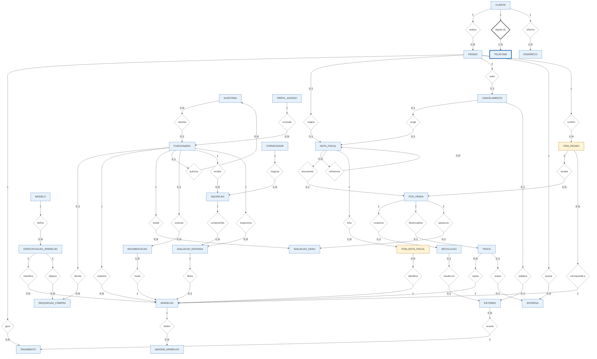

# CellGO — DER Atualizado

> Cópia da seção 6 do [README principal](../../README.md).

## 6. DER Atualizado

### 6.1 Entidades

| Nº | Entidade | Tipo | Descrição |
|---:|---|---|---|
| 01 | **CLIENTE** | Forte | Pessoa física ou jurídica que compra aparelhos na loja on-line. |
| 02 | **ENDERECO** | Forte | Cada endereço do cliente, usado para entrega ou cobrança. |
| 03 | **TELEFONE** | Fraca (depende de CLIENTE) | Cada número de telefone de um cliente. |
| 04 | **PEDIDO** | Forte | A venda e suas condições comerciais: o que foi vendido, por qual valor e em qual forma de pagamento. |
| 05 | **ITEM_PEDIDO** | Associativa (PEDIDO × APARELHO) | Cada aparelho vendido em um pedido, com o preço praticado e as datas de garantia. |
| 06 | **PAGAMENTO** | Forte | Cada tentativa de cobrança do pedido enviada à instituição de pagamento. |
| 07 | **NOTA_FISCAL** | Forte | Documento fiscal de venda, de entrada (devolução) ou de saída (reposição). |
| 08 | **ITEM_NOTA_FISCAL** | Associativa (NOTA_FISCAL × APARELHO) | Cada aparelho (IMEI) documentado em uma nota fiscal. |
| 09 | **CANCELAMENTO** | Forte | Cancelamento de um pedido antes do envio. |
| 10 | **ESTORNO** | Forte | Devolução de valor ao cliente, ligada ao pagamento revertido. |
| 11 | **ENTREGA** | Forte | Envio de um pedido ou de um aparelho de reposição, com rastreamento. |
| 12 | **POS_VENDA** | Forte | Solicitação do cliente sobre um aparelho já vendido (arrependimento, defeito ou garantia). |
| 13 | **DEVOLUCAO** | Forte | Devolução de um aparelho, por arrependimento ou por defeito. |
| 14 | **AVALIACAO_DANO** | Forte | Avaliação técnica do aparelho em uma solicitação de pós-venda. |
| 15 | **TROCA** | Forte | Troca de um aparelho com defeito por um aparelho equivalente. |
| 16 | **APARELHO** | Forte | Unidade física de celular, identificada pelo IMEI. |
| 17 | **IMAGEM_APARELHO** | Forte | Foto de um aparelho exibida na loja on-line. |
| 18 | **ESPECIFICACAO_APARELHO** | Forte | Combinação de modelo, cor e capacidade, com os parâmetros de estoque. |
| 19 | **MODELO** | Forte | Modelo de celular e sua marca. |
| 20 | **REQUISICAO_COMPRA** | Forte | Pedido interno de reposição de estoque de uma especificação. |
| 21 | **MOVIMENTACAO** | Forte | Cada mudança de status de um aparelho. |
| 22 | **AUDITORIA** | Forte | Registro de operações sensíveis, com executor e autorizador. |
| 23 | **FUNCIONARIO** | Forte | Colaborador ou sócio que usa o sistema, com o seu perfil de acesso. |
| 24 | **PERFIL_ACESSO** | Forte | Perfil de acesso ao sistema e o nível hierárquico correspondente. |
| 25 | **FORNECEDOR** | Forte | Pessoa física ou distribuidor que vende aparelhos para a loja. |
| 26 | **AQUISICAO** | Forte | Compra de um ou mais aparelhos de um fornecedor, com o documento da compra. |
| 27 | **AVALIACAO_ENTRADA** | Forte | Verificação de procedência e checklist técnico de cada aparelho oferecido à loja. |

### 6.2 Atributos

#### CLIENTE
- Cpf_Cnpj (PK)
- Nome
- Email
- Data_Nascimento
- Tipo_Pessoa

#### ENDERECO
- Id_Endereco (PK)
- Cpf_Cnpj (FK)
- Rua
- Bairro
- Cidade
- CEP
- Numero
- Complemento
- Tipo_Endereco

#### TELEFONE
- DDD (PK)
- Numero_Telefone (PK)
- Cpf_Cnpj (PK, FK)

#### PEDIDO
- Id_Pedido (PK)
- Cpf_Cnpj (FK)
- Data_Pedido
- Status_Pedido
- Forma_Pagamento
- Numero_Parcelas
- Valor_Produtos
- Percentual_Desconto_Pix
- Valor_Desconto
- Valor_Taxas
- Valor_Final

#### ITEM_PEDIDO
- Imei (PK, FK)
- Id_Pedido (PK, FK)
- Preco_Unitario
- Data_Inicio_Garantia
- Data_Fim_Garantia_Loja
- Data_Fim_Garantia_Fabricante

#### PAGAMENTO
- Id_Pagamento (PK)
- Id_Pedido (FK)
- Codigo_Transacao
- Data_Tentativa
- Data_Confirmacao
- Valor
- Status
- Comprovante

#### NOTA_FISCAL
- Id_Nota (PK)
- Numero_Nota
- Id_PosVenda (FK)
- Id_Nota_Referencia (FK)
- Codigo_Cancelamento (FK)
- Id_Pedido (FK)
- Chave_Acesso
- Tipo_Nota
- Natureza
- Status
- Data_Emissao

#### ITEM_NOTA_FISCAL
- Imei (PK, FK)
- Id_Nota (PK, FK)
- Valor_Item

#### CANCELAMENTO
- Codigo_Cancelamento (PK)
- Id_Pedido (FK)
- Data_Solicitacao
- Motivo
- Status

#### ESTORNO
- Id_Estorno (PK)
- Id_Pagamento (FK)
- Codigo_Devolucao (FK)
- Codigo_Cancelamento (FK)
- Valor
- Data_Abertura
- Prazo_Limite
- Data_Conclusao
- Status

#### ENTREGA
- Codigo_Rastreio (PK)
- Codigo_Troca (FK)
- Id_Pedido (FK)
- Transportadora
- Status_Entrega
- Data_Despacho
- Data_Entrega
- Origem_Atualizacao

#### POS_VENDA
- Id_PosVenda (PK)
- Imei (FK)
- Id_Pedido (FK)
- Tipo_Solicitacao
- Data_Abertura
- Descricao
- Status

> Id_Pedido e Imei formam juntos uma única chave estrangeira composta, que aponta para ITEM_PEDIDO.

#### DEVOLUCAO
- Codigo_Devolucao (PK)
- Id_PosVenda (FK)
- Data_Devolucao
- Motivo
- Status

#### AVALIACAO_DANO
- Codigo_Avaliacao (PK)
- Id_PosVenda (FK)
- Codigo_Funcionario (FK)
- Classificacao_Dano
- Descricao_Dano
- Cobertura_Garantia
- Destino_Aparelho
- Data_Avaliacao

#### TROCA
- Codigo_Troca (PK)
- Id_PosVenda (FK)
- Imei_Reposicao (FK)
- Data_Troca
- Status

#### APARELHO
- Imei (PK)
- Id_Especificacao (FK)
- Id_Avaliacao_Entrada (FK)
- Codigo_Funcionario (FK)
- Condicao
- Preco_Venda
- Custo_Aquisicao
- Status
- Data_Entrada
- Data_Disponivel
- Data_Fim_Quarentena
- Elegivel_Desconto_Pix

#### IMAGEM_APARELHO
- Id_Imagem (PK)
- Imei (FK)
- URL

#### ESPECIFICACAO_APARELHO
- Id_Especificacao (PK)
- Id_Modelo (FK)
- Cor
- Capacidade
- Estoque_Minimo
- Limite_Dias_Atencao
- Limite_Dias_Critico

#### MODELO
- Id_Modelo (PK)
- Nome_Modelo
- Marca

#### REQUISICAO_COMPRA
- Id_Requisicao (PK)
- Codigo_Funcionario (FK)
- Id_Especificacao (FK)
- Qtd_Atual_Estoque
- Estoque_Minimo
- Parecer_Financeiro
- Data_Abertura
- Data_Decisao
- Motivo_Recusa
- Status
- Qtd_Sugerida

#### MOVIMENTACAO
- Numero_Movimentacao (PK)
- Codigo_Funcionario (FK)
- Imei (FK)
- Tipo_Movimento
- Status_Anterior
- Status_Novo
- Data_Hora

#### AUDITORIA
- Id_Auditoria (PK)
- Codigo_Funcionario (FK)
- Codigo_Autorizador (FK)
- Acao
- Tabela_Afetada
- Registro_Id
- Valor_Anterior
- Valor_Novo
- Data_Hora
- Descricao

#### FUNCIONARIO
- Codigo_Funcionario (PK)
- Nome
- Cargo
- Login
- Id_Perfil (FK)
- Ativo

#### PERFIL_ACESSO
- Id_Perfil (PK)
- Nome_Perfil
- Nivel_Acesso

#### FORNECEDOR
- Cpf_Cnpj_Fornecedor (PK)
- Tipo_Pessoa
- Nome
- Tipo_Documento
- Numero_Documento
- Telefone_Contato

#### AQUISICAO
- Id_Aquisicao (PK)
- Codigo_Funcionario (FK)
- Cpf_Cnpj_Fornecedor (FK)
- Data_Aquisicao
- Tipo_Documento_Compra
- Numero_Documento_Compra
- Termo_Responsabilidade_Aceito
- Valor_Total
- Status

#### AVALIACAO_ENTRADA
- Id_Avaliacao_Entrada (PK)
- Codigo_Funcionario (FK)
- Id_Aquisicao (FK)
- Imei_Avaliado
- Base_Consultada
- Resultado_Consulta_Imei
- Data_Consulta
- Checklist_Bateria
- Checklist_Tela
- Checklist_Cameras
- Checklist_Botoes
- Checklist_Som
- Checklist_Conectividade
- Checklist_Pecas_Originais
- Bloqueio_Conta
- Reset_Fabrica_Realizado
- Resultado
- Motivo_Recusa
- Data_Reconsulta_Imei
- Resultado_Reconsulta_Imei

### 6.3 Relacionamentos

| # | Entidade | Relação | Entidade |
|---|---|---|---|
| 1 | CLIENTE | **REALIZA** | PEDIDO |
| 2 | CLIENTE | **DISPÕE DE** (identificador) | TELEFONE |
| 3 | PEDIDO | **GERA** | PAGAMENTO |
| 4 | PEDIDO | **ORIGINA** | NOTA_FISCAL |
| 5 | PEDIDO | **SOFRE** | CANCELAMENTO |
| 6 | CANCELAMENTO | **EXIGE** | NOTA_FISCAL |
| 7 | CANCELAMENTO | **VIABILIZA** | ESTORNO |
| 8 | NOTA_FISCAL (original) | **REFERENCIA** | NOTA_FISCAL (derivada) |
| 9 | PEDIDO | **POSSUI** | ENTREGA |
| 10 | PEDIDO | **CONTÉM** | ITEM_PEDIDO |
| 11 | ITEM_PEDIDO | **RECEBE** | POS_VENDA |
| 12 | NOTA_FISCAL | **DOCUMENTA** | POS_VENDA |
| 13 | POS_VENDA | **OCASIONA** | DEVOLUCAO |
| 14 | DEVOLUCAO | **RESULTA EM** | ESTORNO |
| 15 | POS_VENDA | **DESENCADEIA** | TROCA |
| 16 | POS_VENDA | **PASSA POR** | AVALIACAO_DANO |
| 17 | ITEM_PEDIDO | **CORRESPONDE A** | APARELHO |
| 18 | TROCA | **REPÕE** | APARELHO |
| 19 | TROCA | **REQUER** | ENTREGA |
| 20 | APARELHO | **DETÉM** | IMAGEM_APARELHO |
| 21 | ESPECIFICACAO_APARELHO | **CLASSIFICA** | APARELHO |
| 22 | MOVIMENTACAO | **MUDA** | APARELHO |
| 23 | ESPECIFICACAO_APARELHO | **DISPARA** | REQUISICAO_COMPRA |
| 24 | FUNCIONARIO | **DECIDE** | REQUISICAO_COMPRA |
| 25 | FUNCIONARIO | **CADASTRA** | APARELHO |
| 26 | FUNCIONARIO | **AVALIA** | AVALIACAO_DANO |
| 27 | AUDITORIA | **RASTREIA** | FUNCIONARIO |
| 28 | FUNCIONARIO | **AUTORIZA** | AUDITORIA |
| 29 | FUNCIONARIO | **EXECUTA** | MOVIMENTACAO |
| 30 | ESTORNO | **REVERTE** | PAGAMENTO |
| 31 | NOTA_FISCAL | **LISTA** | ITEM_NOTA_FISCAL |
| 32 | ITEM_NOTA_FISCAL | **IDENTIFICA** | APARELHO |
| 33 | FORNECEDOR | **NEGOCIA** | AQUISICAO |
| 34 | AQUISICAO | **COMPREENDE** | AVALIACAO_ENTRADA |
| 35 | AVALIACAO_ENTRADA | **LIBERA** | APARELHO |
| 36 | FUNCIONARIO | **RECEBE** | AQUISICAO |
| 37 | FUNCIONARIO | **INSPECIONA** | AVALIACAO_ENTRADA |
| 38 | CLIENTE | **INFORMA** | ENDERECO |
| 39 | MODELO | **DEFINE** | ESPECIFICACAO_APARELHO |
| 40 | PERFIL_ACESSO | **CONCEDE** | FUNCIONARIO |

> Os relacionamentos 10 e 17 formam juntos a entidade associativa ITEM_PEDIDO, que resolve o relacionamento N:N entre PEDIDO e APARELHO. Da mesma forma, os relacionamentos 31 e 32 formam a entidade associativa ITEM_NOTA_FISCAL, que resolve o relacionamento N:N entre NOTA_FISCAL e APARELHO.

### 6.4 Cardinalidades

> Leitura da notação: em "A (x,y) — relação — B (z,w)", o par ao lado de cada entidade indica quantas ocorrências dela se ligam a uma ocorrência da outra.

**1. Cliente – Pedido**
 - Descrição: 1 CLIENTE realiza N PEDIDOs (cada pedido pertence a exatamente 1 cliente)
 - Notação: CLIENTE (1,1) — realiza — PEDIDO (0,N)

**2. Cliente – Telefone**
 - Descrição: 1 CLIENTE dispõe de pelo menos 1 TELEFONE (o telefone é obrigatório no cadastro, RN-01); cada telefone pertence a exatamente 1 cliente
 - Notação: CLIENTE (1,1) — dispõe de — TELEFONE (1,N)

**3. Pedido – Pagamento**
 - Descrição: 1 PEDIDO gera N PAGAMENTOs (tentativas de cobrança), dos quais no máximo 1 é Aprovado; cada pagamento pertence a exatamente 1 pedido
 - Notação: PEDIDO (1,1) — gera — PAGAMENTO (0,N)

**4. Pedido – Nota Fiscal**
 - Descrição: 1 PEDIDO origina no máximo 1 NOTA_FISCAL de venda; as notas de entrada e de reposição não têm essa origem
 - Notação: PEDIDO (0,1) — origina — NOTA_FISCAL (0,1)

**5. Pedido – Cancelamento**
 - Descrição: 1 PEDIDO sofre no máximo 1 CANCELAMENTO
 - Notação: PEDIDO (1,1) — sofre — CANCELAMENTO (0,1)

**6. Cancelamento – Nota Fiscal**
 - Descrição: 1 CANCELAMENTO exige no máximo 1 NOTA_FISCAL de entrada (apenas quando o prazo de cancelamento direto da nota de venda já passou)
 - Notação: CANCELAMENTO (0,1) — exige — NOTA_FISCAL (0,1)

**7. Cancelamento – Estorno**
 - Descrição: 1 CANCELAMENTO viabiliza no máximo 1 ESTORNO
 - Notação: CANCELAMENTO (0,1) — viabiliza — ESTORNO (0,1)

**8. Nota Fiscal (original) – Nota Fiscal (derivada)**
 - Descrição: 1 NOTA_FISCAL original é referenciada por N NOTA_FISCAL derivadas (autorrelacionamento); cada nota derivada referencia exatamente 1 nota original
 - Notação: NOTA_FISCAL original (1,1) — referencia — NOTA_FISCAL derivada (0,N)

**9. Pedido – Entrega**
 - Descrição: 1 PEDIDO possui N ENTREGAs (a entrega da venda e, quando houver troca, a entrega do aparelho de reposição)
 - Notação: PEDIDO (1,1) — possui — ENTREGA (0,N)

**10. Pedido – Item do Pedido**
 - Descrição: 1 PEDIDO contém N ITEM_PEDIDO (mínimo 1 item por pedido)
 - Notação: PEDIDO (1,1) — contém — ITEM_PEDIDO (1,N)

**11. Item do Pedido – Pós-Venda**
 - Descrição: 1 ITEM_PEDIDO recebe N solicitações de POS_VENDA
 - Notação: ITEM_PEDIDO (1,1) — recebe — POS_VENDA (0,N)

**12. Nota Fiscal – Pós-Venda**
 - Descrição: 1 POS_VENDA é documentado por N NOTA_FISCAL (na troca, uma de entrada e uma de saída); cada uma dessas notas documenta no máximo 1 POS_VENDA
 - Notação: NOTA_FISCAL (0,N) — documenta — POS_VENDA (0,1)

**13. Pós-Venda – Devolução**
 - Descrição: 1 POS_VENDA ocasiona no máximo 1 DEVOLUCAO
 - Notação: POS_VENDA (1,1) — ocasiona — DEVOLUCAO (0,1)

**14. Devolução – Estorno**
 - Descrição: 1 DEVOLUCAO resulta em no máximo 1 ESTORNO
 - Notação: DEVOLUCAO (0,1) — resulta em — ESTORNO (0,1)

**15. Pós-Venda – Troca**
 - Descrição: 1 POS_VENDA desencadeia no máximo 1 TROCA
 - Notação: POS_VENDA (1,1) — desencadeia — TROCA (0,1)

**16. Pós-Venda – Avaliação de Dano**
 - Descrição: 1 POS_VENDA passa por no máximo 1 AVALIACAO_DANO
 - Notação: POS_VENDA (1,1) — passa por — AVALIACAO_DANO (0,1)

**17. Item do Pedido – Aparelho**
 - Descrição: 1 APARELHO corresponde a N ITEM_PEDIDO ao longo do tempo (pode ser vendido de novo após devolução); cada item corresponde a exatamente 1 aparelho
 - Notação: ITEM_PEDIDO (0,N) — corresponde a — APARELHO (1,1)

**18. Troca – Aparelho**
 - Descrição: N TROCA repõem exatamente 1 APARELHO cada (aparelho de reposição)
 - Notação: TROCA (0,N) — repõe — APARELHO (1,1)

**19. Troca – Entrega**
 - Descrição: 1 TROCA requer no máximo 1 ENTREGA
 - Notação: TROCA (0,1) — requer — ENTREGA (0,1)

**20. Aparelho – Imagem do Aparelho**
 - Descrição: 1 APARELHO detém N IMAGEM_APARELHO
 - Notação: APARELHO (1,1) — detém — IMAGEM_APARELHO (0,N)

**21. Especificação do Aparelho – Aparelho**
 - Descrição: 1 ESPECIFICACAO_APARELHO classifica N APARELHOs
 - Notação: ESPECIFICACAO_APARELHO (1,1) — classifica — APARELHO (0,N)

**22. Movimentação – Aparelho**
 - Descrição: 1 APARELHO tem pelo menos 1 MOVIMENTACAO (a entrada no estoque); cada movimentação muda exatamente 1 aparelho
 - Notação: MOVIMENTACAO (1,N) — muda — APARELHO (1,1)

**23. Especificação do Aparelho – Requisição de Compra**
 - Descrição: 1 ESPECIFICACAO_APARELHO dispara N REQUISICAO_COMPRA
 - Notação: ESPECIFICACAO_APARELHO (1,1) — dispara — REQUISICAO_COMPRA (0,N)

**24. Funcionário – Requisição de Compra**
 - Descrição: 1 FUNCIONARIO (Diretoria) decide N REQUISICAO_COMPRA; a requisição ainda não decidida não tem decisor
 - Notação: FUNCIONARIO (0,1) — decide — REQUISICAO_COMPRA (0,N)

**25. Funcionário – Aparelho**
 - Descrição: 1 FUNCIONARIO cadastra N APARELHOs
 - Notação: FUNCIONARIO (1,1) — cadastra — APARELHO (0,N)

**26. Funcionário – Avaliação de Dano**
 - Descrição: 1 FUNCIONARIO avalia N AVALIACAO_DANO
 - Notação: FUNCIONARIO (1,1) — avalia — AVALIACAO_DANO (0,N)

**27. Auditoria – Funcionário**
 - Descrição: cada AUDITORIA rastreia no máximo 1 FUNCIONARIO executor (vazio quando a ação é automática)
 - Notação: AUDITORIA (0,N) — rastreia — FUNCIONARIO (0,1)

**28. Funcionário – Auditoria**
 - Descrição: 1 FUNCIONARIO (autorizador) autoriza N AUDITORIA (vazio quando a operação não exige autorização)
 - Notação: FUNCIONARIO (0,1) — autoriza — AUDITORIA (0,N)

**29. Funcionário – Movimentação**
 - Descrição: 1 FUNCIONARIO executa N MOVIMENTACAO (vazio quando a mudança é automática, como a baixa na aprovação do pagamento)
 - Notação: FUNCIONARIO (0,1) — executa — MOVIMENTACAO (0,N)

**30. Estorno – Pagamento**
 - Descrição: 1 PAGAMENTO aprovado pode ser revertido por N ESTORNOs (por exemplo, devoluções de aparelhos diferentes do mesmo pedido); cada estorno reverte exatamente 1 pagamento
 - Notação: ESTORNO (0,N) — reverte — PAGAMENTO (1,1)

**31. Nota Fiscal – Item da Nota Fiscal**
 - Descrição: 1 NOTA_FISCAL lista N ITEM_NOTA_FISCAL (mínimo 1 aparelho por nota)
 - Notação: NOTA_FISCAL (1,1) — lista — ITEM_NOTA_FISCAL (1,N)

**32. Item da Nota Fiscal – Aparelho**
 - Descrição: 1 APARELHO aparece em N ITEM_NOTA_FISCAL ao longo do tempo (venda, devolução, reposição); cada item identifica exatamente 1 aparelho
 - Notação: ITEM_NOTA_FISCAL (0,N) — identifica — APARELHO (1,1)

**33. Fornecedor – Aquisição**
 - Descrição: 1 FORNECEDOR negocia N AQUISICOES (o fornecedor só é cadastrado quando vende algo à loja); cada aquisição tem exatamente 1 fornecedor
 - Notação: FORNECEDOR (1,1) — negocia — AQUISICAO (1,N)

**34. Aquisição – Avaliação de Entrada**
 - Descrição: 1 AQUISICAO compreende N AVALIACAO_ENTRADA, uma para cada aparelho oferecido (mínimo 1)
 - Notação: AQUISICAO (1,1) — compreende — AVALIACAO_ENTRADA (1,N)

**35. Avaliação de Entrada – Aparelho**
 - Descrição: 1 AVALIACAO_ENTRADA aprovada libera no máximo 1 APARELHO (a recusada não libera nenhum); cada aparelho está ligado a exatamente 1 avaliação de entrada (a da sua entrada mais recente)
 - Notação: AVALIACAO_ENTRADA (1,1) — libera — APARELHO (0,1)

**36. Funcionário – Aquisição**
 - Descrição: 1 FUNCIONARIO (Estoque e Logística) recebe N AQUISICOES
 - Notação: FUNCIONARIO (1,1) — recebe — AQUISICAO (0,N)

**37. Funcionário – Avaliação de Entrada**
 - Descrição: 1 FUNCIONARIO (Assistência Técnica) inspeciona N AVALIACAO_ENTRADA
 - Notação: FUNCIONARIO (1,1) — inspeciona — AVALIACAO_ENTRADA (0,N)

**38. Cliente – Endereço**
 - Descrição: 1 CLIENTE informa pelo menos 1 ENDERECO (o endereço é obrigatório no cadastro, RN-01, e é usado na entrega e na nota fiscal); cada endereço pertence a exatamente 1 cliente
 - Notação: CLIENTE (1,1) — informa — ENDERECO (1,N)

**39. Modelo – Especificação do Aparelho**
 - Descrição: 1 MODELO define N ESPECIFICACAO_APARELHO (uma para cada combinação de cor e capacidade); cada especificação pertence a exatamente 1 modelo
 - Notação: MODELO (1,1) — define — ESPECIFICACAO_APARELHO (0,N)

**40. Perfil de Acesso – Funcionário**
 - Descrição: 1 PERFIL_ACESSO é concedido a N FUNCIONARIOs; cada funcionário tem exatamente 1 perfil
 - Notação: PERFIL_ACESSO (1,1) — concede — FUNCIONARIO (0,N)

### 6.5 Diagrama Entidade-Relacionamento

#### Legenda

| Forma | Significado |
|---|---|
| Retângulo de borda fina | Entidade forte |
| Retângulo de borda grossa | Entidade fraca (`TELEFONE`) |
| Retângulo amarelo de borda tracejada | Entidade associativa (`ITEM_PEDIDO`, `ITEM_NOTA_FISCAL`): relacionamento N:N transformado em entidade por ter atributos próprios |
| Losango de borda fina | Relacionamento |
| Losango de borda grossa | Relacionamento identificador (`dispõe de`, entre `CLIENTE` e `TELEFONE`) |
| Número na linha | Cardinalidade (`1`, `0..1`, `0..N`, `1..N`) |
