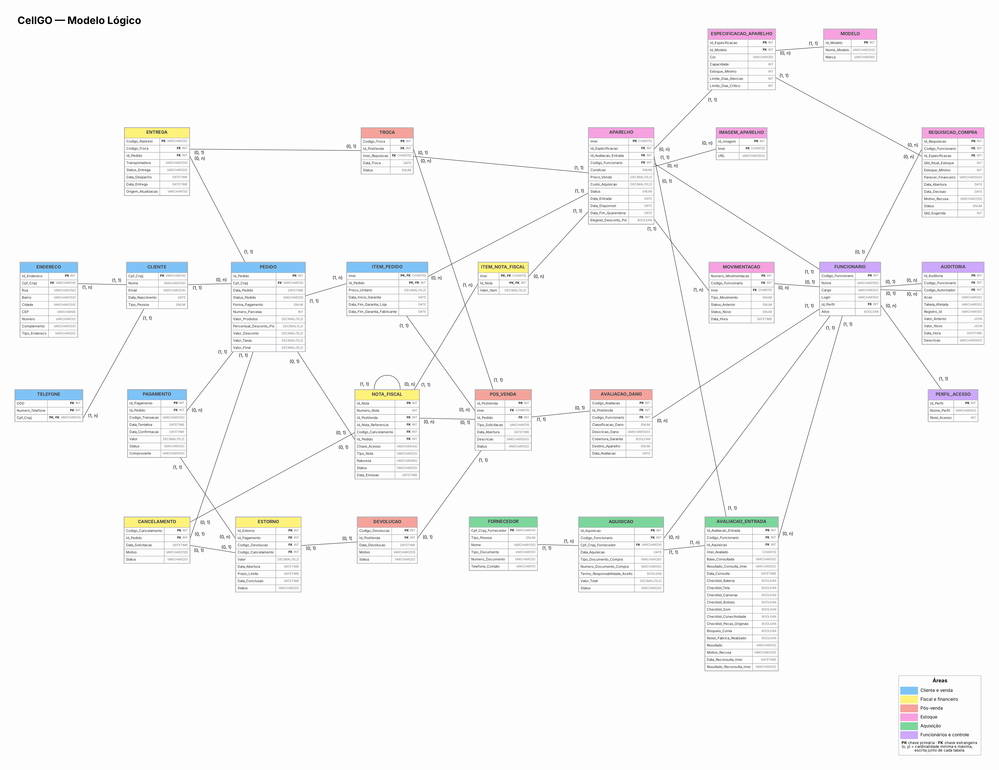

# CellGO — Modelo Lógico

> Cópia da seção 7 do [README principal](../../README.md).

## 7. Modelo Lógico

O modelo lógico mostra cada tabela com os seus campos, tipos e chaves (PK e FK), e as ligações entre as tabelas com as cardinalidades. A cor do cabeçalho indica a área de cada tabela (legenda no canto inferior direito).

### 7.1 Justificativas Técnicas

#### Controle de estoque por unidade (IMEI), e não por quantidade

**Decisão:** A entidade APARELHO é controlada individualmente pelo Imei (PK), e não existe nenhuma entidade de "saldo de estoque" por modelo.

**Justificativa:** A RN-03 e o RF-03 exigem que cada aparelho seja acompanhado individualmente, com seu próprio histórico, status, garantia e tempo em estoque. Isso não é possível quando o estoque é controlado apenas pela quantidade de cada modelo. Com um controle por quantidade, a empresa não saberia, por exemplo, qual unidade está parada há mais de 60 dias (RN-05) nem conseguiria ligar a garantia a um aparelho específico (RN-17). A contagem por modelo, usada no ponto de pedido (RN-06), é apenas uma consulta feita sobre os registros de APARELHO, e não uma tabela própria. Assim, não existem dois números de estoque diferentes que poderiam discordar entre si.

#### Separação entre APARELHO e ESPECIFICACAO_APARELHO

**Decisão:** Cor, Capacidade, Estoque_Minimo e os limites de dias de giro ficam em uma entidade própria, ESPECIFICACAO_APARELHO, separada da unidade física (APARELHO). O nome do modelo e a marca ficam em MODELO, ligada à especificação.

**Justificativa:** Esses dados valem para todos os aparelhos de uma mesma combinação de modelo, cor e capacidade, e não para cada unidade (RN-02, RN-05 e RN-06). Se ficassem dentro de APARELHO, o mesmo estoque mínimo teria de ser repetido em cada IMEI daquele modelo. Quando a Diretoria alterasse esse valor, seria preciso atualizar vários registros, com risco de algum ficar diferente dos outros. Com a separação, basta alterar um único registro. A separação também permite que a REQUISICAO_COMPRA (RN-06) seja gerada a partir da especificação, e não de um aparelho específico. Pelo mesmo motivo, o modelo e a marca ficam em MODELO: a marca depende só do modelo (todo iPhone 15 é da Apple), e não da cor nem da capacidade. Se a marca ficasse na especificação, ela se repetiria em cada combinação de cor e capacidade do mesmo modelo, o que seria uma dependência transitiva (Id_Especificacao → Modelo → Marca) e violaria a 3ª Forma Normal. Essa organização segue as regras de normalização: cada informação fica guardada na entidade da qual ela realmente depende.

#### Ausência de reserva de estoque e validação no fechamento da venda

**Decisão:** Não existe o status "Reservado" no ciclo de vida do APARELHO. A disponibilidade é conferida quando o cliente monta o pedido e conferida novamente no momento da aprovação do pagamento (RN-04).

**Justificativa:** A proibição de reserva é uma decisão explícita do negócio (RN-03 e RN-04). Ela simplifica o modelo e evita um problema comum em e-commerce: dois clientes "segurando" o mesmo aparelho ao mesmo tempo. Para impedir que duas compras sejam concluídas para a mesma unidade, a conferência da disponibilidade, a aprovação do pagamento e a mudança do status para "Vendido" acontecem como uma única operação: ou tudo é concluído junto, ou nada é gravado. Se outro cliente já tiver comprado o aparelho, a segunda compra é bloqueada e o cliente é informado. Isso sustenta o RNF-06 (confiabilidade).

#### Entidade fraca × entidade associativa

**Decisão:** O modelo usa os dois conceitos, cada um no lugar certo: TELEFONE é uma **entidade fraca**; ITEM_PEDIDO e ITEM_NOTA_FISCAL são **entidades associativas**.

**Justificativa:** Os dois conceitos são diferentes e não devem ser confundidos:

| | Entidade fraca | Entidade associativa |
|---|---|---|
| Origem | Depende de **uma** entidade dona para existir e para ser identificada | Nasce de um relacionamento **N:N** entre **duas** entidades que precisa guardar atributos próprios |
| Chave primária | Chave da entidade dona + um identificador parcial (discriminador) | Chaves das duas entidades que ela liga |
| Relacionamento | Ligada à dona por um relacionamento identificador | Ligada às duas entidades, sem dona única |
| No CellGO | TELEFONE: (Cpf_Cnpj + DDD + Numero_Telefone) | ITEM_PEDIDO: (Id_Pedido + Imei); ITEM_NOTA_FISCAL: (Id_Nota + Imei) |

TELEFONE é fraca porque não tem identidade fora do cliente: DDD e número só identificam o registro quando combinados com o Cpf_Cnpj do titular (identificador parcial), e o telefone deixa de existir se o cliente for removido. Por isso o relacionamento "dispõe de" é identificador.

ITEM_PEDIDO não é fraca: sua chave não é "chave do pedido + discriminador", mas a junção das chaves de duas entidades fortes, PEDIDO e APARELHO. A relação entre elas é N:N, porque um pedido pode ter vários aparelhos e um mesmo aparelho pode aparecer em vários pedidos ao longo do tempo (quando é devolvido e revendido). Esse relacionamento precisa guardar dados que pertencem à combinação dos dois: o preço praticado naquela venda e as datas de garantia daquele aparelho naquele pedido. Se ficassem em APARELHO, seriam substituídos a cada revenda; se ficassem em PEDIDO, não funcionariam para pedidos com mais de um aparelho. Por isso o relacionamento N:N é promovido a entidade associativa. A mesma lógica vale para ITEM_NOTA_FISCAL (uma nota lista vários aparelhos, e um aparelho aparece em várias notas: venda, devolução, reposição).

#### Telefone como entidade do cliente

**Decisão:** O telefone não é um campo dentro de CLIENTE: ele é modelado como a entidade fraca TELEFONE, ligada a CLIENTE por um relacionamento identificador, com cardinalidade 1..N.

**Justificativa:** A RN-01 e o RF-01 exigem telefone no cadastro, e um mesmo cliente pode ter mais de um número (celular, fixo ou WhatsApp). Um único atributo não comporta essa variação, e colunas fixas como Telefone1 e Telefone2 violariam a 1ª Forma Normal e limitariam a quantidade de números. Com a entidade TELEFONE, cada número é um registro separado. A cardinalidade mínima 1 no lado do telefone garante que todo cliente tenha pelo menos um contato, como exige a regra. Já no FORNECEDOR a regra pede apenas um contato, por isso lá o telefone é um atributo simples (Telefone_Contato).

#### Endereço como entidade própria

**Decisão:** Os dados de endereço (Rua, Numero, Complemento, Bairro, Cidade, CEP e Tipo_Endereco) saíram de CLIENTE e passaram para a entidade ENDERECO, com identificador próprio (Id_Endereco) e ligada ao cliente pelo Cpf_Cnpj, com cardinalidade 1..N.

**Justificativa:** Um mesmo cliente pode ter mais de um endereço: o residencial, o de entrega e, para pessoa jurídica, o comercial ou de cobrança. Com o endereço dentro de CLIENTE, só caberia um, ou seria preciso repetir colunas (Rua1, Rua2...), o que viola a 1ª Forma Normal. Com a entidade própria, cada endereço é um registro e o atributo Tipo_Endereco diz para que ele serve. ENDERECO tem identificador próprio (Id_Endereco) em vez de usar o Cpf_Cnpj como parte da chave porque nenhum outro atributo identifica o endereço com segurança: o cliente pode ter dois endereços do mesmo tipo, e qualquer campo do endereço pode ser alterado. A cardinalidade mínima 1 no lado do endereço garante que todo cliente tenha pelo menos um endereço, como exige a RN-01, já que ele é necessário para a entrega e para a nota fiscal.

#### Tipos de dados das chaves e dos valores

**Decisão:** IMEI é CHAR(15); CPF/CNPJ é VARCHAR(14); código de rastreio é VARCHAR(30); valores em dinheiro são DECIMAL(10,2). Os identificadores gerados pelo próprio sistema (Id_* e Codigo_*) são INT.

**Justificativa:** IMEI, CPF, CNPJ e código de rastreio são códigos, e não números usados em cálculos. O IMEI tem 15 dígitos e o CNPJ tem 14, o que não cabe em um INT; o CPF pode começar com zero, que seria perdido em um campo numérico; e o código de rastreio tem letras. Por isso são guardados como texto. Os valores em dinheiro usam DECIMAL(10,2), e não FLOAT, porque o FLOAT guarda valores aproximados e pode errar centavos em somas, descontos e estornos; o RNF-10 exige valores com duas casas decimais exatas.

#### Imagem do aparelho como entidade separada

**Decisão:** As fotos de cada aparelho ficam em uma entidade própria, IMAGEM_APARELHO (Id_Imagem, Imei, URL), e não em um atributo de APARELHO.

**Justificativa:** Como a venda é feita exclusivamente pela internet, cada aparelho pode ter várias fotos (frente, verso ou o detalhe de uma marca de uso em um seminovo, por exemplo), e a quantidade varia de uma unidade para outra. Guardar as fotos em um único campo de APARELHO dificultaria incluir ou remover uma imagem sem alterar o registro inteiro. Com a entidade própria, cada foto é um registro, identificado pelo seu próprio código (Id_Imagem) e ligado ao aparelho pelo Imei. Um aparelho pode não ter nenhuma foto ou ter uma ou várias (cardinalidade 1 : 0..N). Diferente de TELEFONE, IMAGEM_APARELHO tem identificador próprio (Id_Imagem), por isso é uma entidade forte.

#### Semântica de PEDIDO × PAGAMENTO

**Decisão:** PEDIDO representa a **venda e suas condições comerciais**: o que foi vendido (ITEM_PEDIDO), a forma de pagamento escolhida, o número de parcelas, o desconto, as taxas e o valor final. PAGAMENTO representa **cada tentativa de cobrança** desse valor enviada à instituição de pagamento, com código da transação, datas, valor e status. Os atributos Forma_Pagamento e Numero_Parcelas ficam apenas em PEDIDO, e os status das duas entidades são separados.

**Justificativa:** Na versão anterior, PEDIDO e PAGAMENTO repetiam a forma de pagamento e o número de parcelas, e o status do pedido misturava a situação da venda com a situação da cobrança ("Parcialmente pago"). Isso não deixava claro o que cada entidade representava, nem o que significava um pedido ter vários pagamentos.

A forma de pagamento pertence ao pedido porque é ela que define o valor da venda: o desconto Pix (RN-10) e as taxas do parcelamento (RN-12) são calculados antes da confirmação, a partir da forma escolhida. O pagamento, por sua vez, registra o que de fato aconteceu com a cobrança. A cardinalidade 1 : 0..N passa a ter um significado concreto: um Pix pode expirar, um cartão pode ser recusado e o cliente pode tentar de novo, e cada tentativa fica registrada com seu próprio status (Pendente, Aprovado, Recusado, Expirado ou Estornado). A regra de que existe no máximo um pagamento Aprovado por pedido garante que a venda não seja cobrada duas vezes. Se o cliente mudar a forma de pagamento entre uma tentativa e outra, o pedido é recalculado antes da nova cobrança (RN-11), e por isso a forma continua sendo um dado do pedido.

Com essa separação, cada status descreve uma única coisa: Status_Pedido diz em que ponto está a venda (Aberto, Aguardando pagamento, Pago, Finalizado, Cancelado), e o Status do pagamento diz o que aconteceu com cada cobrança. O status "Parcialmente pago" foi removido, pois o negócio não aceita dividir o pagamento entre formas diferentes e, no cartão parcelado, quem recebe as parcelas é a operadora, e não a loja.

#### NOTA_FISCAL ligada ao PEDIDO, e não ao PAGAMENTO

**Decisão:** A nota fiscal de venda passa a ser originada pelo PEDIDO (Id_Pedido), e não pelo PAGAMENTO. A NOTA_FISCAL continua tendo três origens possíveis e excludentes: Id_Pedido (nota de venda), Codigo_Cancelamento (nota de entrada por cancelamento fora do prazo de cancelamento direto) e Id_PosVenda (nota de entrada por devolução ou troca, e nota de saída do aparelho de reposição). O atributo Tipo_Nota indica qual é o documento.

**Justificativa:** A nota fiscal documenta uma operação com mercadoria: quem comprou, quais aparelhos (IMEI) e por qual valor. Essas informações estão no pedido e em seus itens, e não no pagamento. A aprovação do pagamento é apenas o **gatilho** que inicia a emissão (RN-20), ou seja, uma regra de momento, e não um vínculo entre os dados. Ligar a nota ao pagamento trazia ainda um problema: como um pedido pode ter várias tentativas de pagamento, a nota ficaria presa a uma tentativa específica, e não à venda. Ligada ao pedido, a nota de venda acompanha a venda inteira, independentemente de quantas tentativas de cobrança houve. A regra de que cada nota tem exatamente uma origem é registrada como restrição do modelo e verificada pelo sistema no momento da gravação.

#### Identificador próprio da NOTA_FISCAL e chave de acesso opcional

**Decisão:** A chave primária de NOTA_FISCAL passa a ser um identificador interno (Id_Nota). A chave de acesso (Chave_Acesso) e o número da nota (Numero_Nota) passam a ser atributos que podem ficar vazios, com a chave de acesso marcada como única.

**Justificativa:** A chave de acesso de 44 dígitos e o número da NF-e só existem depois que a SEFAZ autoriza a nota. Pela RN-20, a nota nasce com status "Aguardando emissão" e pode ficar "Pendente" em caso de erro, situações em que ainda não há chave nem número. Uma chave primária não pode ser vazia, por isso usar a chave de acesso como PK impediria registrar a nota antes da autorização. Com o Id_Nota, o registro existe desde o início da emissão, e a chave de acesso e o número são preenchidos quando a nota é autorizada. O número da nota também foi incluído porque o RF-17 e a RN-20 exigem registrá-lo.

#### ITEM_NOTA_FISCAL: os aparelhos documentados em cada nota

**Decisão:** A entidade associativa ITEM_NOTA_FISCAL (Id_Nota, Imei, Valor_Item) registra quais aparelhos cada nota documenta.

**Justificativa:** Uma nota fiscal lista mercadorias, e no CellGO cada mercadoria é um aparelho identificado pelo IMEI (Política Fiscal e Documental: rastreabilidade por IMEI). Sem essa entidade, a nota de saída da troca não teria como indicar o aparelho de reposição, porque esse aparelho não faz parte do pedido original (não é um ITEM_PEDIDO). Da mesma forma, a nota de entrada de uma devolução precisa indicar qual IMEI está voltando. Como uma nota pode listar vários aparelhos e um aparelho aparece em várias notas ao longo da vida (venda, devolução, reposição), a relação é N:N, resolvida pela entidade associativa.

#### Autorrelacionamento em NOTA_FISCAL ("referencia")

**Decisão:** NOTA_FISCAL tem um relacionamento com ela mesma. Uma nota de entrada ou de reposição aponta para a nota de venda original por meio do atributo Id_Nota_Referencia.

**Justificativa:** A RN-20, seguindo a legislação fiscal, exige que a nota de entrada (devolução) indique a nota de venda que está sendo desfeita: não existe nota de entrada "solta". A nota de saída do aparelho de reposição também fica ligada à nota original, para que toda a troca possa ser rastreada. O autorrelacionamento representa exatamente essa ligação. Uma nota original pode ter várias notas ligadas a ela (na troca, por exemplo, uma de entrada e uma de saída), mas cada uma dessas notas aponta para uma única nota original (cardinalidade 1 : 0..N). A nota de venda comum fica com Id_Nota_Referencia vazio, porque ela própria é a original.

#### POS_VENDA como entidade central de troca, devolução e garantia

**Decisão:** Em vez de ligar TROCA, DEVOLUCAO e AVALIACAO_DANO diretamente a ITEM_PEDIDO, o modelo cria POS_VENDA como ponto único de entrada para as solicitações do cliente sobre um aparelho já vendido. O CANCELAMENTO fica fora desse fluxo e se liga diretamente ao PEDIDO.

**Justificativa:** Troca por defeito (RN-14), devolução por arrependimento (RN-15), devolução por defeito (RN-16) e solicitações de garantia (RN-17) começam da mesma forma: o cliente abre uma solicitação, com data, descrição e status, sobre um aparelho específico. Depois disso, o aparelho passa por avaliação técnica (RN-18), e só então o caso segue para troca, devolução ou encerramento por mau uso. Concentrar essa abertura em POS_VENDA evita repetir os mesmos atributos em várias tabelas e permite que o histórico do cliente (RN-22) e a auditoria (RN-23) encontrem todas as solicitações em um só lugar. O cancelamento é diferente: ele vale para o pedido inteiro, só pode acontecer antes do envio (RN-13) e não passa por avaliação de dano. Por isso, fica em uma entidade própria, ligada ao PEDIDO.

#### DEVOLUCAO como entidade única para arrependimento e defeito

**Decisão:** Uma única entidade, DEVOLUCAO, atende tanto a devolução por arrependimento (RN-15) quanto a devolução por defeito (RN-16). O tipo vem do atributo Tipo_Solicitacao do POS_VENDA que originou a devolução.

**Justificativa:** Os dois tipos de devolução guardam as mesmas informações: data, motivo, status e ligação com POS_VENDA e ESTORNO. O que muda é a regra que autoriza cada uma. A devolução por arrependimento não exige defeito e deve ser pedida em até 7 dias após o recebimento. A devolução por defeito só é autorizada quando o defeito é coberto pela garantia e não há aparelho equivalente para troca. Nos dois casos, o aparelho passa por avaliação técnica (AVALIACAO_DANO) antes de voltar ao estoque. Criar duas entidades repetiria os mesmos atributos e dificultaria a consulta do histórico do cliente (RN-22), que precisa mostrar todas as devoluções juntas. A diferença entre os dois tipos fica no Tipo_Solicitacao do POS_VENDA e nas validações de cada regra, e não na estrutura da tabela. DEVOLUCAO não repete esse tipo em um atributo próprio porque ele já é determinado pela solicitação de origem; guardá-lo de novo criaria uma dependência transitiva (Codigo_Devolucao → Id_PosVenda → Tipo_Solicitacao), contrária à 3ª Forma Normal.

#### ESTORNO ligado ao pagamento revertido, com duas origens que não se misturam

**Decisão:** Todo ESTORNO tem uma chave estrangeira obrigatória para o PAGAMENTO que está sendo revertido (Id_Pagamento) e duas chaves estrangeiras opcionais de origem, Codigo_Cancelamento e Codigo_Devolucao, das quais apenas uma é preenchida.

**Justificativa:** A RN-19 determina que o estorno siga a forma de pagamento original: Pix devolvido para a conta de origem e cartão estornado junto à operadora. Para isso, o estorno precisa saber qual cobrança está desfazendo, e essa informação está no pagamento aprovado (código da transação, valor e data). Sem esse vínculo, o sistema teria de "adivinhar" o pagamento a partir do pedido. A forma de restituição não é guardada no ESTORNO, porque é determinada pela forma de pagamento do pedido (Pix → devolução Pix; cartão → estorno no cartão); guardá-la também seria uma dependência transitiva. Um mesmo pagamento pode ter mais de um estorno quando o pedido tem vários aparelhos e mais de um deles é devolvido (cardinalidade 1 : 0..N).

Quanto à origem, a RN-19 prevê estorno em duas situações diferentes: quando o pedido é cancelado antes do envio e o pagamento já tinha sido feito (RN-13), e quando há devolução, por arrependimento (RN-15) ou por defeito (RN-16). A troca não gera estorno, porque o aparelho de reposição tem valor igual ou superior e não há diferença a devolver ao cliente (RN-14). Um mesmo estorno nunca nasce de um cancelamento e de uma devolução ao mesmo tempo. Usar duas chaves estrangeiras com nomes claros, em vez de um único campo genérico de "origem", deixa evidente de onde veio cada estorno. A garantia de que apenas uma das duas é preenchida é registrada como restrição do modelo e verificada pelo sistema no momento da gravação. A situação "atrasado" não é gravada como status: ela é calculada pela comparação entre o Prazo_Limite e a data atual enquanto o estorno estiver Pendente.

#### Cardinalidades opcionais (0,1) nos relacionamentos de pós-venda

**Decisão:** Relacionamentos como POS_VENDA–DEVOLUCAO, POS_VENDA–TROCA e CANCELAMENTO–ESTORNO têm, do lado opcional, cardinalidade máxima 1 (0..1), e nunca 0..N.

**Justificativa:** As regras de negócio determinam que cada solicitação gere no máximo um resultado de cada tipo: uma solicitação de pós-venda gera no máximo uma troca e no máximo uma devolução, e um cancelamento gera no máximo um estorno. A cardinalidade 0..1 impede, já no modelo de dados, que esses registros sejam duplicados. Além disso, a RN-14 determina que uma mesma solicitação resulte em troca ou em devolução, nunca nas duas. Como a cardinalidade sozinha não consegue expressar essa escolha entre dois relacionamentos, ela é registrada como restrição do modelo e verificada pelo sistema.

#### Nenhum dado bancário armazenado (LGPD)

**Decisão:** O sistema não guarda dados bancários do cliente (banco, agência ou conta) em nenhuma entidade.

**Justificativa:** A RNF-02 exige que o sistema guarde o mínimo possível de dados pessoais. Como a loja aceita apenas Pix e cartão de crédito, todo estorno volta pelo mesmo meio usado na compra: o Pix é devolvido para a conta de origem pela própria instituição de pagamento, e o cartão é estornado junto à operadora, a partir do código da transação registrado em PAGAMENTO (RN-19). Em nenhum desses casos a loja precisa conhecer a conta bancária do cliente. Por isso, ESTORNO não tem atributos bancários, o que elimina um dado pessoal sensível do banco de dados e reduz o risco em caso de vazamento.

#### MOVIMENTACAO como histórico de mudanças de status do APARELHO

**Decisão:** Toda mudança de status do aparelho gera um registro em MOVIMENTACAO, com Status_Anterior, Status_Novo, Funcionário e Data_Hora. O APARELHO continua guardando o seu status atual.

**Justificativa:** A RN-03, a RN-23 e o RF-03 exigem o histórico completo de cada mudança de status: quando o aparelho entrou no estoque, quando saiu da quarentena, quando foi vendido, quando foi para "Em avaliação", quando voltou a "Disponível" e quem fez cada alteração. O status atual em APARELHO atende às consultas do dia a dia, como verificar se a unidade pode ser vendida, mas não mostra o que aconteceu antes. Por isso, o histórico fica em uma entidade própria, e todo aparelho tem pelo menos uma movimentação: a entrada no estoque (cardinalidade 1..N). O funcionário é opcional (Codigo_Funcionario pode ficar vazio) porque algumas mudanças são automáticas, como a baixa do aparelho quando o pagamento é aprovado. Esse histórico também ajuda a conferir o controle do tempo em estoque (RN-05), que reinicia a contagem quando o aparelho volta ao estoque após uma troca ou devolução.

#### Perfis de acesso em uma entidade própria (PERFIL_ACESSO)

**Decisão:** Os perfis de acesso ficam na entidade PERFIL_ACESSO (Id_Perfil, Nome_Perfil, Nivel_Acesso), e cada FUNCIONARIO aponta para o seu perfil (Id_Perfil). O nível de acesso deixa de ser um atributo do funcionário.

**Justificativa:** A RN-24 define cinco perfis (um para cada uma das quatro áreas e um para a Diretoria) e dois níveis hierárquicos: o Nível 1, operacional, para os perfis das áreas, e o Nível 2, estratégico, exclusivo da Diretoria. O nível depende apenas do perfil: todo funcionário com o perfil Diretoria tem Nível 2, e todos os outros têm Nível 1. Se o nível ficasse em FUNCIONARIO junto com o perfil, haveria uma dependência transitiva (Codigo_Funcionario → Perfil → Nivel_Acesso), que viola a 3ª Forma Normal e permitiria gravar combinações contraditórias, como um funcionário de Vendas com Nível 2. Com PERFIL_ACESSO, a relação entre perfil e nível é cadastrada uma única vez, e o funcionário só indica o seu perfil. Essa tabela também é consultada em toda validação de autorização (RF-20 e RN-24), por exemplo para conferir se o funcionário indicado como autorizador em AUDITORIA (Codigo_Autorizador) tem permissão para autorizar aquela operação.

#### Dois relacionamentos distintos entre AUDITORIA e FUNCIONARIO

**Decisão:** AUDITORIA se relaciona com FUNCIONARIO duas vezes: uma para quem executou a ação ("rastreia") e outra para quem a autorizou ("autoriza"). Cada uma usa sua própria chave estrangeira: Codigo_Funcionario e Codigo_Autorizador.

**Justificativa:** A RN-23 exige o registro do usuário responsável por cada operação, e a RN-24 exige que, nas operações que precisam de autorização, também fique registrado quem autorizou, com seu perfil e sua área. Essas duas pessoas podem ser diferentes. Por exemplo: quando um aparelho fica encalhado, um colaborador de Estoque e Logística pode registrar a revisão do preço daquele IMEI, mas essa alteração precisa ser autorizada pela Diretoria (RN-05). Uma única chave estrangeira não conseguiria guardar as duas informações. As duas chaves são opcionais (cardinalidade 0..1 do lado do funcionário): o executor fica vazio quando a ação é automática, como a atualização da entrega feita pela integração com a transportadora (RF-23), e o autorizador fica vazio quando a operação não exige autorização.

#### REQUISICAO_COMPRA ligada à especificação, e não ao aparelho

**Decisão:** REQUISICAO_COMPRA tem chave estrangeira para ESPECIFICACAO_APARELHO, e não para APARELHO.

**Justificativa:** O ponto de pedido (RN-06) é calculado por combinação de modelo, cor e capacidade, e a requisição trata de uma compra futura, cujos aparelhos ainda não existem no sistema e, portanto, ainda não têm IMEI. Por isso, não seria possível ligar a requisição a um APARELHO específico. A ligação correta é com a especificação. Ela também permite aplicar a regra de que só pode existir uma requisição em aberto para cada especificação, evitando pedidos de compra duplicados. O pedido de compra ao fornecedor fica fora do escopo do sistema (RN-06); quando os novos aparelhos chegam, a entrada deles segue o fluxo de aquisição (RN-25).

#### Aquisição e procedência: FORNECEDOR, AQUISICAO e AVALIACAO_ENTRADA

**Decisão:** A entrada de aparelhos no estoque passa a ser modelada por três entidades: FORNECEDOR (quem vende o aparelho para a loja), AQUISICAO (cada compra, com o documento da compra) e AVALIACAO_ENTRADA (a consulta do IMEI e o checklist técnico de cada aparelho oferecido). Todo APARELHO fica ligado à avaliação de entrada aprovada que permitiu o seu cadastro.

**Justificativa:** A Política de Aquisição (Seção 5.4) e a RN-25 exigem várias informações que, na versão anterior, não tinham onde ser guardadas: quem vendeu o aparelho e com qual documento, o resultado da consulta do IMEI, o checklist técnico, a verificação de bloqueio iCloud/FRP, o termo de responsabilidade, o documento da compra, o limite de aparelhos por CPF/dia e a quarentena. Sem essas entidades, a empresa não conseguiria comprovar a procedência lícita do estoque, que é justamente o objetivo das políticas.

Cada entidade guarda o que depende dela. Os dados de identificação ficam em FORNECEDOR, porque valem para todas as vendas que aquela pessoa ou empresa fizer à loja. O documento da compra, a data e o termo de responsabilidade ficam em AQUISICAO, porque pertencem àquela transação. Os resultados de verificação ficam em AVALIACAO_ENTRADA, porque são feitos aparelho por aparelho. O limite de 3 aparelhos por CPF/dia não precisa de atributo: é uma consulta que conta as avaliações aprovadas das aquisições daquele fornecedor naquela data.

AVALIACAO_ENTRADA é uma entidade separada de APARELHO porque a avaliação acontece **antes** de o aparelho existir no estoque e é registrada **mesmo quando o aparelho é recusado** (para comprovar que a loja verificou e recusou um aparelho irregular). Por isso o IMEI avaliado é um atributo comum (Imei_Avaliado), e não uma chave estrangeira: um aparelho recusado nunca chega a ser cadastrado em APARELHO. Quando a avaliação é aprovada, o aparelho é cadastrado e passa a apontar para ela (Id_Avaliacao_Entrada), e, por meio dela, chega-se à aquisição e ao fornecedor sem repetir esses dados no APARELHO. Se um aparelho já vendido for recomprado no futuro, ele passa por uma nova avaliação, e o APARELHO passa a apontar para a avaliação mais recente; as anteriores continuam no histórico, localizáveis pelo Imei_Avaliado.

Os itens do checklist foram modelados como atributos de AVALIACAO_ENTRADA, e não como uma entidade à parte, porque a lista de itens é fixa e definida pela própria política (bateria, tela, câmeras, botões, som, conectividade e peças). Ficam vazios para aparelhos lacrados, nos quais o checklist não se aplica.

A quarentena não precisou de uma entidade nova: ela é um status do APARELHO (Em quarentena), com a data de término calculada (Data_Fim_Quarentena), e a nova consulta do IMEI ao fim do prazo fica registrada na própria avaliação de entrada (Data_Reconsulta_Imei e Resultado_Reconsulta_Imei). Isso mantém o controle por IMEI (RN-03) e registra a mudança de status em MOVIMENTACAO, como acontece com qualquer outro status.
