<div align="center">
  
</div>

<br/>

<div align="center">

<a href="https://www.linkedin.com/in/ryan-henrique-de-aguiar-dos-santos-282258236">
  
</a>
<a href="mailto:ryanaguiar871@gmail.com">
  
</a>
<a href="https://github.com/RyanHenrique20?tab=repositories">
  
</a>

</div>

<br/>

## 🕹️ Ficha do jogador

```text
JOGADOR .... RYAN HENRIQUE          CLASSE ..... DESENVOLVEDOR WEB
IDADE ...... 23 ANOS                BASE ....... SÃO PAULO · BR
GUILDA ..... UNICID                 STATUS ..... EM FORMAÇÃO
MISSÃO ..... VIRAR DEV PROFISSIONAL
```

Fala! Eu sou o **Ryan**, tenho **23 anos**, moro em **São Paulo** e estudo na **UNICID**. A tecnologia me conquistou de um jeito que virou rotina: gosto de entender como as coisas funcionam por baixo, construir projetos do zero e aprender com cada erro no caminho.

Aqui no GitHub você acompanha meus projetos e a minha evolução como desenvolvedor — e, a partir de agora, o progresso também aparece como um **placar de arcade**: cada commit entra em cena como um asteroide, atravessa o setor e estoura em blocos de XP.

<div align="center">

| 🎯 Missão | 📚 Sendo farmado | 🚀 Progresso |
| :--- | :--- | :--- |
| me tornar **desenvolvedor web** | HTML · CSS · JavaScript · PHP | projetos reais, commits diários |

</div>

---

## ☄️ Campo de asteroides — meus commits

<div align="center">
  
</div>

> **Cada asteroide = 1 commit.** Ele é detectado pelo radar do setor 07, cruza a tela e, no ponto de impacto, se estilhaça em blocos que valem **+20 XP** cada. A cena é gerada automaticamente a partir dos meus dados públicos do GitHub, e um robô do repositório redesenha o placar todo dia — então cada commit novo aparece aqui sem eu precisar editar nada.

<br/>

## 🎮 Painel do jogador — nível, XP e conquistas

<div align="center">
  
</div>

<br/>

<table>
<tr>
<td width="50%" valign="top">

**Como o XP é calculado**

| Ação | XP |
| :--- | ---: |
| Commit | **+20** |
| Pull request | **+100** |
| Issue | **+60** |
| Nível | a cada **150 XP** |

**Patentes**

| Nível | Patente |
| :---: | :--- |
| 1–2 | 🛰️ Cadete |
| 3–4 | 🚀 Piloto |
| 5–6 | 🔭 Caçador |
| 7–9 | 👾 Comandante |
| 10–14 | 🌌 Almirante |
| 15+ | ⭐ Lenda Galáctica |

</td>
<td width="50%" valign="top">

**Conquistas**

| | Conquista | Como desbloquear |
| :---: | :--- | :--- |
| 🎯 | Primeiro contato | 1 commit |
| 🔥 | Motores ligados | 10 commits |
| 🌗 | Meio século | 50 commits |
| 💯 | Centurião | 100 commits |
| 🏃 | Maratona | 3 dias seguidos |
| 🌟 | Semana estelar | 7 dias seguidos |
| 🧬 | Poliglota | 3 linguagens |
| 🏗️ | Construtor | 5 repositórios |
| 💥 | Dia pesado | 10 commits em 1 dia |
| 👑 | Almirante | alcançar o nível 10 |

</td>
</tr>
</table>

---

## 🗺️ Mapa estelar — atividade e setores

<div align="center">
  
</div>

<br/>

## 🛠️ Equipamento carregado

<div align="center">
  
</div>

<br/>

<div align="center">

| Camada | Stack |
| :--- | :--- |
| **Front-end** | HTML · CSS · JavaScript |
| **Back-end** | PHP · Laravel · MySQL |
| **Ferramentas** | Git · GitHub · VS Code |
| **Estudos** | Python · C · Modelagem de dados |

</div>

---

## 🧩 Projetos em destaque

<div align="center">

| Projeto | O que é | Stack |
| :--- | :--- | :---: |
| [**CellGO**](https://github.com/RyanHenrique20/CellGO) | Modelagem de dados de um ERP para e-commerce de celulares | `SQL` `DB` |
| [**Santo-Taquito**](https://github.com/RyanHenrique20/Santo-Taquito) | Site de restaurante mexicano com cardápio e SAC | `HTML` `CSS` |
| [**Cardápio**](https://github.com/RyanHenrique20/Cardapio) | Página de cardápio responsiva | `HTML` `CSS` |
| [**Exercício de distribuição de notas**](https://github.com/RyanHenrique20/exercicio-de-distribuicao-de-notas) | Exercício de lógica em C | `C` |

</div>

<br/>

## ⚙️ Como esta gamificação funciona

Tudo o que aparece no topo é **gerado por código**, não é imagem estática:

```text
GitHub API  ──►  scripts/gerar.mjs  ──►  arte/*.svg  ──►  este README
                 (dados + regras)      (SVG animado)
```

- 🛰️ `data/snapshot.json` guarda a última leitura dos meus dados públicos (commits, contribuições, sequência, linguagens e repositórios).
- 🎨 `scripts/lib/*.mjs` desenha cada cena em **SVG puro** — animações em CSS, sem JavaScript, do jeito que o GitHub aceita.
- 🤖 O workflow [`.github/workflows/atualizar-arte.yml`](.github/workflows/atualizar-arte.yml) roda **todo dia às 06:17 (UTC)** e a cada push: consulta a API, redesenha as cenas e comita os SVGs atualizados.
- 🔁 Para atualizar na mão: `node scripts/gerar.mjs` (ou `node scripts/gerar.mjs --offline` para usar o snapshot).

<br/>

<div align="center">
  
</div>

<div align="center">
  <sub>Feito com café, curiosidade e muitos commits · <b>Ryan Henrique</b> · 2026</sub>
</div>
